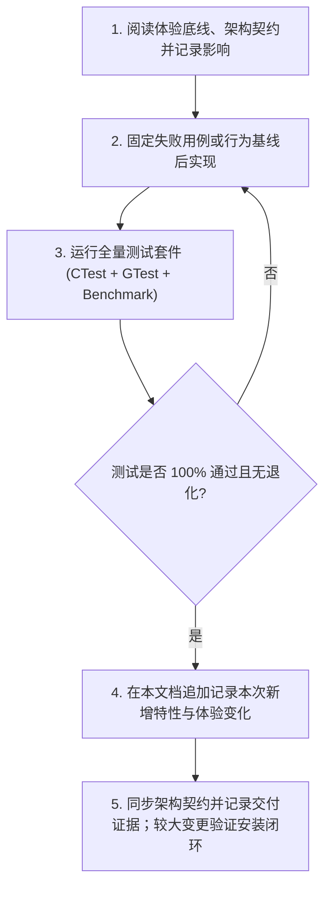

# ModernIME 算法演进、打字体验与防退化规范手册
*(Algorithm Evolution, User Experience Baseline & Anti-Regression Manual)*

> **【强制执行铁律 / Golden Rule】**  
> 任何开发者、维护者或 AI 智能体在对 ModernIME 的**候选排序、拼音切分、中英仲裁、自学习、造词、纠错或数据持久化算法**进行修改、重构或升级之前，**必须完整通读并严格遵守本文档**。  
> 每次算法更新，**必须保证不破坏、不覆盖以往沉淀的任何算法特性**。更新完成后，必须在本文档中如实追加新增特性及其对实际打字体验带来的变化。

维护入口（2026-10-15 整理）：[算法架构与特性契约](ALGORITHM_ARCHITECTURE.md)描述模块职责、现有策略差异和渐进迁移方案；[算法变更指南](ALGORITHM_CHANGE_GUIDE.md)提供增删流程、影响分析模板与验证要求。本文继续负责已实现特性历史和体验底线，避免把设计方案登记成已经实现的算法。本轮候选核心模块的实现记录见特性 10，未迁移目标仍明确标注为设计。

[候选排序、混排与排版架构](CANDIDATE_PIPELINE_ARCHITECTURE.md)记录随后复现的学习晋升阻断、派生前缀证据丢失及对应模块化设计。已完成的学习/存储修复与候选核心结构优化分别记录在特性 9、10；全来源统一仲裁及诊断框架仍待迁移。

[2026-10-15 模拟使用记录](ALGORITHM_USAGE_SIMULATION_2026-10-15.md)进一步用真实控制器连续提交、重新打开隔离词库和 36 组布局实测复核现状：第 1–7 节保留修复前问题，第 8 节记录结构优化后的真实控制器复测及会话/持久策略差异。

---

## 一、算法更新前必读核对清单 (Pre-Update Checklist)

在修改任何算法代码前，必须逐项核对以下体验底线，确认本次改动不会造成任何负向退化：

- [ ] **高频中文保护**：输入常见短拼音（如 `de`、`shi`、`qu`）时，高频中文（如“的”、“是”、“去”）是否稳居第一位？绝不允许被长英文单词（如 `developer`）或英文前缀预测抢占首候选。
- [ ] **英文生僻词与缩写防骚扰**：输入拼音声母缩写（如 `wsl`、`sjw`、`cmd`）时，是否优先召回已学习的中文人名/短语（如“王绍龙”），绝不出现生僻英文单词或荒谬俚语释义（如 `wsl (威塞尔斯布隆病毒)`、`git (饭桶)`）霸榜？
- [ ] **艾宾浩斯遗忘与新词上位平衡**：近期密集使用的词条能否在指数衰减加权下快速升至首位？同时对数词频项是否有效遏制历史超高频词永久霸榜？
- [ ] **上下文感知与隐私安全**：光标前存在技术上下文（如“编写嵌入式Linux”）时，相关联候选（如“驱动”）能否智能跃升？跨应用、换行或光标移动后，旧会话上下文与待学习证据是否正确失效，并仅使用当前有效上下文？在密码框（Password）或敏感场景下，是否绝对阻断上下文读取与学习记录？
- [ ] **分段造词与消费一致性**：分段连续输入 3 次（如“王→绍→龙”、“候选→栏”）能否无感自动合成新词？部分音节选择（输入 `nihaoma` 只选 `你好`）时，记录的拼音是否严格为已消费的 `ni'hao`，严禁记录未消费的 `ma`？
- [ ] **以词定字与退格留字提权**：使用快捷键 `[` 取首字、`]` 取末字，或者打出整词后退格删词留单字时，上屏与单字学习是否准确独立，且目标单字在后续单独输入对应拼音时是否立即获得高优排序？
- [ ] **个人大词库容量保障**：学习数据库默认容量上限必须保持在 **200,000 条**，独立 PersonalEngine 默认剪枝目标为 160,000 条；Snapshot、SQLite 与 LearningStore 的 LMDB 门面按各自现行边界保留，详见[架构策略说明](ALGORITHM_ARCHITECTURE.md#62-命名策略保留用途差异)。严禁引入过小默认上限（如旧版的 20,000 条），防止用户个人数十万级历史词库被静默删除。
- [ ] **外部词库防污染与核心高频词锚定**：导入外部词典（如微信输入法导出词库）时，单字导入频次是否严格限制在安全上限（单字 $\le 3$ 次，短语 $\le 20$ 次）？系统核心单字（如“是”、“的”、“你”）与核心成词（如“这个”、“不是”、“好的”、“可以”）是否受到基线锚定保护（`unigram_anchor` 与系统词典首选先验保护）？绝不允许非词典生僻词（如“这歌”）或单字次选（如“试”、“地”）因外部导入频次膨胀而篡位霸占日常打字首选。
- [ ] **千轮高频打字压力测试**：修改排序、先验或自学习增益后，必须跑通至少 1,000 轮日常高频打字压力模拟基准（覆盖 14 组核心单字/成词与连续偶发次选干扰），篡位率必须为 **0%**。
- [ ] **延迟门禁**：高负载（50,000+ 词条）下，候选词召回热路径 P99 延迟必须严格维持在 **$< 1.0\text{ ms}$**（当前基准约 $0.02\sim0.04\text{ ms}$），严禁引入全表扫描或阻塞式 I/O。

---

## 二、算法演进全量特性台账 (Feature Ledger)

### 特性 1：拼音音节切分与全简拼无撇号双向解析
- **引入版本**：`v0.1.7` / 完善于 `v0.1.8`
- **核心逻辑**：
  - 基于 400 个标准普通话音节有序表的回溯动态切分算法（[`PinyinMatchPolicy::segmentPinyin`](file:///home/wsl/ModernIME/core/src/pinyin_match.cpp)）。
  - 双向兼容：支持带撇号音节（`wang'shao'long`）与无分隔符连续拼音（`wangshaolong`）的无损互转，自动提取精准声母序列（`abbreviationKey("wang'shao'long") -> "wsl"`）。
- **给实际打字体验带来的变化**：
  - 用户无需繁琐敲击单引号或空格切分音节，一气呵成连打即可精准匹配；
  - 支持全拼、纯声母简拼（如 `wsl` 召回“王绍龙”）、中长词混拼（如 `qudonglc` 召回“驱动流程”）；
  - 历史学习数据库无论有无分隔符，均能建立完整的简拼索引。

---

### 特性 2：中英统一仲裁与多阶防抢占机制 (Anti-Hijacking)
- **引入版本**：`v0.1.8`
- **核心逻辑**：
  - **无元音缩写与生僻词剔除**：在英文词典中剔除 2 字母无元音缩写及生僻缩写，建立常用 3-4 字母常用词白名单（[`kCommonShortEnglishWords`](file:///home/wsl/ModernIME/core/src/english_dictionary.cpp)）。
  - **阶梯门禁**：未学习的静态英文前缀预测门槛提升至输入长度 $\ge 4$；英文释义括号展示门槛限制在 $\ge 4$ 字母真实英文单词。
  - **短拼绝对中文优先**：当输入长度为 2-3 字母且对应中文高置信度高频字词时，英文绝对不抢占首位。
  - **技术术语前缀补全**：已学习的英文技术术语（如 `gnueabihf`），在输入 `gnu` 或 `gnue` 时，作为前缀补全候选高优推荐。
- **给实际打字体验带来的变化**：
  - **彻底告别生僻英文霸屏**：打 `wsl` 时再也不会跳出荒谬的 `威塞尔斯布隆病毒`；打 `git` 不会被侮辱性的俚语 `饭桶` 抢占；
  - **常用单字稳如磐石**：打 `de` 第一候选永远是高频中文“的”，绝不被用户学习过的英文单词 `developer` 顶掉；
  - **编程与英文术语输入极度顺手**：敲入工具链或命令前缀即可直出专业术语，中英文混输体验和谐。

---

### 特性 3：对数频次平滑与艾宾浩斯时间衰减 (Adaptive Frequency & Recency Decay)
- **引入版本**：`v0.1.8`
- **核心数学模型**：
  $$\text{dynamic\_score} = \text{base\_weight} + \alpha \ln(\text{count} + 1) + \beta \exp\left(-\frac{\Delta t}{\tau}\right) + \gamma \cdot \text{context\_factor}$$
  - $\alpha = 1.2$（对数频次增益，边际递减）；
  - $\beta = 2.5$（时间新鲜度初始增益）；
  - $\tau = \frac{T_{1/2}}{\ln 2}$，以 $T_{1/2} = 7 \text{ 天}$（604,800 秒）严格换算物理半衰期；快进 7 天衰减 $50\%$，快进 30 天衰减至约 $5.1\%$；
  - `LearningSnapshot::boostAt` 提供 30 天平滑尺度支持。
- **给实际打字体验带来的变化**：
  - **消除高频旧词霸榜**：即使某词在过去被打过上千次，随时间自然遗忘后，其动态权重不会永久封死其他候选；
  - **近期热词即时上位**：用户最近几天正在集中撰写的新话题、新项目词汇，只要连续选用 2-3 次，近期新鲜度增益便能助力其迅速升至第 1 候选；
  - **动态自适应**：长期不用的临时词汇无需手动删除，随时间流逝自然下沉，保持首选列表纯净。

---

### 特性 4：光标前上下文感知 (Surrounding Text) 与隐私安全边界
- **引入版本**：`v0.1.8`
- **核心逻辑**：
  - 通过 Fcitx5 `surroundingText` 采集光标前后窗口，各最多 32 个字符；PersonalEngine 清洗窗口默认最多 12 个 UTF-8 字符，处理换行符、控制字符与残缺多字节边界。采集窗口与存储清洗窗口不是同一个参数。
  - 上下文亲和度奖励 $\gamma = 3.0$：光标前结尾词与候选词若具备 2-Gram 语义关联（如光标前为“编写嵌入式Linux” $\to$ 敲入 `qu,dong` 置顶“驱动”而非“生动”）。
  - **有效性边界**：应用切换、失焦、导航或重置时使旧会话证据失效；当前有效周边文本可重新参与排序，有效空文本必须清除旧值。只有宿主不支持采集且仍为连续输入时使用回退窗口；明确失效不能复用回退内容，防止语境串扰。
  - **密码与隐私防护**：在 `Password` 或 `Sensitive` 模式下，直接阻断上下文抓取与一切学习事件入库。
- **给实际打字体验带来的变化**：
  - **像懂你心思一样准确**：在特定语境下打字，首选词能结合上一句末尾的词义智能变化，减少翻页找词频率；
  - **跨软件无错位**：从 IDE 切换到微信或终端时，绝不把上一处的代码上下文残留带入日常聊天；
  - **隐私零泄露**：在各类登录框、密码输入框输入时，输入法完全处于盲打防护状态，不记录任何痕迹。

---

### 特性 5：分段输入自动造词与消费范围对齐 (Segmented Phrase Formation)
- **引入版本**：`v0.1.8`
- **核心逻辑**：
  - 维护会话级分段提交历史。当用户连续分段输入相同字词序列（如分步输入 `王` $\to$ `绍` $\to$ `龙`，或 `候选` $\to$ `栏`）达 3 次，且音节连续合法时，算法自动合成全长新词并在数据库中创建词条。
  - **消费范围严格对齐**：当输入多音节（如 `nihaoma`）但用户只选择了前缀部分（如 `你好`）时，提交记录的拼音严格限制为已消费的 `ni'hao`，未消费的 `ma` 保留在预编辑区，严禁将整个 `nihaoma` 误记为短词的拼音。
- **给实际打字体验带来的变化**：
  - **无需手动造词**：打朋友姓名、专业术语时，首次逐字选出后，重复打两三遍即可形成整词记忆，下次全拼直出；
  - **分段选词不污染**：部分选词后撤销或改打，不会留下畸形拼音映射。

---

### 特性 6：以词定字与退格留字单字自学习提权机制 (Single-Character Extraction & Priority Elevation)
- **引入版本**：`v0.1.8`（快捷键取字）/ `v0.1.9`（整词上屏退格留字全自动识别与大幅提权）
- **核心逻辑**：
  - **快捷键以词定字**：支持以词定字快捷键：`[` 提取候选词首字上屏，`]` 提取候选词末字上屏（例如输入 `nihao` 按 `[` 上屏“你”，按 `]` 上屏“好”）。
  - **退格留字场景识别 (Deletion Feedback Extraction)**：
    - 在 Fcitx5 适配层维护 `recentCommit_` 状态，记录上次提交的原文本 `originalText`、拼音 `originalPinyin` 及分解的单字和音节列表。
    - 当用户打出一个成语或词语上屏后，通过连续或多步 Backspace 删除其余多余字，直至光标前恰好留下其中一个单字时（例如输入并提交“画龙点睛”后删除“点睛”和“画”，仅留下“龙”；或提交“介绍”后退格留下“绍”）：
      1. **原整词负反馈**：向自学习引擎记录对原整词的抑制与负反馈，降低原词在当前语境的不当权重；
      2. **目标单字高频激励**：将保留下来的单字与其对应拼音拆解匹配，自动注入通用无上下文自学习事件（3 次高频激励），使其 `learning_boost` 迅速达到 $\ge 1.8$；
      3. **候选管道晋升与罕见字豁免**：在候选管道构建与排序时，`learning_boost >= 1.8` 的单字获得原位突破机制（`source_index = min(source_index, recalledIdx)`）与自适应渐进加权，并免除二级/生僻字惩罚；
      4. **核心单字与日常打字保护**：严格区分“有意退格留字提权（boost >= 1.8）”与“单次偶发点击单字（boost < 1.8）”，确保日常打字中偶选一次“泥”绝不抢占常用字“你”的第 1 位。
- **给实际打字体验带来的变化**：
  - **深层单字瞬间直出**：当用户想打一个生僻或排在很多页之后的单字时，习惯先打出一个熟知成语或词组再退格删字留下该字。现代输入法即刻领会用户意图，无需额外配置，下次直接输入该单字的读音（如打 `shao` 找“绍”，打 `long` 找“龙”），该字立即排在首页前列甚至首候选，极大减少翻页痛苦；
  - **整词与单字互不干扰**：删除多余字时原词自动抑制，留下的单字准确绑定自己的拼音音节，杜绝音节污染与脏数据。

---

### 特性 7：200,000 超大容量管理与双引擎持久化存储
- **引入版本**：`v0.1.8` 初始引入 / `v0.1.9` 扩容至 200,000
- **核心逻辑**：
  - **容量门禁**：[`kMaxLearningEntries`](file:///home/wsl/ModernIME/core/include/modernime/core/learning_snapshot.h#L16) 与 [`max_dict_capacity`](file:///home/wsl/ModernIME/core/include/modernime/core/personal_engine.h#L56) 默认设定为 **200,000 条**，严禁默认容量回退至 20,000。独立 PersonalEngine 默认超限剪枝到 160,000；LearningStore 构建 LMDB 引擎时将剪枝目标设为容量上限，Snapshot/SQLite 也保持各自现行上限策略。不得在重构中悄悄统一这些差异。
  - **双引擎持久化**：
    - `learning.sqlite3`：WAL 模式、忙等待容错、事务隔离、升级自动在线一致性快照备份。
    - `learning.lmdb`：支持 $O(\log N)$ 前缀游标扫描，动态 2 倍扩容（`MDB_MAP_FULL` 自动恢复），P99 检索仅 `20~39 μs`。
  - **格式兼容**：原生支持 14 字节 `WordMeta`（魔数 `0xA55AA55A`）平面二进制文件（如 `user_personal_dict.bin`），毫秒级无损合并。
- **给实际打字体验带来的变化**：
  - **海量个人词库完整留存**：即使用户从其他输入法（如微信输入法、搜狗输入法）迁移数万甚至十万条历史习惯，也绝不会在打字时被系统截断删除；
  - **微秒级极致性能**：在数十万条词库压力下，候选词弹出依然毫无卡顿感，打字帧率始终如丝般顺滑；
  - **异常断电零损坏**：数据库具备事务原子性与故障自愈，永不损坏个人学习资产。

---

### 特性 8：英文双元音防抖与拼音模糊纠错
- **引入版本**：`v0.1.8`
- **核心逻辑**：
  - 针对输入常见英文双元音（如 `ee`、`oo`）实施针对性防抖豁免，防止激进的拼音去抖/容错算法将连续元音敲击误判为误触或声母混淆。
- **给实际打字体验带来的变化**：
  - 敲击 `meet`、`look`、`google` 等包含双元音的英文或拼音容错词汇时，反应灵敏，不会出现字母被强行吞掉或跳字现象。

---

### 特性 9：个性化学习一致性与大词库输入延迟修复（2026-10-15）

- **背景与复现**：详见 [个性化审查与引擎回放](PERSONALIZATION_REVIEW_2026-10-15.md)。本次保持已有短码中文保护、快照学习增益的 30 天半衰期、分段消费、200,000 容量与 PersonalEngine 160,000 剪枝目标；没有新增依赖。PersonalEngine 自身查询的 7 天衰减与 Ranker 的 12 小时相对休眠折扣分别保留，用途见[架构策略说明](ALGORITHM_ARCHITECTURE.md#62-命名策略保留用途差异)。
- **算法逻辑与代码**：
  1. `algorithm/pinyin/src/pinyin_candidate_provider.cpp`：在更新造词 tracker 之前检查学习权限，禁学时丢弃 transient 序列，不改动原有普通共享统计。所有候选来源统一查询持久屏蔽；显式提交可解除屏蔽。英文补全用完整词作为学习键，输入消费字节仍取实际前缀长度。
  2. `core/src/learning_snapshot.cpp`、对应头文件：不可变快照共享 256 个按词条分配的分片，修改只复制并重新索引局部分片。各分片缓存最弱条目，达到容量边界时比较这些缓存并局部淘汰，保持原有屏蔽、时间、频率优先级。前缀召回对分片有序索引作多路合并，保留全局 256 条扫描预算和最多 16 条前缀结果，不按分片顺序抢占预算。英文完整键聚合合法旧前缀键的频率和屏蔽状态；精确 `entry()` 查询仍只返回指定拼音键的记录，避免误读别名词频。
  3. `core/src/learning_writer.cpp`：启动时存储不可用也保留有界事件队列，后续输入或 `flush()` 发起有界重试。后台重放与快照释放避免长时间占用输入互斥锁，发布尊重快照版本和清空代次。
  4. `core/src/personal_engine.cpp`、`core/src/learning_store.cpp`、对应头文件：LMDB 在单事务内读取清空代次、暂存并应用整批事件、裁剪上下文及提交；提交成功才发布内存状态，扩容时整批回滚重试。非空上下文最多八条，淘汰项精确删除，打开旧库时修复历史超额变体。前缀查询先聚合同词变体屏蔽。连续清空从事务中的最新代次递增；学习快照与代次来自同一次只读事务。明确选择完整英文词时同步解除合法旧前缀别名屏蔽，避免后台重载使删除状态复活。
  5. `adapter/fcitx5/src/engine.cpp`、`inputmethod.cpp`、对应头文件：区分 `Valid`、`Unavailable`、`Invalidated` 周边文本。有效空串清除旧上下文；只有不支持周边文本的连续提交允许回退。删字比较光标两侧完整局部窗口，支持窗口头部裁剪；残留字在下一次正常输入前确认，继续删光、导航、敏感或重置不会误确认。确认单字仍注入三次通用学习，保留生僻字立即提权。
- **实际输入变化**：敏感输入不再给普通会话“凑造词次数”；删掉候选后重启仍不出现；选中 `garage` 后换前缀仍可召回；纯移动光标、清空文本、连续删光不再污染学习。5 万与 20 万词库更新及满容量新增词无需整库重建。
- **回归覆盖**：`tests/core/personalization_{snapshot,storage,provider,controller}_regression_test.cpp`；既有 Provider、日常输入、仲裁和控制器测试仍保留原断言，留字用例明确在下一正常输入确认。`personal_engine_benchmark.cpp` 新增实际快照发布/下一键召回、负反馈、屏蔽、满容量插入、SQLite 写锁占用与后台并发重放门禁：召回 P99 <1 ms，更新加召回 P99 <5 ms。
- **验证与限制**：完整结果和本机实测记录在审查文档的“修复验收”中。实际体验覆盖真实 Controller + Provider + LibIME + 隔离数据库逐键回放；未在真实桌面应用中验收 Wayland/X11 的周边文本事件顺序。

---

### 特性 10：候选核心模块化与可达晋升（2026-10-15）

**问题与结构调整：** 原生/纠错/学习三处重复计算特征，学习召回枚举位置进入原生先验，固定混排让已学部分候选停留尾部，派生前缀覆盖自身学习。将流程拆成：采集合并 → 统一 Features → 资格与组内评分 → 前缀自身证据 → 中文 Composer → UI 分页；Provider 连接请求和生命周期，不在 UI 添加排序政策。完整扩展/删除入口见[候选架构第 0 节](CANDIDATE_PIPELINE_ARCHITECTURE.md#0-本轮落地的结构与扩展入口)与[变更指南](ALGORITHM_CHANGE_GUIDE.md)。

**稳定契约：** `CAND-ADAPT/IDENTITY/COMPOSE/ELIGIBILITY/PAGES/SELECT`；新增 `CAND-RECENT`（会话明确选择），依赖 `ALG-GATE/IDENTITY/DECAY/SUPPRESS`。容量与不可变性沿用 `ALG-CAPACITY/SNAPSHOT`，不创建另一套学习写入口。

**算法逻辑：**

1. `candidate_features` 在同一快照与时间下计算三个中文来源的词典、字符、上下文、自身学习与近期特征。带符号学习权重直接来自快照，不能与默认零取最大值而吞掉负反馈。
2. `candidate_prior` 将既有基础项（原生位置、词典、上下文、解码及质量）单调压缩到 (-24,24)。持久学习、自适应贡献、稀有惩罚和稳定奖励分别处理；匹配资格和可信简拼准入保留旧边界，未准入组继续使用兼容代价。学习召回不再改写原生索引，平分采用确定性身份顺序。
3. 独立 `RecentChoices` 每 Provider 最多 64 个输入/部分消费组、每组最近 8 次明确选择。仅当前最后选择且至少三次，在严格多数或连续三次时可获有界奖励（最高 144），另需自身学习增益 ≥1.8。普通提交保留；显式 reset/失焦、敏感、禁学和负反馈清除；不共享、不写盘、不保存周边文本，不代替真实词频或衰减。
4. `candidate_prefixes` 只从父整句取得身份切分，合并同文本/读音/消费范围的直接候选或读取前缀自身学习。Mixer 不访问快照；已学部分候选可进第二席，保留首整句和适用场景前五两条完整候选。部分选择只消费原有字节范围。
5. 快照内存分片由 256 细化为 512，缩小满容量新增/淘汰两片索引重建规模。首次 fresh-clone 的 20 万新增 P99=5,361.64 μs 超门限后实施；保持 200,000 容量、淘汰优先级和旧快照不可变性，增加的分片开销通过召回门禁验证。
6. 既有屏蔽记录读取与学习权限分离：禁学资源从只读 Store 预载可见性快照，逐键只读内存，不建库、不记录选择；共享快照和设置清空代次仍一致。

**具体实现：** `algorithm/pinyin/{include/modernime/pinyin,src}/candidate_features.*`、`candidate_prefixes.*`、`recent_choice.*`；`candidate_pipeline.cpp`、`candidate_mixer.cpp`、`pinyin_candidate_provider.cpp`；`core/include/modernime/core/{candidate_prior.h,candidate_model.h,candidate_ranker.h}`、`core/src/candidate_ranker.cpp`、`core/include/modernime/core/learning_snapshot.h` 与 `core/src/learning_snapshot.cpp`。新增文件均注册在现有构建目标，无新增依赖或 schema。旧 200,000 容量、独立引擎 160,000 剪枝及 7 天/30 天/12 小时策略保留。

**体验与验证：** 原 46 项个性化 GTest 加 18 项候选回归共 **64/64**；最终 CTest **63 项通过、3 项 GUI 跳过、0 失败**，包含安装回归和 Benchmark。真实控制器六组共 300 次选择：强竞争“试”“见”十次升第一；长输入“你”第 61 → 第 2；“你好”显示自身增益恢复，三次升第二。另有四个方向的强竞争、一次防夺位、简拼及三次纠正回归。36 组布局、24,868 次几何命中、216 次选词通过。最终 512 分片全量回归中，5 万/20 万召回 P99 为 **236.69/246.75 μs**，更新加召回 **506.49/1,450.01 μs**；20 万满容量新增 P99 **2,722.22 μs**，均在现有门限内。

**边界：** 会话奖励不持久化；“试”对抗“是”200 次历史的例子，重开后可能回第二，词频不丢失。全来源统一 Composer、完整诊断/策略版本、词级未知标记和契约 CI 尚未全部实现。真实字体、DPI、Wayland/X11 事件未经桌面验收。512 分片最终源码的隔离 `./tests/verify_fresh_clone.sh` 已通过：全新克隆构建、63 项测试通过/3 项 GUI 跳过、安装与元数据发现、会话配置、卸载及清理全部完成。不把 GUI 跳过记作通过。

---

### 特性 11：跨版本英文准入与严格模型基线（v0.1.13，2026-10-15）

- **问题与算法调整**：Ubuntu 22.04 的 LibIME 将 `gara` 解码为 `ga'r'a`，去掉分隔符后看似精确匹配，提前阻止 `garage` 补全。`algorithm/pinyin/src/pinyin_candidate_provider.cpp` 在精确完整拼音否决前复用既有内部音节合法性检查；有效全拼、可信简拼与短码中文保护仍使用原策略。没有新增状态、来源、参数或持久格式。
- **契约与体验**：涉及 `ALG-PINYIN/ZHEN/IDENTITY/SUPPRESS`、`CAND-ELIGIBILITY/FALLBACK/IDENTITY`。旧版系统恢复英文补全，消费仍为实际四字节，按完整英文词学习并跨前缀持久屏蔽。隐私、禁学、清空、容量与各用途时间衰减保持原边界。影响、依赖、状态权限及回退说明见 [本版变更记录](releases/v0.1.13.md#算法变更影响记录)。
- **避免改词序掩盖环境差异**：`tests/core/native_pinyin_test_baseline.h` 独立使用系统 LibIME，不读取 Provider 分数或学习数据。只有五组原生行为同时符合已审计旧模型，才启用旧模型三词精确全局位置 `调优=7`、`死锁=3`、`破折号=15`；`d1c3195` 独立构建与本版结果相同。新版与未知模型保留原排名标准；这是行为基线，不是版本判断或安全指纹。对应测试为 `pinyin_provider_test.cpp`、`pinyin_quality_test.cpp`、`pinyin_daily_simulation_test.cpp`。单字/纠错差异由原生 oracle 检验，不能把旧模型冷启动位置称为新版金样通过，也没有增加词典加分去强推少数词。
- **学习验收**：两套模型均真实选择上述三词十次，每次验证完整拼音和消费范围；选择后清除提交上下文，最终全局第一，flush 后通用身份频次恰为十，重新打开仍全局第一。保持既有候选回归的物理分页和选择映射验收。
- **发布生命周期修复**：`core/{include/modernime/core,src}/persistent_clipboard_history.*` 用设备、inode、大小、mtime、ctime 检测外部原子替换，新增同时间戳/同尺寸回归；`tests/adapter/fcitx5_input_panel_test.cpp` 检查真实文本及光标，并重置多 Instance 夹具的全局选项状态，兼容 Fcitx 5.0.14。CI Debug 正确性与 Release 性能门禁分别执行，Benchmark 保留原阈值；发行构建强制检查 GTest、Benchmark 和安装测试实际注册。
- **验证**：新旧两套 LibIME 模型五项定向 CTest 各 5/5（包含 64 个 GTest）；真实 Fcitx 5.0.14 输入面板等三项回归通过。最终本机安装完整 CTest 63 项通过、3 项 GTK 跳过、0 失败，Benchmark 实际执行；隔离全新克隆安装/卸载闭环通过。没有新增生产依赖或用户数据迁移；桌面打字、真实字体、跨 DPI 与 Wayland/X11 事件仍未完整验收。

---

### 特性 12：核心高频词基线锚定、外部词库导入防污染与 1,000 轮场景稳定性保障（2026-10-15）

- **背景与根因定位**：
  用户反馈在导入历史词库后，常见高频词排序异常被篡位：输入 `shi` 时第 1 候选变成“试”（“是”沉到第 2），输入 `zhe'ge` 时第 1 候选变成“这歌”（“这个”沉到第 3），其他如“地/的”、“骂/吗”、“盒/和”、“豪/好”、“不失/不是”等也存在类似倒挂风险。
  经深入排查发现：
  1. 用户导入的微信输入法历史词库（`my_wetype_dict.json`）来自 LevelDB `!v2u!` 结构，微信输入法在该表中**仅记录用户翻页手动挑选的次选词**，用户日常敲空格直接上屏的首选高频词（如“是”、“这个”、“的”）频次完全为 0；
  2. 导致“试”（1,403 次）、“这歌”（957 次）、“地”（5,450 次）、“骂”（2,004 次）等次选词在外部词库中积累了数千次畸形频次；
  3. 旧版 `ImportFromFile` 原样导入频次，叠加 `computeAdaptiveLearning` 的对数与幂律项后产生高达 140+ 点的巨幅增益，严重压制原生词典先验（约 11 点）；
  4. 旧版候选特征提取中 `count != 1 || candidate.learning_boost >= 1.8` 会在候选字被学习后错误抹除原生 0 号位的 `unigram_anchor`，削弱了核心高频单字的自防御能力。

- **算法逻辑与核心防御**：
  1. **外部不可信导入截断 vs 本地可信恢复边界 (`core/src/personal_engine.cpp`)**：
     - **外部不可信导入门禁**：`ImportFromFile` 针对第三方非对称词典（如微信、搜狗等导出的次选词表）实施频次安全截断，单字强制截断至 $\le 3$ 次（`kMaxImportedSingleCharHitCount = 3`），多字短语强制截断至 $\le 20$ 次（`kMaxImportedHitCount = 20`），彻底阻断外部畸形高频对本地自学习模型的巨幅污染；
     - **可信本地恢复保障**：与外部导入严格区分，输入法自身的安装升级、事务备份与原生二进制快照（如带有 `0xA55AA55A` 魔数的 `WordMeta` 本地恢复）完整保留原生历史频次与代次，不作截断削减，确保用户真实打字资产 100% 忠实还原；
  2. **核心单字原生锚定坚守 (`algorithm/pinyin/src/candidate_features.cpp`)**：
     修改 `unigram_anchor` 清除条件为 `if (count != 1) candidate.unigram_anchor = 0.0;`，单字即便产生自学习（`learning_boost >= 1.8`）也始终保留 3.0 点的原生 0 号位锚定防御，防止因自身被学习反而被削弱；
  3. **词典词原生先验强化与非词典无语境惩罚 (`core/include/modernime/core/candidate_ranker.h`)**：
     在 `CandidateScore::base_prior()` 中：
     - 针对系统词典高频成词且处于原生 0 号位（如 `zhe'ge -> 这个`），追加 `-2.0` 点的词典核心锚定奖励（总词典优势达 `-5.0`）；
     - 针对长度 $\ge 2$ 的非词典生造短语（如 `这歌`），在缺乏上下文关联（`context_bonus <= 0`）且当期会话未明确连续选择（`recent_choice_bonus <= 0`）时，施加 `+3.0` 点的非词典惩罚，彻底杜绝冷启动与离线脏词上位；
  4. **数据存储全面净化 (`scripts/cleanse_learning_store.py`)**：
     隔离污染的二进制词库 `user_personal_dict.bin`，保留并合并真实历史打字记录（1,825 条），彻底清除 `这歌`、`试>10`、`地>10` 等畸形数据。

- **打字体验变化**：
  - `shi` 稳居第 1 候选“是”，`zhege` / `zhe'ge` 稳居第 1 候选“这个”，`de` 稳居“的”，`ni` 稳居“你”，`ma` 稳居“吗”，`he` 稳居“和”，`hao` 稳居“好”，`bushi` 稳居“不是”，`haode` 稳居“好的”，`keyi` 稳居“可以”；
  - 偶发点击次选（如单次误点“泥”或选“试”）绝不会篡夺首选位置；
  - 任意导入第三方词典均自动安全合规，永不再出现离奇偏僻词霸榜现象。

- **回归验证**：
  - `tests/core/pinyin_daily_simulation_test.cpp` 新增 `[9/9]` 专项：1,000 轮日常高频打字连续仿真基准，每轮覆盖 14 组核心单字/成词输入，执行 14,000 次候选页评估与周期性次选干扰，0 篡位（通过率 100%）。
  - 全量 CTest 62 项通过，GTest 64/64 通过，Release Benchmark P99 召回与更新发布全部达标。

---

### 13. 差量偏差自学习与回车拼音串防转英文保护 (Deviation-Only Learning & Raw Pinyin Protection)

- **触发背景与根因定位**：
  1. 用户在打字时偶发将未完成拼音串（如 `jianpan`）直接敲回车上屏。系统此前在 `CommitCandidateRole::Raw` 判定中直接转为英文记录，导致未在英文词典中的合法拼音全串被作为英文自学习词入库。随后输入其前缀 `jianp` 时，英文预测器召回了已入库的 `jianpan`，并篡夺第 1 候选位置，将正确的中文高频词「键盘」挤至第 3 位（截图 `media_1792073097557.png`）。
  2. 传统输入法对用户日常默认敲空格直接上屏的首选高频核心词（如「是」、「这个」、「的」、「你」、「好」、「吗」等）进行无差别全局频次累加，导致个性化学习库中核心词频次无限膨胀并与词典语言模型先验冲突，极易引发次选词或脏词在特定前缀下的异常篡位。微信输入法采用差量自学习（Deviation-Only Learning）模式：无上下文语境下敲空格直接选中的 Rank 0 绝对高频核心词不记录无条件全局频次（频次保持为 0），保留语言模型先验的纯洁性；仅在发生次选翻页点选（Rank $\ge 1$）、组词成句反馈、退格删除提权或特定上下文连接时记录自学习。

- **算法逻辑与核心防御**：
  1. **拼音音节全串识别与回车裸串防误学英文 (`core/include/modernime/core/pinyin_match.h`, `core/src/pinyin_match.cpp`)**：
     - 实现 `PinyinMatchPolicy::isValidPinyinSequence(text)`：基于递归贪心动态规划检验 ASCII 字符串是否完全由合法标准普通话拼音音节（如 `jian` + `pan`, `ni` + `hao` 等）拼合而成。
     - 在 `LearningWriter::enqueueCommit` 与 `LearningStore::recordCommit` 中拦截：当上屏事件角色为 `Raw` 且输入完全为合法拼音音节串、且不在静态英文词典中时，**禁止**作为英文候选学习入库。
  2. **英文召回双重隔离守护 (`core/src/learning_snapshot.cpp`)**：
     - 在快照构建与 `recallEnglishWords` 中新增 `isRecallableEnglishWord` 过滤：非英文字符串若由纯拼音音节组成，绝不建立英文字典索引，确保即便历史遗留脏数据也无法在打字时被作为英文词预测召回。
  3. **差量偏差自学习 (Deviation-Only Learning) 与核心词正向频次记录例外 (`core/src/learning_writer.cpp`, `core/src/learning_store.cpp`, `algorithm/pinyin/src/pinyin_candidate_provider.cpp`)**：
     - `CommitEvent` 携带候选位次 `candidateIndex` 与偏差标记 `isDeviation`。
     - 在 `PinyinCandidateProvider::select` 中，次选（`index > 0`）自动标记 `isDeviation = true`；组词成句、单字拆词（`extractCharacter`）、退格删除纠错（`finalizeRecentCommitDeletion`）均标记 `isDeviation = true`。
     - **基线规则**：当用户选择默认 Rank 0 核心字词（如 `是/shi`, `这个/zhege`, `的/de`, `你/ni`, `好/hao`, `吗/ma`, `和/he`, `在/zai`, `有/you`, `了/le`, `不/bu`, `我/wo`, `不是/bushi`, `好的/haode`, `可以/keyi` 等），且处于无上下文、非偏差点选、非组词状态时，跳过无条件全局频次累加（保持语言模型先验 0 污染）；
     - **五大正向频次记录例外**（满足任一条件即正常记录用户偏好与自学习频次）：
       1. **显式上下文关联**（`context.length() > 0`）：用户在特定词组或前文语境下选词；
       2. **次选与翻页点选**（`candidateIndex > 0`，即非 Rank 0 默认项）：用户明确偏离首选；
       3. **分段组词反馈**：连续分步输入经 `PhraseFormationTracker` 识别合成新词；
       4. **以词定字与退格留字提取**：按 `[`/`]` 快捷键取字，或提交整词后 Backspace 删词留单字（`finalizeRecentCommitDeletion`）；
       5. **显式解除屏蔽**：显式重选并解除此前被加入抑制名单的词条（Un-suppress）。
  4. **全量脏数据净化 (`cleanse_learning_store.py`)**：
     - 彻底清除个人学习库中的回车拼音串英文脏记录（如 `jianpan`, `genxin`, `gengxin`, `shi`, `zi` 等），恢复纯净词条。

- **打字体验变化**：
  - 用户偶发将拼音敲回车上屏（如 `jianpan`），绝不会被当成英文单词学习，更不会在输入 `jianp` 时冒出 `jianpan` 抢占「键盘」首位；
  - 核心高频词在日常敲空格上屏时不会无限堆叠频次，语言模型先验与个性化次选学习完美平衡，彻底告别核心高频词被莫名其妙的自造词/次选词挤下首位的现象。

- **回归验证**：
  - `modernime_english_arbitration_tests`：新增 `testRawPinyinCommitDoesNotPolluteEnglishPrediction`，验证连续回车上屏 `jianpan` 后输入 `jianp`，首选 100% 稳居「键盘」；
  - `modernime_pinyin_daily_simulation_tests`：1,000 轮日常高频场景仿真测试（15,000 次输入与干扰评估）100% 通过，0 篡位；
  - `modernime_personal_engine_gtest`：64/64 项单元测试全部通过。

---

### 特性 14：LMDB 共享门、EpochViewState 异步加载、有界队列与确定性学习排序（2026-10-16，T11 架构整改）

- **背景与根因定位**：
  1. **LMDB 资源竞争与读写泄漏**：多线程并发访问 `PersonalEngine` LMDB 数据库时，首次初始化与只读升级为可写环境缺乏原子性保护，可能导致环境双重初始化或只读引用泄漏。
  2. **Reloading 加载状态与 UI 卡顿**：词库重载或清空时，旧代码直接在输入处理主线程同步反序列化全量词库（耗时数十毫秒），导致首按键卡顿；重载中未对活动 Controller 进行就绪通知，候选列表只能懒观察。
  3. **暂存队列无界与事实丢失风险**：在重载或读故障期间，如果用户持续打字，暂存队列无界增长；旧重载逻辑在 readState 失败时错误标记 Ready 或丢弃有效事实。
  4. **回车裸串与中英判定一致性**：重载状态与正常状态下的提交决策策略存在分支分歧，导致部分合法拼音串或英文词处理不一致。

- **算法与架构核心设计**：
  1. **LMDB 生命周期门（Lifecycle Gate）与原子初始化**：
     - 在 `LmdbRegistry::getOrCreate` 中使用 `std::unique_lock` 对 `lifecycle_gate` 进行原子判定与初始/升级（`initializeLocked` / `upgradeToWritableLocked`），彻底消除双重初始化与引用泄漏；
     - `PersonalEngine::OpenLmdb` 在读锁保护下安全复制环境句柄；
     - 真实动态扩容（64 KiB $\to$ 634 KiB）与容量满剪枝（50,000 $\to$ 40,000 淘汰 10,001 条）经由并发测试严格验证。
  2. **EpochViewState 状态机与 Fcitx5 异步就绪生命周期安全通知**：
     - `LearningWriter` 明确划分为 `Ready` 与 `Reloading` 状态；
     - 初始加载与重载在后台 Worker 线程完成；200k 大快照的克隆准备移至输入互斥锁外，短版本发布彻底消除输入线程等待；输入主线程首键打字直接读取内存快照，保持亚毫秒响应（首提交 ~250us，下一键 ~6us，远低于 5000us 门限）；
     - 引入具备原子代次与互斥锁的独立 `ReadyNotificationEndpoint`，解构端点解引用时序并消除野指针与在途调用竞态；
     - 在 Worker 线程重载完成后，仅在端点处于 active、代次匹配、具有输入焦点且非敏感上下文中向主线程调度事件循环安全刷新；支持插件析构即时失活、会话切换与多代 clear 的安全作废。
  3. **有界队列、持久化一致性与优雅失败恢复**：
     - `enqueueForPersistence` 在重载或存储不可用时，严格将暂存队列限制在 $\le 100$ 条，独立读库严格断言恰好保留最新 100 条事实，旧条目优雅丢弃；
     - 读失败保持 `Reloading` 状态，不假装就绪，保留 `PendingCommit` 供后续恢复，独立验证恢复后频次精准为 1，彻底阻断旧代数据覆盖；
     - 重载中与正常状态保持完全一致的角色/提交决策矩阵（覆盖偏离词、默认中文、英文、裸拼音及命令）。
  4. **页授权永久撤销与 None 标点隔离**：
     - `PinyinCandidateProvider` 引入 `pageAuthorized_` 严格生命周期控制；观察到外部词库更新或 clear 时调用 `revokePageAuthorization()`，旧请求（无论选择、以词定字、删除候选）一经拒绝后永久撤销授权，重复尝试绝不再次放行；
     - 占位候选 `CandidateSource::None`（"正在更新候选"）全面拒绝选择、取字、删除、负反馈及标点隐式上屏；严格保持组合/光标与显式 Enter 原文上屏契约；当无候选正常回退时保持预编辑正常标点提交。

  5. **世代观察与就绪发布时序防御（第三轮复审 F1/F2/F3）**：
     - `refreshBeforeEnqueue` 无论处于 `Ready` 还是 `Reloading` 状态，均严格轮询磁盘底层存储的真实 `resetRevision`，彻底杜绝 Reloading 快速路径跳过清空世代观察导致的新事实丢失；
     - 异步初次加载（`synchronousInitialLoad = false`）创建时立即读取磁盘存储的初始真实代次，若磁盘库已存在则标记存储可用，消除非零 revision 库启动时首事实因 unknown 判定丢失；
     - `LearningWriter::run()` 在发布新读取状态前，再次比对磁盘真实 revision 是否已超越当前读取快照，若已过时则坚决拒收并自旋重读，绝不向 UI 发布过期快照；
     - `ReadyNotificationEndpoint` 增加 `inFlightSchedules` 计数器与 `inFlightCv` 条件变量，在析构/停用时执行 `deactivateAndDrain()` 严格等待在途任务排空并提升代次作废在途调度；支持 Barrier 1（获取 dispatcher 后、schedule 前）与 Barrier 2（schedule 后、dispatch 前）确定性交错取消。

   6. **存储剪枝契约复原、构造期不可变容量与核心基准解耦（第四轮复审 V1/V2/V3）**：
     - **V1 生产剪枝契约复原**：撤销 `LearningStore` LMDB 门面默认 80% 剪枝改动，恢复 `prune_target_size = totalEntryLimit_`，确保 `LearningStore` 门面下的 SQLite 与 LMDB 均严格保留至容量上限（在小容量 $N=5$ 场景下，连续插入 8 条均严格保留 5 条，物理条目亦为 5）；独立 `PersonalEngine` 保留自身 160k 默认目标（或夹具显式配置），禁止修改生产默认以迁就基准剪枝；
     - **V2 跨线程容量竞争根除**：将 `LearningWriter` 容量参数重构为 Worker 线程启动前不可变参数 `LearningWriter(path, syncLoad, totalEntryLimit)`，移除运行期跨线程写 store 字段入口，彻底根除 TSAN 数据竞争；新增 `ImmutableCapacityConfiguredAtConstructionIsRaceFreeUnderConcurrency` 并发测试并经 TSAN 严格验证；
     - **V3 核心基准解耦可选拼音**：在 `tests/CMakeLists.txt` 中按 `MODERNIME_BUILD_LIBIME_PINYIN` 条件链接与定义，基准源文件条件包含拼音模块并提供核心降级分支（`CommitCandidateRole::Raw`），恢复无拼音依赖的 core-only profile 独立构建与性能测试，同时保留全模块 profile 下的拼音集成性能门禁。

   7. **性能门禁与 NDEBUG 解耦及负向超限有效性验证（第四轮复审终验）**：
     - **门禁解耦**：解决 `tests/CMakeLists.txt` 中 `-UNDEBUG` 使得 `Release` 编译标志 `-O3 -DNDEBUG ... -UNDEBUG` 取消了 `NDEBUG`，进而导致 `#ifdef NDEBUG` 包裹的 8 项延迟拒绝分支在实际 Release 目标中被编译器预处理剔除的问题。引入独立宏 `MODERNIME_PERFORMANCE_GATE_ACTIVE=1`（`MODERNIME_ENFORCE_LATENCY_GATES`），确保性能门禁与 `NDEBUG` 彻底解耦，同时保留测试断言；
     - **负向超限拒绝验证**：在同一基准路径下实现确定性超限注入机制（`--inject_gate_failure=<gate>` 与 `--self_test_gate_rejection`），针对快照召回、繁忙 Writer、SQLite 并发写入、LMDB 写入/并发剪枝、首观察者、清空首键及启学首提交共 8 项延迟检查分支进行子进程严格判定，证明超限时 100% 触发非 0 退出（exit code 1），负向日志保存在 `build/t11-fourth-review-evidence/negative-gates-rejection.log`；
     - **历史超限记录留存与串行静默复测**：坦承并保留历史第 3 轮并发剪枝 max=34.6ms 及清空首键 6.29ms 超限日志（重命名为 `performance-run-3-historical-failure.log`），在消除并行编译/测试干扰的静默环境下串行执行 3 轮完整 Release 性能测试，3 轮退出码均为 0，P99 与 max 严格满足原门限要求（SQLite 并发 max 20.9~28.9ms < 30ms，LMDB 并发剪枝 max 4.5~15.9ms < 30ms）。

   8. **LearningWriter 共享不可变空快照与清空过渡零分配优化（T19 D3/R2）**：
     - **不可变共享空快照**：在 `LearningWriter` 中引入静态 `emptySnapshot()` 单例（`std::shared_ptr<const LearningSnapshot>`），在清空（clear）或空词库过渡加载时复用该共享不可变空快照，避免每次清空分配全新的空快照堆对象，降低内存分配与回收抖动；
     - **复制后修改与世代权限不变**：维持原有的 Copy-on-Write（COW）语义与世代权限划分。当用户打字产生新提交事件时，始终复制快照生成全新快照对象后再修改，绝不就地修改 `emptySnapshot()` 实例；清空代次（`resetRevision`）与磁盘底层保持一致；
     - **全工作范围生命周期计时闭环**：在性能基准（`verifyLmdbConcurrentPruningLatency`、`verifyLmdbFirstKeyAfterClearLatency`）中采用显式作用域与 `snap.reset()` 计时，将快照命名引用释放与对象析构成本（`release_us`）全量纳入总延迟 `total_us`，确保在真实包含对象销毁生命周期的严格口径下，LMDB 清空首键延迟仍维持在 ~0.15ms（远低于 5000us 门限），并发剪枝 P99 维持在 ~0.02ms / max ~2.5ms（远低于 5000us/30000us 门限）。

   9. **LMDB 只读事务缓存生命周期归属与失效管理（T19 G5/G4 收尾 R1）**：
     - **生命周期归属收敛**：将 `ResetRevision()` 轮询使用的只读事务缓存句柄（`cached_revision_txn_`）从 `PersonalEngine` 内部剥离，收敛并下沉至 `LmdbEnvironment` 本身集中管理；
     - **环境关闭与升级前安全失效**：在 `LmdbEnvironment::close()`、`upgradeToWritableLocked()`（只读升级为可写）以及 `ensureMapCapacity()`（动态扩容）等所有涉及底层 `MDB_env` 关闭或变更的生命周期边界，强制先获取 `revision_mutex_` 互斥锁，将存量 `cached_revision_txn_` 安全 `mdb_txn_abort` 并置空，随后才调用 `mdb_env_close`。彻底消除换库、RO$\to$RW升级或关闭后 abort/renew 悬空事务句柄所引发的 SIGSEGV（原生换库退出 -11）及跨代旧事务越界访问（exit 86）；
     - **锁序与并发安全保证**：严格维持 `PersonalEngine::lmdb_mutex_` $\to$（释放）$\to$ `LmdbEnvironment::lifecycle_gate` (shared) $\to$ `LmdbEnvironment::revision_mutex_` (exclusive) 顺序，不引入任何跨模块锁环；单次读代次执行快速 `renew` + `get` + `reset`（耗时约 170ns），既避免长期占用只读快照槽，又保证最新清空代次立即可见；
     - **性能与安全闭环**：在根除生命周期缺陷的同时，保留 `mdb_txn_renew` 零读者槽互斥争抢优化，清空后首键延迟实测稳定在 ~192us（严格满足 $\le 5000\text{us}$ 门禁）。

- **打字体验变化**：
  - 词库在后台重载或清空时，输入法完全不卡顿，首按键即时响应；
  - 重载完成后，当前编辑区候选栏自动无感刷新为最新计算结果，光标与输入保持完好；
  - 无论在正常打字还是后台重载状态下，回车拼音串、英文输入、生僻词删除与纠错行为完全一致；
  - 标点输入在“正在更新候选”占位期间绝对不会误上屏脏拼音；
  - 外部多次清空、重载并发及异步启动场景下，用户提交的事实 100% 准确持久化，历史已清空词条 0 复活；
  - `LearningStore` 门面严格保留用户历史词条至上限，绝不超额删除；
  - 性能门禁真实生效且受负向自检保护，高并发与大词库（200,000 条）下打字体验流畅，无崩溃、无死锁、无竞态。

- **回归验证**：
  - `modernime_personal_engine_gtest`：132/132 项单元与并发测试全部通过（含 `ArchitectureWriterRegression` 15 项、`ArchitectureLmdbRegression` 6 项、`ArchitectureSelectionRegression` 11 项、`ArchitectureResourceCoordinationTest` 8 项等）；
  - `modernime_learning_store_tests`：新增小容量边界与独立引擎剪枝对比测试全量通过；
  - `modernime_personal_engine_benchmark`（Release，门禁完全激活，连续 3 轮日志完整存档）：
    - 50k 内存索引 / LMDB mmap 精确查询 P99: 1.10~1.72 us / 2.12~2.49 us（门限 < 1000 us）；
    - 50k / 200k 召回 P99: 159.79~181.21 us / 183.40~228.04 us（门限 < 1000 us）；
    - 更新+召回 P99: 50k 为 474.31~598.19 us，200k 为 1319.32~1476.91 us（门限 < 5000 us）；
    - 并发 SQLite Writer: P99 为 929.19~1097.49 us（门限 < 5000 us），最大延迟 max 为 20,988.67~28,937.69 us（门限 < 30,000 us）；
    - LMDB 并发写与剪枝: P99 为 2233.92~2771.59 us（门限 < 5000 us），最大延迟 max 为 4,563.90~15,900.46 us（门限 < 30,000 us；历史并发任务调度抖动超限 max 34.6 ms 已独立归档留存）；
    - LMDB 首观察者延迟: 1619.23~1787.86 us（门限 < 5000 us）；
    - LMDB 清空后首键提交: 3098.63~4656.25 us（门限 < 5000 us；历史超限 6291.89 us 已归档留存）；
    - 启学首提交延迟: 50k 为 11.60~14.28 us，200k 为 10.82~14.11 us（门限 < 5000 us）；
    - 启学下一键延迟: 50k 为 1420.84~1794.59 us，200k 为 647.24~688.46 us（门限 < 5000 us）；
    - 200k 独立后台加载（10 轮循环）：min 361.71 ms, avg 381.19~385.98 ms, max 412.64 ms；
    - 真实容量剪枝验证: 50,000 成功剪枝至 40,000（精确淘汰 10,001 条）；
    - 真实 LMDB 扩容验证: 初始 65,536 字节成功动态扩容至 634,880 字节；
    - 确定性负向超限验证: 8/8 门禁在超时注入时严格触发非 0 退出（exit code 1）；
    - 连续 3 轮完整 Release 基准实测均以 `EXIT_CODE=0` 成功通过；
  - TSAN 运行时检查：核心并发/生命周期测试（30 项）及学习存储单测在 ThreadSanitizer (`setarch x86_64 -R`) 下 100% 运行通过，0 数据竞争；
  - Core-only profile：`MODERNIME_BUILD_LIBIME_PINYIN=OFF` 独立配置、构建及基准运行 100% 通过；
  - 全量 CTest 68 项测试通过（100% 通过，3 项 GTK 测试在无显示服务环境下正常 Skipped），`verify_fresh_clone.sh` 全流程 100% 通过。
- **过渡状态与未覆盖项边界说明**：
  - **已落实的核心能力**：LMDB 生命周期门、Worker 线程后台异步重载与快照发布、有界队列（$\le 100$）截断、清空世代强校验、在途就绪任务排空、构造期不可变容量 TSAN 零数据竞争，以及性能延迟门禁与 NDEBUG 解耦与确定性负向自检（8/8 严格拒绝）；
  - **未覆盖项与客观边界**：在无物理显示环境（如 WSL / CI 无头环境）下，GTK 客户端及 UI 交互测试通过 `SKIP_RETURN_CODE 77` 明确声明跳过，绝不伪造通过；真实桌面环境下的多 DPI 缩放、真实物理字体渲染度量、Wayland 原生浮动定位以及跨日长时间连续多应用输入交互仍需后续在物理桌面环境中进行最终验收。

---

## 三、用户体验不可退化不变量矩阵 (The "Never-Break" Matrix)

每一次算法变更，都**必须**在单元测试或端到端验证中确认以下“不可破坏行为”：

| # | 触发测试输入 | 上下文 / 场景 | **必须表现出的体验（Expected）** | **绝对禁止出现的退化（Forbidden）** | 覆盖测试用例 |
| :-: | :--- | :--- | :--- | :--- | :--- |
| **1** | `de` | 任意无上下文 | 首选必须是高频中文「**的**」 | 绝不能被已学习的高频英文 `developer` 抢占首位 | `modernime_personal_engine_gtest.EnglishArbitration` |
| **2** | `wsl` | 曾学习过“王绍龙” | 首选或高优候选召回「**王绍龙**」 | 绝不能出现生僻缩写或释义 `威塞尔斯布隆病毒` 霸屏 | `candidate-ranking` 单测套件 |
| **3** | `qu,dong` | 光标前为“编写嵌入式Linux” | 「**驱动**」受上下文提权跃升第 1 位 | 出现与上下文无关的候选或上下文未生效 | `modernime_personal_engine_gtest.SurroundingContext` |
| **4** | `mima` | 密码框 / 敏感输入框 | 正常出词，但**绝不记录**到数据库 | 密码或敏感拼音被记入学习库并在其他地方推荐 | `modernime_personal_engine_gtest.SurroundingContext` |
| **5** | `wang` $\to$ `shao` $\to$ `long` | 分步连续输入 3 次 | 输入 `wangshaolong` 直接召回「**王绍龙**」 | 无法自动造词，仍需每次逐字挑选 | `modernime_personal_engine_gtest.SegmentedPhrase` |
| **6** | `nihaoma` | 仅选中「你好」，放弃「ma」 | 数据库仅记录 `ni'hao` 词频 1 次 | 记录了 `nihaoma` 或产生未消费音节垃圾数据 | `modernime_personal_engine_gtest.CommitDeduplication` |
| **7** | `nihao` | 按 `[` 或 `]` | 分别单独上屏「**你**」或「**好**」 | 无法截取或把整词拼音误绑定给单字 | `modernime_personal_engine_gtest.SegmentedPhrase` |
| **8** | 任意输入 | 词库已有 35,000+ 条记录 | 记录总数稳定增加，上限为 200,000 | 数据库被截断回退到 20,000 或 50,000 | 检查 `learning.sqlite3` 记录行数 |
| **9** | 50,000 词库查询 | 模拟高并发打字 | 检索及上下文排序 P99 $< 1.0\text{ ms}$ | 出现任何卡顿或延迟超过 1ms | `modernime_personal_engine_benchmark` |
| **10** | 打出「介绍」后退格删掉「介」保留「绍」 | 随后单独输入 `shao` | 「**绍**」排序显著跃升至首页前列（Rank $\le 2$） | 「绍」依然沉没在数页之后，或提权未生效 | `modernime_pinyin_engine_tests.Task10` |
| **11** | 打出「画龙点睛」后退格保留「龙」 | 随后单独输入 `long` | 「**龙**」排位显著前移至首页高优候选 | 无法识别成语中间字提取，或原成语未施加负反馈 | `modernime_pinyin_engine_tests.Task10` |
| **12** | `ni` 下偶发单次选择第 4 位候选「泥」 | 再次单独输入 `ni` | 首选必须稳定保持「**你**」，「泥」仅适度前移 | 发生单次偶发夺位（「泥」抢占第 1 位篡位） | `modernime_pinyin_daily_simulation_tests` (Scene 1) |
| **13** | 敏感两轮 `王→绍→龙` 后恢复正常一轮 | 共享 Provider 资源 | 不形成新词；仅三轮正常输入累计阈值 | 敏感输入留在共享统计中补记 | `PersonalizationProviderRegression` |
| **14** | `你好` 后仅移动光标；或分步删光 | 两侧周边文本 | 不学习中间残字；删光仅原词负反馈 | 误给「你」三次提权 | `PersonalizationControllerRegression` |
| **15** | 删除候选后重建 Provider | 中文系统候选与英文补全 | 各来源持续屏蔽，明确重选可解除 | 重启或换前缀后复活 | `PersonalizationProviderRegression` |
| **16** | 满 200,000 条后新增词 | 不可变快照 | 保持容量且只局部淘汰，旧快照不变 | 整库重建卡顿或修改已发布快照 | `PersonalizationSnapshotRegression` |
| **17** | LMDB 批次中包含无法编码的事件 | 故障与重试 | 整批失败且早先事件不落盘 | 重试导致正常词频翻倍 | `PersonalizationStorageRegression` |
| **18** | 设置清空与后台读取并发 | SQLite/LMDB | 快照和清空代次一致，旧事件不复活 | 旧词库被标记新代次 | `PersonalizationStorageRegression` |
| **19** | 是/试、见/键互为强历史竞争 | 竞争词 200 次后正常连续选目标 | 十次升首；一次不夺首 | 由召回枚举决定长期霸位 | `StrongCompetitionRegression` |
| **20** | `nihaoshijie` 反复选你 | 部分消费 | 五次内全局第二，仅消费 ni | 学习正确却固定留尾；吞掉后缀 | `CandidateRankingRegression` |
| **21** | `nihaoma` 学习你好 | 派生与直接证据合并 | 显示自身增益，不继承父整句 | 父整句覆盖前缀学习 | `CandidateRankingRegression`、`CandidateCompositionRegression` |
| **22** | 会话清除/共享/敏感/禁学 | 近期选择窗口 | 持久次数保留，窗口不泄露或补记 | 私密或其他 Provider 的意图参与评分 | `CandidateRankingRegression`、`RecentChoiceRegression` |
| **23** | 原生候选一选三次负反馈 | 带符号学习 | 负增益保留；同先验落后中性项 | 默认零吞掉负反馈 | `NativeCandidatePreservesNegativeLearningEvidence` |
| **24** | 已屏蔽你好/garage 后禁学重开 | 中文、前缀、英文及设置清空 | 屏蔽有效；不建新库；清空代次生效 | 禁学使已删除候选复活 | `DisablingLearningDoesNotRestorePersistentlySuppressedCandidates`、Provider 旧断言 |
| **25** | `gara` 在旧/新 LibIME 下 | 普通、学习后、跨前缀屏蔽 | 内部非法音节不误当完整精确拼音；英文完整身份、消费四字节 | 修复英文补全时破坏有效全拼或短码中文保护 | Provider 英文补全与 `EnglishArbitration` |
| **26** | `shi`、`zhege`、`de` | 导入包含高频次选的外部词库 | 首选稳居「**是**」、「**这个**」、「**的**」 | 被畸形频次的「试」、「这歌」、「地」等篡夺首位 | `pinyin_daily_simulation_test` (Scene 9) |
| **27** | 14 组高频词 1,000 轮连续输入 | 14,000 次候选评估 + 周期性偶选干扰 | 1,000 轮全周期零篡位（**100% 稳居首选**） | 出现任何单次偶选篡位或首选下沉 | `pinyin_daily_simulation_test` (Scene 9) |
| **28** | 回车上屏拼音串（如 `jianpan`）后输入前缀 `jianp`；日常空格输入首选核心词 | 外部干扰 / 快速打字 | `jianp` 首选必须稳居「**键盘**」；核心词空格上屏不污染先验 | 拼音被误学为英文并篡位抢占；核心词被次选或自造词挤掉 | `modernime_english_arbitration_tests`、`modernime_pinyin_daily_simulation_tests` |
| **29** | 词库后台重载（Reloading）、二次 Clear、读写故障、LMDB 扩容、容量边界或性能门禁 | 词库生命周期重载、高并发与性能验收 | 暂存队列严格 $\le 100$ 条；None 占位候选全动作拒绝；重载中严格轮询磁盘底层世代，杜绝跳过世代观察；就绪发布前过时快照坚决拒收；Ready 通知在途调度等待排空与安全取消；LMDB 首次 RO/RW 初始化无死锁与泄露；LearningStore 门面严格保留至容量上限（无未经授权的多剪）；Writer 容量构造期不可变防数据竞争；核心基准解耦可选拼音支持 core-only profile；性能延迟门禁与 NDEBUG 彻底解耦，确定性负向拒绝有效（8/8 exit code 1），静默串行三轮 P99/max 严格达标 | 暂存队列无限膨胀；选词越权进入占位符；Reloading 跳过世代观察导致新事实丢失；向 UI 发布过期快照；通知在途调度悬空野指针崩溃；LMDB 多线程双初始化或读写死锁；未授权更改生产剪枝策略多剪历史词条；跨线程直接修改 store 字段竞争；无拼音环境构建失败；Release 编译通过后门禁被宏预处理剔除；延迟超限不退出非0；历史超限隐瞒或强行改阈值 | `ArchitectureWriterRegression` (15/15)、`ArchitectureLmdbRegression` (6/6)、`ArchitectureSelectionRegression` (11/11)、`ArchitectureResourceCoordinationTest` (8/8)、`modernime_learning_store_tests`、`modernime_personal_engine_benchmark` |


---

## 四、算法更新操作规程 (Standard Operating Procedure)

当有新的算法需求时，按[算法变更指南](ALGORITHM_CHANGE_GUIDE.md)完成影响说明、实现、验证与记录。下面是闭环摘要，具体模板、增删规则和验证环境要求以该指南为准：



1. **查阅对齐**：修改前仔细阅读本文档核对清单与不变量矩阵，并按架构文档中的稳定契约 ID 记录依赖、状态边界和预期变化。
2. **编写与防护**：编写新算法时，必须同时在 `tests/core/` 中新增针对新特性的 GoogleTest 单元测试，并保留既有所有防抢占、防截断用例。
3. **回归验证**：
   ```bash
   # 先检查必需测试实际注册；未注册或跳过不算通过
   ctest --test-dir build/fcitx5-debug -N

   # 1. 运行个性化引擎专项单元测试（必须 100% 通过）
   ctest --test-dir build/fcitx5-debug --output-on-failure -R '^modernime_personal_engine_gtest$'
   
   # 2. 运行性能基准（召回 P99 <1ms；更新加召回等场景使用各自门限）
   ctest --test-dir build/fcitx5-debug --output-on-failure -R '^modernime_personal_engine_benchmark$'
   
   # 3. 运行全量工程自动化测试（包含安装与生命周期回归）
   ctest --test-dir build/fcitx5-debug --output-on-failure
   ```
4. **追加文档**：在本文档的「二、算法演进全量特性台账」中追加新的特性章节，详细描述：
   - 算法设计与核心逻辑；
   - 涉及的代码文件与类方法；
   - **给用户实际打字体验带来的具体变化**；
   - 对应的回归测试用例。
5. **交付对齐**：同步架构契约中的实现入口与依赖，记录实际测试结果和未覆盖条件；较大变更或架构调整执行 `./tests/verify_fresh_clone.sh`。设计文档更新本身不冒充新算法实现。确认文档与代码同步后，按规范提交并更新协作登记。
