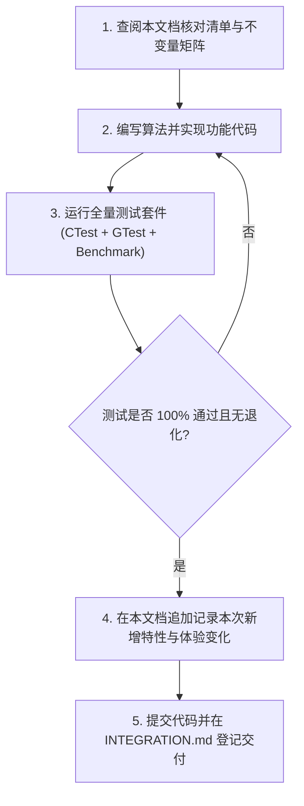

# ModernIME 算法演进、打字体验与防退化规范手册
*(Algorithm Evolution, User Experience Baseline & Anti-Regression Manual)*

> **【强制执行铁律 / Golden Rule】**  
> 任何开发者、维护者或 AI 智能体在对 ModernIME 的**候选排序、拼音切分、中英仲裁、自学习、造词、纠错或数据持久化算法**进行修改、重构或升级之前，**必须完整通读并严格遵守本文档**。  
> 每次算法更新，**必须保证不破坏、不覆盖以往沉淀的任何算法特性**。更新完成后，必须在本文档中如实追加新增特性及其对实际打字体验带来的变化。

---

## 一、算法更新前必读核对清单 (Pre-Update Checklist)

在修改任何算法代码前，必须逐项核对以下体验底线，确认本次改动不会造成任何负向退化：

- [ ] **高频中文保护**：输入常见短拼音（如 `de`、`shi`、`qu`）时，高频中文（如“的”、“是”、“去”）是否稳居第一位？绝不允许被长英文单词（如 `developer`）或英文前缀预测抢占首候选。
- [ ] **英文生僻词与缩写防骚扰**：输入拼音声母缩写（如 `wsl`、`sjw`、`cmd`）时，是否优先召回已学习的中文人名/短语（如“王绍龙”），绝不出现生僻英文单词或荒谬俚语释义（如 `wsl (威塞尔斯布隆病毒)`、`git (饭桶)`）霸榜？
- [ ] **艾宾浩斯遗忘与新词上位平衡**：近期密集使用的词条能否在指数衰减加权下快速升至首位？同时对数词频项是否有效遏制历史超高频词永久霸榜？
- [ ] **上下文感知与隐私安全**：光标前存在技术上下文（如“编写嵌入式Linux”）时，相关联候选（如“驱动”）能否智能跃升？跨应用、换行或光标移动后，上下文是否立即干净失效？在密码框（Password）或敏感场景下，是否绝对阻断上下文读取与学习记录？
- [ ] **分段造词与消费一致性**：分段连续输入 3 次（如“王→绍→龙”、“候选→栏”）能否无感自动合成新词？部分音节选择（输入 `nihaoma` 只选 `你好`）时，记录的拼音是否严格为已消费的 `ni'hao`，严禁记录未消费的 `ma`？
- [ ] **以词定字与退格留字提权**：使用快捷键 `[` 取首字、`]` 取末字，或者打出整词后退格删词留单字时，上屏与单字学习是否准确独立，且目标单字在后续单独输入对应拼音时是否立即获得高优排序？
- [ ] **个人大词库容量保障**：学习数据库容量上限必须保持在 **200,000 条**（剪枝目标 160,000 条），严禁在代码或编译二进制中引入过小上限（如旧版的 20,000 条），防止用户个人数十万级历史词库被静默删除。
- [ ] **延迟门禁**：高负载（50,000+ 词条）下，候选词召回热路径 P99 延迟必须严格维持在 **$< 1.0\text{ ms}$**（当前基准约 $0.02\sim0.04\text{ ms}$），严禁引入全表扫描或阻塞式 I/O。

---

## 二、算法演进全量特性台账 (Feature Ledger)

### 特性 1：拼音音节切分与全简拼无撇号双向解析
- **引入版本**：`v0.1.7` / 完善于 `v0.1.8`
- **核心逻辑**：
  - 基于 400 个标准普通话音节有序表的回溯动态切分算法（[`PinyinMatchPolicy::segmentPinyin`](file:///home/wsl/ModernIME/core/src/pinyin_match.cpp)）。
  - 双向兼容：支持带撇号音节（`wang'shao'long`）与无分隔符连续拼音（`wangshaolong`）的无损互转，自动提取精准声母序列（`abbreviationKey("wang'shao'long") -> "wsl"`）。
- **给实际打字体验带来的变化**：
  - 用户无需繁琐敲击单引号或空格切分音节，一气呵成连打即可精准匹配；
  - 支持全拼、纯声母简拼（如 `wsl` 召回“王绍龙”）、中长词混拼（如 `qudonglc` 召回“驱动流程”）；
  - 历史学习数据库无论有无分隔符，均能建立完整的简拼索引。

---

### 特性 2：中英统一仲裁与多阶防抢占机制 (Anti-Hijacking)
- **引入版本**：`v0.1.8`
- **核心逻辑**：
  - **无元音缩写与生僻词剔除**：在英文词典中剔除 2 字母无元音缩写及生僻缩写，建立常用 3-4 字母常用词白名单（[`kCommonShortEnglishWords`](file:///home/wsl/ModernIME/core/src/english_dictionary.cpp)）。
  - **阶梯门禁**：未学习的静态英文前缀预测门槛提升至输入长度 $\ge 4$；英文释义括号展示门槛限制在 $\ge 4$ 字母真实英文单词。
  - **短拼绝对中文优先**：当输入长度为 2-3 字母且对应中文高置信度高频字词时，英文绝对不抢占首位。
  - **技术术语前缀补全**：已学习的英文技术术语（如 `gnueabihf`），在输入 `gnu` 或 `gnue` 时，作为前缀补全候选高优推荐。
- **给实际打字体验带来的变化**：
  - **彻底告别生僻英文霸屏**：打 `wsl` 时再也不会跳出荒谬的 `威塞尔斯布隆病毒`；打 `git` 不会被侮辱性的俚语 `饭桶` 抢占；
  - **常用单字稳如磐石**：打 `de` 第一候选永远是高频中文“的”，绝不被用户学习过的英文单词 `developer` 顶掉；
  - **编程与英文术语输入极度顺手**：敲入工具链或命令前缀即可直出专业术语，中英文混输体验和谐。

---

### 特性 3：对数频次平滑与艾宾浩斯时间衰减 (Adaptive Frequency & Recency Decay)
- **引入版本**：`v0.1.8`
- **核心数学模型**：
  $$\text{dynamic\_score} = \text{base\_weight} + \alpha \ln(\text{count} + 1) + \beta \exp\left(-\frac{\Delta t}{\tau}\right) + \gamma \cdot \text{context\_factor}$$
  - $\alpha = 1.2$（对数频次增益，边际递减）；
  - $\beta = 2.5$（时间新鲜度初始增益）；
  - $\tau = \frac{T_{1/2}}{\ln 2}$，以 $T_{1/2} = 7 \text{ 天}$（604,800 秒）严格换算物理半衰期；快进 7 天衰减 $50\%$，快进 30 天衰减至约 $5.1\%$；
  - `LearningSnapshot::boostAt` 提供 30 天平滑尺度支持。
- **给实际打字体验带来的变化**：
  - **消除高频旧词霸榜**：即使某词在过去被打过上千次，随时间自然遗忘后，其动态权重不会永久封死其他候选；
  - **近期热词即时上位**：用户最近几天正在集中撰写的新话题、新项目词汇，只要连续选用 2-3 次，近期新鲜度增益便能助力其迅速升至第 1 候选；
  - **动态自适应**：长期不用的临时词汇无需手动删除，随时间流逝自然下沉，保持首选列表纯净。

---

### 特性 4：光标前上下文感知 (Surrounding Text) 与隐私安全边界
- **引入版本**：`v0.1.8`
- **核心逻辑**：
  - 通过 Fcitx5 `surroundingText` 获取光标前最多 12 个 UTF-8 字符（清洗换行符、控制字符与残缺多字节边界）。
  - 上下文亲和度奖励 $\gamma = 3.0$：光标前结尾词与候选词若具备 2-Gram 语义关联（如光标前为“编写嵌入式Linux” $\to$ 敲入 `qu,dong` 置顶“驱动”而非“生动”）。
  - **即时失效机制**：应用切换、失焦、光标移动或重置输入时立即清空上下文，回退至纯拼音排序，防止语境串扰。
  - **密码与隐私防护**：在 `Password` 或 `Sensitive` 模式下，直接阻断上下文抓取与一切学习事件入库。
- **给实际打字体验带来的变化**：
  - **像懂你心思一样准确**：在特定语境下打字，首选词能结合上一句末尾的词义智能变化，减少翻页找词频率；
  - **跨软件无错位**：从 IDE 切换到微信或终端时，绝不把上一处的代码上下文残留带入日常聊天；
  - **隐私零泄露**：在各类登录框、密码输入框输入时，输入法完全处于盲打防护状态，不记录任何痕迹。

---

### 特性 5：分段输入自动造词与消费范围对齐 (Segmented Phrase Formation)
- **引入版本**：`v0.1.8`
- **核心逻辑**：
  - 维护会话级分段提交历史。当用户连续分段输入相同字词序列（如分步输入 `王` $\to$ `绍` $\to$ `龙`，或 `候选` $\to$ `栏`）达 3 次，且音节连续合法时，算法自动合成全长新词并在数据库中创建词条。
  - **消费范围严格对齐**：当输入多音节（如 `nihaoma`）但用户只选择了前缀部分（如 `你好`）时，提交记录的拼音严格限制为已消费的 `ni'hao`，未消费的 `ma` 保留在预编辑区，严禁将整个 `nihaoma` 误记为短词的拼音。
- **给实际打字体验带来的变化**：
  - **无需手动造词**：打朋友姓名、专业术语时，首次逐字选出后，重复打两三遍即可形成整词记忆，下次全拼直出；
  - **分段选词不污染**：部分选词后撤销或改打，不会留下畸形拼音映射。

---

### 特性 6：以词定字与退格留字单字自学习提权机制 (Single-Character Extraction & Priority Elevation)
- **引入版本**：`v0.1.8`（快捷键取字）/ `v0.1.9`（整词上屏退格留字全自动识别与大幅提权）
- **核心逻辑**：
  - **快捷键以词定字**：支持以词定字快捷键：`[` 提取候选词首字上屏，`]` 提取候选词末字上屏（例如输入 `nihao` 按 `[` 上屏“你”，按 `]` 上屏“好”）。
  - **退格留字场景识别 (Deletion Feedback Extraction)**：
    - 在 Fcitx5 适配层维护 `recentCommit_` 状态，记录上次提交的原文本 `originalText`、拼音 `originalPinyin` 及分解的单字和音节列表。
    - 当用户打出一个成语或词语上屏后，通过连续或多步 Backspace 删除其余多余字，直至光标前恰好留下其中一个单字时（例如输入并提交“画龙点睛”后删除“点睛”和“画”，仅留下“龙”；或提交“介绍”后退格留下“绍”）：
      1. **原整词负反馈**：向自学习引擎记录对原整词的抑制与负反馈，降低原词在当前语境的不当权重；
      2. **目标单字高频激励**：将保留下来的单字与其对应拼音拆解匹配，自动注入通用无上下文自学习事件（3 次高频激励），使其 `learning_boost` 迅速达到 $\ge 1.8$；
      3. **候选管道晋升与罕见字豁免**：在候选管道构建与排序时，`learning_boost >= 1.8` 的单字获得原位突破机制（`source_index = min(source_index, recalledIdx)`）与自适应渐进加权，并免除二级/生僻字惩罚；
      4. **核心单字与日常打字保护**：严格区分“有意退格留字提权（boost >= 1.8）”与“单次偶发点击单字（boost < 1.8）”，确保日常打字中偶选一次“泥”绝不抢占常用字“你”的第 1 位。
- **给实际打字体验带来的变化**：
  - **深层单字瞬间直出**：当用户想打一个生僻或排在很多页之后的单字时，习惯先打出一个熟知成语或词组再退格删字留下该字。现代输入法即刻领会用户意图，无需额外配置，下次直接输入该单字的读音（如打 `shao` 找“绍”，打 `long` 找“龙”），该字立即排在首页前列甚至首候选，极大减少翻页痛苦；
  - **整词与单字互不干扰**：删除多余字时原词自动抑制，留下的单字准确绑定自己的拼音音节，杜绝音节污染与脏数据。

---

### 特性 7：200,000 超大容量管理与双引擎持久化存储
- **引入版本**：`v0.1.8` 初始引入 / `v0.1.9` 扩容至 200,000
- **核心逻辑**：
  - **容量门禁**：[`kMaxLearningEntries`](file:///home/wsl/ModernIME/core/include/modernime/core/learning_snapshot.h#L16) 与 [`max_dict_capacity`](file:///home/wsl/ModernIME/core/include/modernime/core/personal_engine.h#L56) 设定为 **200,000 条**（剪枝目标 160,000 条），严禁任何模块回退至 20,000。
  - **双引擎持久化**：
    - `learning.sqlite3`：WAL 模式、忙等待容错、事务隔离、升级自动在线一致性快照备份。
    - `learning.lmdb`：支持 $O(\log N)$ 前缀游标扫描，动态 2 倍扩容（`MDB_MAP_FULL` 自动恢复），P99 检索仅 `20~39 μs`。
  - **格式兼容**：原生支持 14 字节 `WordMeta`（魔数 `0xA55AA55A`）平面二进制文件（如 `user_personal_dict.bin`），毫秒级无损合并。
- **给实际打字体验带来的变化**：
  - **海量个人词库完整留存**：即使用户从其他输入法（如微信输入法、搜狗输入法）迁移数万甚至十万条历史习惯，也绝不会在打字时被系统截断删除；
  - **微秒级极致性能**：在数十万条词库压力下，候选词弹出依然毫无卡顿感，打字帧率始终如丝般顺滑；
  - **异常断电零损坏**：数据库具备事务原子性与故障自愈，永不损坏个人学习资产。

---

### 特性 8：英文双元音防抖与拼音模糊纠错
- **引入版本**：`v0.1.8`
- **核心逻辑**：
  - 针对输入常见英文双元音（如 `ee`、`oo`）实施针对性防抖豁免，防止激进的拼音去抖/容错算法将连续元音敲击误判为误触或声母混淆。
- **给实际打字体验带来的变化**：
  - 敲击 `meet`、`look`、`google` 等包含双元音的英文或拼音容错词汇时，反应灵敏，不会出现字母被强行吞掉或跳字现象。

---

## 三、用户体验不可退化不变量矩阵 (The "Never-Break" Matrix)

每一次算法变更，都**必须**在单元测试或端到端验证中确认以下“不可破坏行为”：

| # | 触发测试输入 | 上下文 / 场景 | **必须表现出的体验（Expected）** | **绝对禁止出现的退化（Forbidden）** | 覆盖测试用例 |
| :-: | :--- | :--- | :--- | :--- | :--- |
| **1** | `de` | 任意无上下文 | 首选必须是高频中文「**的**」 | 绝不能被已学习的高频英文 `developer` 抢占首位 | `modernime_personal_engine_gtest.EnglishArbitration` |
| **2** | `wsl` | 曾学习过“王绍龙” | 首选或高优候选召回「**王绍龙**」 | 绝不能出现生僻缩写或释义 `威塞尔斯布隆病毒` 霸屏 | `candidate-ranking` 单测套件 |
| **3** | `qu,dong` | 光标前为“编写嵌入式Linux” | 「**驱动**」受上下文提权跃升第 1 位 | 出现与上下文无关的候选或上下文未生效 | `modernime_personal_engine_gtest.SurroundingContext` |
| **4** | `mima` | 密码框 / 敏感输入框 | 正常出词，但**绝不记录**到数据库 | 密码或敏感拼音被记入学习库并在其他地方推荐 | `modernime_personal_engine_gtest.SurroundingContext` |
| **5** | `wang` $\to$ `shao` $\to$ `long` | 分步连续输入 3 次 | 输入 `wangshaolong` 直接召回「**王绍龙**」 | 无法自动造词，仍需每次逐字挑选 | `modernime_personal_engine_gtest.SegmentedPhrase` |
| **6** | `nihaoma` | 仅选中「你好」，放弃「ma」 | 数据库仅记录 `ni'hao` 词频 1 次 | 记录了 `nihaoma` 或产生未消费音节垃圾数据 | `modernime_personal_engine_gtest.CommitDeduplication` |
| **7** | `nihao` | 按 `[` 或 `]` | 分别单独上屏「**你**」或「**好**」 | 无法截取或把整词拼音误绑定给单字 | `modernime_personal_engine_gtest.SegmentedPhrase` |
| **8** | 任意输入 | 词库已有 35,000+ 条记录 | 记录总数稳定增加，上限为 200,000 | 数据库被截断回退到 20,000 或 50,000 | 检查 `learning.sqlite3` 记录行数 |
| **9** | 50,000 词库查询 | 模拟高并发打字 | 检索及上下文排序 P99 $< 1.0\text{ ms}$ | 出现任何卡顿或延迟超过 1ms | `modernime_personal_engine_benchmark` |
| **10** | 打出「介绍」后退格删掉「介」保留「绍」 | 随后单独输入 `shao` | 「**绍**」排序显著跃升至首页前列（Rank $\le 2$） | 「绍」依然沉没在数页之后，或提权未生效 | `modernime_pinyin_engine_tests.Task10` |
| **11** | 打出「画龙点睛」后退格保留「龙」 | 随后单独输入 `long` | 「**龙**」排位显著前移至首页高优候选 | 无法识别成语中间字提取，或原成语未施加负反馈 | `modernime_pinyin_engine_tests.Task10` |
| **12** | `ni` 下偶发单次选择第 4 位候选「泥」 | 再次单独输入 `ni` | 首选必须稳定保持「**你**」，「泥」仅适度前移 | 发生单次偶发夺位（「泥」抢占第 1 位篡位） | `modernime_pinyin_daily_simulation_tests` (Scene 1) |

---

## 四、算法更新操作规程 (Standard Operating Procedure)

当有新的算法需求（如引入深度学习模型、拼音模糊音矩阵调整、云词库同步等）时，必须执行以下 4 步闭环：



1. **查阅对齐**：修改前仔细阅读本文档第二节与第三节，评估改动是否可能触碰既有特性的边界。
2. **编写与防护**：编写新算法时，必须同时在 `tests/core/` 中新增针对新特性的 GoogleTest 单元测试，并保留既有所有防抢占、防截断用例。
3. **回归验证**：
   ```bash
   # 1. 运行个性化引擎专项单元测试（必须 100% 通过）
   ctest --output-on-failure -R modernime_personal_engine_gtest
   
   # 2. 运行 50,000 级高负载性能基准（P99 必须低于 1ms）
   ctest --output-on-failure -R modernime_personal_engine_benchmark
   
   # 3. 运行全量工程自动化测试（包含安装与生命周期回归）
   ctest --output-on-failure
   ```
4. **追加文档**：在本文档的「二、算法演进全量特性台账」中追加新的特性章节，详细描述：
   - 算法设计与核心逻辑；
   - 涉及的代码文件与类方法；
   - **给用户实际打字体验带来的具体变化**；
   - 对应的回归测试用例。
5. **合入交付**：确认文档与代码同步更新后，按规范进行代码提交并更新协作登记。
