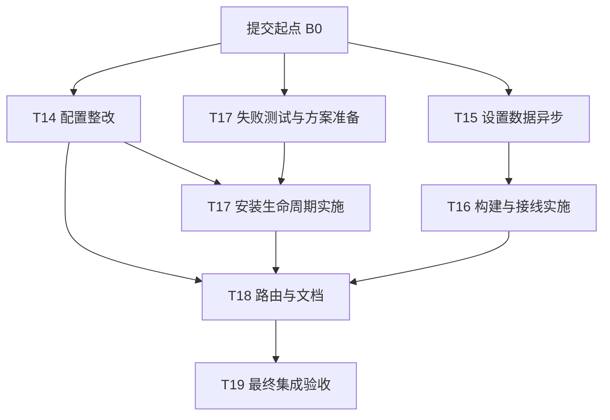

# ModernIME 剩余任务并行执行 Implementation Plan

> **For agentic workers:** 使用 `superpowers:executing-plans` 执行分配给自己的一个任务。用户要求一个对话一个职责；协调对话只调度、审查、集成与验收，不承包全部业务实现。对应独立提示词见 `docs/并行任务提示词.md`。

**Goal:** 并行完成 T14 收尾与 T15–T19，减少等待和重复验证，同时保留任务边界、数据安全与可追溯验收。

**Architecture:** 一个协调者、独立任务 worktree、明确文件归属、版本化接口交付、单一集成入口。代码工作并行，重资源验证调度执行；分支定向通过与集成验收通过严格分开。

**Tech Stack:** 现有 C++20/CMake/Fcitx5/GTK/SQLite/LMDB/Bash/Python；Git worktree、现有测试检查工具和系统已有 `flock`。

**Spec:** `docs/superpowers/plans/2026-10-16-架构整改实施与验收方案.md` 的依赖图和 T14–T19；`docs/T14-复审与交接.md` 的 R1–R4。本文改变执行组织方式，不改变生产行为目标或验收标准。

## Global Constraints

- 本文与提示词的编写不是实施：本轮不创建 worktree、不启动实施对话、不修改生产代码、不提交/推送/发布。
- 实施时一个任务一个对话/分支/worktree，禁止多个实施 AI 写同一工作树；当前 T14 在途工作有保留原 checkout 的特殊安排，见第 1 节。
- 完整阅读本任务 worktree 的 AGENTS.md，以及 docs/ 下六份文档：ALGORITHM_ARCHITECTURE、ALGORITHM_CHANGE_GUIDE、ALGORITHM_EVOLUTION、CANDIDATE_PIPELINE_ARCHITECTURE、STABILITY_AUDIT、HANDOVER，共七个必读文件。
- 并行执行使用 `docs/并行任务提示词.md`。本文取代 `2026-10-17-后续任务提示词.md` 的保守串行等待要求，保留原任务内容和验收标准，不混用旧提示词的启动条件。
- 不改候选排序、学习资格、容量、用户数据格式或 T11–T13 已验收协议。T15 是设置数据异步与轻量统计，不是包管理沙箱。
- 无收益不加 Manager/Helper/通用调度框架，不机械拆文件；原有测试、断言、预算与性能门限保留。
- 不 reset/clean/stash 他人改动，不整体覆盖冲突文件，不 `git add -A` 混入用户文件。只提交明确属于本任务的路径。
- 本地任务提交与受控集成在执行提示词授权范围内；不 push、发布、签名或在宿主执行真实 apt/dnf/pkexec/裸 install/uninstall。
- G4 是 Sanitizer/并发；G5 是安装/升级/卸载/渠道。Skipped/NotRun 不是 Passed；虚拟显示不冒充真实桌面。

## Review Focus

1. 把未提交 T14 工作复制给其他任务或回退覆盖：以只读身份记录和明确起点防止。
2. 多个对话修改同一 CMake/安装/SettingsShell 文件：用单一文件负责人和接线申请防止。
3. 单分支绿灯被宣布成整个任务验收：使用第 6 节状态与实际集成 SHA 防止。
4. 多套构建/性能互相干扰或 OOM：用第 7 节机器资源锁和任务私有证据目录防止。
5. 后续任务消费未冻结接口、旧日志或另一工作树的 binary：使用接口交付和快照绑定防止。

## 1. 当前事实与安全启动

2026-10-17 编写时观测到：

- HEAD 为 `7f2f05db34073b526a623d31039b4af06c9198e8`，T14 尚未通过复审。
- `core/include/modernime/core/settings.h`、`core/src/settings.cpp`、`adapter/fcitx5/include/modernime/fcitx5/fcitx_engine.h` 有未提交修改，应视为 T14/用户在途工作，不能被新任务提交、清理或迁移。
- 写方案期间再次观察到 adapter/UI、install.sh、session-init、测试等也出现修改，说明状态仍在变化；这份采样不是交接时的最终文件清单。**所有已经在途的文件沿用现有写入者，先确认其交付/移交，再让协调者接手，不能追溯抢占归属。**
- 仓库已存在多组历史 worktree。不得复用/删除旧的 `.worktrees/integration`、候选、学习或 settings-client 工作树。
- `.worktrees/` 已被忽略；已有 `/usr/bin/flock`。
- 环境采样为 6 个逻辑 CPU、7.7GiB 总内存、约 3.5GiB 可用。它不是未来资源保证，启动时重新检查。

执行协调者先做：

- [ ] 记录当前 HEAD、status、worktree list、差异摘要；不改变原 checkout。
- [ ] 将启动时明确的已提交起点记为 B0。若仍是上述 HEAD，可使用它作为并行开发起点；它不是“T14 已验收”的证明。若 T14 已产生新提交，记录其与原审查基线的关系，不强制倒退到旧 SHA。
- [ ] 继续使用现有 T14 对话作为唯一 T14 写入者。未获得可核实的现有对话 ID 时，由用户把 T14 续跑提示词发到该对话；不要猜测或给其他历史对话发消息。
- [ ] 新建协调/集成 worktree 与 T15 worktree；T17 可新建准备 worktree。只从 B0 的提交创建，不使用含未提交改动的 starting working-tree 快照。
- [ ] 在 `/home/wsl/ModernIME/build/parallel-control-20261017/` 建立协调控制目录，只由协调者写总状态、资源锁和上下文摘要。

未跟踪规划/复审文档不会自动进入 Git worktree。协调者须把原计划、本文、提示词、ARCHITECTURE_AUDIT、REFACTOR_BACKLOG、T13 最终交接及 T14 复审等明确列出的资料复制到新 worktree 的对应路径并保存 SHA256。目标已存在且不同则保留并核对，不直接覆盖。不复制整个原工作树或任意用户未跟踪文件；资料副本不混入业务提交。

## 2. 并行拓扑与启动时机



这是推荐调度，不把“前一个 T 编号完成”当作所有任务的逻辑依赖：

| 对话 | 立即可做 | 完整实施/验收的前置条件 |
|---|---|---|
| 协调/集成 | 建工作树、资料快照、分配文件、排验证队列 | 不实现各任务业务 |
| T14（现有对话） | 继续 R1–R4 | 保持唯一原 checkout 写入者 |
| T15 | 独立实现、50k/200k 与异步测试 | 依赖已验收 T02/T05；不依赖 T14 全部完成 |
| T17 | 冻结行为矩阵、准备故障/回滚测试、设计薄入口 | T14 路径契约通过并移交安装脚本后，才改共享安装实现 |
| T16 | 分析清单/宏、准备 core-only/strict 负向测试 | T15 接口/新增源清单冻结、拿到 CMake 写权限后实施；最终验收依赖 T15 已集成验证 |
| T18 | 可提前只读盘点实际页面和文档事实 | 完整实施等 T14/T16/T17 集成验收，避免 SettingsShell/安装文档冲突 |
| T19 | 不提前宣布验收 | T00–T18 逐项已具备实际交付和复审结果 |

推荐最多三个实施对话同时活动，另有一个协调对话。开始时是 T14、T15、T17 准备；T14 完成后其名额转给 T16，T17 转为实现。只读复审可在空闲名额运行，不再另开第二个同任务写入者。

## 3. 分支与 worktree

以下是新建工作树的建议名称；原生工具若分配其他路径，核对起点并登记实际路径即可，不强制改名或删除工具创建的工作树。

| 角色 | 建议分支 | 建议位置 |
|---|---|---|
| T14 | 保留当前工作分支，任务所有者完成自己的提交 | `/home/wsl/ModernIME`，仅现有 T14 写入 |
| 协调/集成 | `codex/architecture-integration-20261017` | `.worktrees/parallel-integration-20261017` |
| T15 | `codex/architecture-t15-20261017` | `.worktrees/parallel-t15-20261017` |
| T17 | `codex/architecture-t17-20261017` | `.worktrees/parallel-t17-20261017` |
| T16 | `codex/architecture-t16-20261017` | `.worktrees/parallel-t16-20261017` |
| T18 | `codex/architecture-t18-20261017` | `.worktrees/parallel-t18-20261017` |
| T19 | `codex/architecture-t19-20261017` | `.worktrees/parallel-t19-20261017` |

路径相对 `/home/wsl/ModernIME`。存在同名分支/路径时先核对，不删后重建。每个任务只使用自己 worktree 的 build、TMPDIR、合成 HOME/XDG 和证据目录，不调用其他树的旧 binary。

## 4. 文件归属：不允许多人同时编辑同一共享文件

| 文件/范围 | 默认写入负责人 | 其他任务怎么请求变更 |
|---|---|---|
| core/settings.h、settings.cpp | T14 | 通过接口申请；T15 不改配置读取 API |
| adapter 输入法配置/状态、UI addon/布局 | T14 | T15 不重做候选链路 |
| runtime_environment、配置 model/runtime 诊断 | T14 | T15 消费既有接口 |
| learning_store、personal_engine 的轻量计数 | T15 | 只加必要计数，不改 T11 生命周期/学习政策 |
| DataController、Dictionary/Learning/Overview/Clipboard 页面 | T15 | T14 配置 glue 通过共享文件申请 |
| settings_shell.cpp/.h | 协调者维护共享接线，T15 提交数据区域变更申请 | T14/T15 不各自整文件重写；T18 启动时再移交 |
| 全部 CMake、CI、必需测试接线 | 初期协调者；T16 实施时一次性移交 T16 | 工作任务提供精确 source/test/宏清单或局部 patch；同时只一位编辑者 |
| install.sh、install_state.sh | 已在途的 T14 路径改动由现有 T14 完成；空闲共享 glue 可交协调者，之后明确移交 T17 | T17 准备期不改这些文件，协调者不覆盖 T14 未提交 patch |
| session-init、data-guard 的路径协议 | T14，契约验收后移交 T17 | T17 不再引入第二套路径优先级 |
| uninstall、binary payload/generator、package_tarball、新 lifecycle | T17 | CMake 安装条目交当前 CMake 负责人应用 |
| page_registry、app/window 路由 | T18 | 前置未通过时只读盘点 |
| README 与跨任务架构文档 | 协调者收集阶段说明，T18 统一事实核对 | 任务可写自己的 Txx_ACCEPTANCE；共享文档以精确变更申请提交 |

文件负责人可以明确移交，但必须在状态表记录路径、接收方、起始提交；原负责人停止写后才生效。上表是完成启动交接后的默认归属，已经在途的共享文件先沿用现有负责人。禁止用“worktree 隔离”作为同时改同一 CMake/core 文件的理由。

**共享接线的具体流程：**

1. 工作任务在自己树提交业务源/测试，另交 `build/parallel-handoff/wiring-request.md` 或局部 patch，列清每个 target 的 source、链接依赖、宏、测试名/锁/skip/运行命令。
2. 该状态只能叫 `LOCAL_VERIFIED / WIRING_PENDING`。手工执行的新测试可记录为已运行，但不能宣称 CTest 已注册或该任务已最终通过。
3. 协调者在集成树将源提交与接线一起集成、构建、实际注册执行。集成树不得把缺 source 的接线半成品当作稳定交付。
4. 任务若需要该接线继续开发，协调者提供明确的已提交快照供任务合入自己分支；不把集成树未提交文件复制过去。T16 接管后，所有后续接线申请由 T16 处理，协调者停止并发编辑 CMake。

协调者只做共享区域的必要 glue/冲突集成，不替任务实现业务；复杂冲突退回文件负责人处理，不用整文件 ours/theirs，也不默默删掉另一任务测试。

## 5. 接口交付与冻结

“冻结”不是禁止修 bug，而是任何签名/语义/源清单变化都必须通知依赖方并重验受影响证据。

| 接口交付 | 生产者 | 消费者 | 必须发布的事实 |
|---|---|---|---|
| C14 配置读取/应用 | T14 | T15/T17/T18 | 成功/失败/缺失的实际类型与语义；同源 settings/rawLines/hash/stamp；applied/UI 版本交界 |
| C14 路径 | T14 | T17 | 有效 XDG 配置/数据根、MODERNIME 管理覆盖转换、空格 argv/env、启动入口与测试 |
| C15 数据 API | T15 | T16/T18 | `optional<size_t> LearningStore::entryCount() const`；既有 DataController 内 `filterDictionary(span<const UserDictionaryEntry>, string_view)->vector<size_t>`；任务失活/结果版本语义 |
| C15 构建清单 | T15 | T16 | 新增/移除 source、测试文件、链接依赖、编译定义、GTK resource lock、`modernime_settings_data_async_gtk` |
| C17 生命周期 | T17 | T16/T18 | deploy/integrate 显式参数、脚本安装清单、rollback 责任、native 所有权及保护目录 |
| C16 构建 profile | T16 | T18/T19 | INTERFACE source 清单、公开 target、strict/core-only/UI-layout 开关、真实必需测试表 |

原 T17 目标入口保持 `modernime_deploy_payload PAYLOAD PREFIX TRANSACTION_DIR`、`modernime_integrate PREFIX CONFIG_HOME DESKTOP_DIR MANAGED_STATE_DIR`。若 C14 数据环境要求增加显式参数，应先发布并审查契约调整，不能静默增加隐藏全局优先级。

T16 可以在 C15 接口/源清单冻结后基于协调者指定的 provisional 提交开始实现，不必等待所有性能报告；它必须记录该前置尚待集成验收，不能据此宣布 T16 通过。接口再次变化就重建受影响目标并更新证据。

## 6. 交付状态与任务报告

协调状态表位于集成分支 `docs/并行整改状态.md`，仅协调者写。实施对话在自己的 `build/parallel-handoff/Txx.json` 写报告，至少包含：

```json
{
  "task": "T15",
  "worktree": "实际绝对路径",
  "branch": "实际分支",
  "base_sha": "实际起点",
  "tip_sha": "本任务已提交快照",
  "state": "LOCAL_VERIFIED",
  "interface_version": "实际接口交付标识",
  "changed_files": [],
  "wiring_requests": [],
  "executed_tests": [],
  "unrun_or_skipped": [],
  "evidence_dir": "本树独立证据绝对路径",
  "remaining_risks": []
}
```

| 状态 | 含义 |
|---|---|
| PREPARING | 分析/失败测试准备，未声称实现完成 |
| INTERFACE_FROZEN | 明确提交中的接口与文件清单可供依赖方准备 |
| LOCAL_VERIFIED | 当前分支定向测试已实际运行；不等于全量验收 |
| REVIEWED | 独立复审无阻断，允许进入集成候选 |
| MERGED_PENDING_GATES | 已进入集成树，等待接线/组合验证 |
| ACCEPTED | 组合快照通过本任务原定门禁；必须记录 accepted integration SHA 和证据 |
| NEEDS_FIX | 存在具体失败；回任务对话整改，不标完成 |

`INTERFACE_FROZEN`、`LOCAL_VERIFIED` 都不授权把旧日志换个目录当新证据。任务报告使用实际测试函数/命令，不能 print(PASS) 替代行为。

## 7. 构建与测试资源调度

当前小内存环境采用：**多个对话同时分析编码，机器重任务最多一个**。

- 唯一全局锁：`/home/wsl/ModernIME/build/parallel-control-20261017/machine.lock`。
- 重编译、完整 CTest、GTK 集成、ASAN/TSAN、安装打包、fresh clone、性能用排他锁。构建默认 `--parallel 2`，插桩/打包内存不足时降到 1，不并行开多套编译。
- 很小的非 GTK 定向单测可用共享锁；性能排他锁会等待这些单测退出。不要把大词库测试伪装成轻量共享任务。
- CTest 的 RESOURCE_LOCK 只管同一 CTest 调度，不是跨 worktree/跨进程的全局锁，不能替代本锁。
- 现有 T14 对话收到续跑提示词后也遵守同一锁；协调者不杀它已经运行的构建/测试，而是在空闲边界切入。

示例（仅执行时使用，变量设为实际路径）：

```bash
control_dir=/home/wsl/ModernIME/build/parallel-control-20261017
task_worktree=/home/wsl/ModernIME/.worktrees/parallel-t15-20261017
mkdir -p "$control_dir"
flock -x "$control_dir/machine.lock" \
  cmake --build "$task_worktree/build/parallel-debug" --parallel 2
```

不要递归获取同一锁。外层已经包住 fresh clone/安装验证时，内部不用再套同一把锁。每个任务的 TMPDIR、合成 HOME/XDG、prefix、DBus/Xvfb 均私有。

### 验证漏斗：减少重复，不删门禁

1. 实施分支先跑失败前后、必要单元/真实行为测试和相应 Sanitizer，尽早发现错误；不让每个 AI 同时启动所有门禁。
2. 第一次稳定组合：T14+T15。协调者完成接线、逐任务独立复审后，组合快照执行两任务原定 G1/G3/相关 G4/G5/G6；同一原始全量报告可以被两个任务明确引用为“此集成 SHA 的组合验证”，不能冒充各分支单独全量通过。
3. 第二次稳定组合：T16+T17。执行构建 profile/负向准入、全量正确性/性能、安装/升级/卸载/渠道与 fresh clone。T17 的本次产物来源和摘要必须重新记录。
4. T18 按原计划运行路由/保存/配置、GTK、隔离 DBus 与文档核对；影响到其他行为再重跑对应关卡。
5. T19 对最终 HEAD 完整执行 G0–G7，不用早期组合成绩代替最终快照验收。

若组合快照后发生变化，仅在能明确证明不影响某关卡时引用旧结果，并标明原 SHA；相关模块/构建/数据输入发生变化的关卡必须重跑。任何阶段原定必需门禁仍然要有来源，局部 Passed 不改写为最终 Accepted。

## 8. 调度步骤与合并规则

- [ ] 第一批：T14 继续现有工作；T15 从 B0 新 worktree 完整实现；T17 只准备失败矩阵/设计，避开 T14 的路径文件。
- [ ] 协调者先处理 T14 配置读取、失败重试与路径 glue 的复审；把已提交、无阻断的 T14 交付合入专用集成树，再处理 T15。任务分支在此之前不改彼此文件。
- [ ] T14 路径契约通过并移交后，T17 同步该明确提交转完整实施。C15 接口/源清单冻结后，T16 获得 CMake 所有权开始实施。第一批最终门禁可排队运行，不占用其他任务分析/编码时间。
- [ ] 各任务先提交自己明确拥有的路径，独立复审读取 immutable tip SHA。只有协调者合并到集成分支，使用明确被审查的提交，不盲合持续移动的分支名。
- [ ] 合并后处理精确 glue/冲突，构建实际组合，更新报告 accepted SHA。失败回到对应任务对话修复；不在协调者那里顺手重构业务。
- [ ] T16/T17 通过后再启动 T18 的真实路由写入；三条依赖的版本与路径记录要交给 T18。
- [ ] T18 完成后冻结最终集成 SHA；T19 用新 worktree 做最终验收。任何新修复必须产生新 SHA、注明影响并重跑相关最终关卡。

合并保持提交链可追溯；不得为“回到干净状态”重置用户 main。工作树/分支留到用户确认后再考虑清理，本计划不授权删除。最终通过后交付集成分支与提交链，仍不自动推送或发布。

## 9. 明确的阶段验收重点

| 任务 | 不可省略的结果 |
|---|---|
| T14 | 解析/hash/stamp 同源；I/O 失败不误启用、同 stamp 可恢复；真实敏感热载/旧布局；管理与运行路径一致 |
| T15 | 50k/200k、2s 慢 I/O；heartbeat 目标 max<100ms；idle≤200行或4ms先到即让出；旧结果拒收、关闭无UAF、失败不clear |
| T16 | source 清单统一；消费宏隔离；strict 缺项失败；core-only 不被 GTK/Pango 强拉入；当前构建实际注册执行 |
| T17 | 显式 deploy/integrate；回滚保留并发用户写入；源码/binary/native 所有权清楚；新产物完整安装卸载闭环 |
| T18 | 当前完整 registry 的 CLI/别名/搜索/导航/包装一致；隔离已有实例；文档与真实代码/证据一致 |
| T19 | T00–T18 清单、全部矩阵、最终 HEAD 门禁、资源/格式/性能/渠道证据；物理桌面未验则继续待验 |

## 10. 启动方式与权限

推荐用户只需：

1. 把 `docs/并行任务提示词.md` 的 P1 T14 续跑提示词交给现有 T14 实施对话，确认在途文件与交接点，防止第二位 T14 写入者。
2. 在新协调对话粘贴 P0 协调提示词。两者可以很快依次发送；无需等待 T14 全部完成才创建 T15。
3. 协调者可在用户实际粘贴的授权范围内创建 T15/T17 等新任务对话，绑定独立 worktree，并向这些明确登记的任务发送范围内反馈。若工具不可用，按 P2/P3 等提示词手工开对话，保持同一规则。

提示词文件还提供 T16/T18/T19 与只读复审模板。未经明确授权，不把任务消息发往其他历史会话或项目。本次规划没有启动上述操作。
