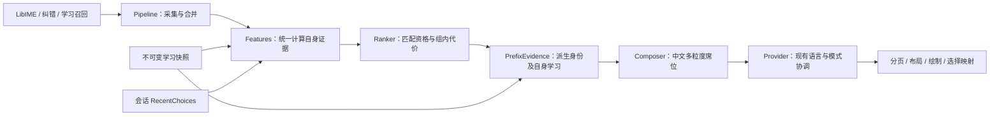
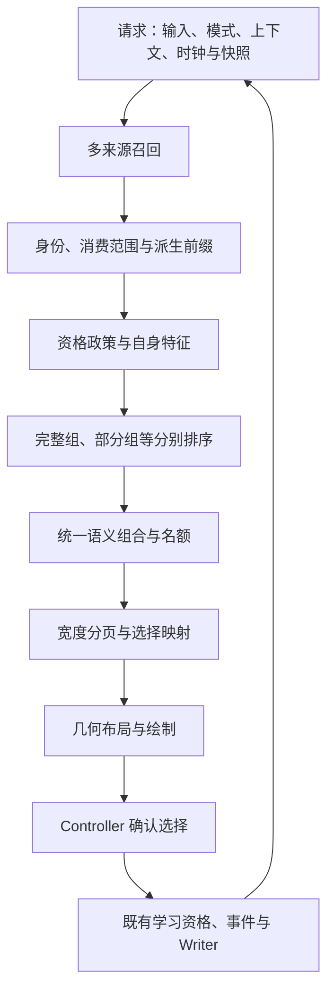

# ModernIME 候选排序、混排与排版架构

> 日期：2026-10-15。状态：**核心模块已落地，统一仲裁与诊断链路继续渐进迁移**。
> 第 2 节保留修复前实证；本轮实现范围与验证见第 0 节。目标模块表不是全部已实现的接口清单。

## 0. 本轮落地的结构与扩展入口

| 已实现模块 | 单一职责 / 输入输出 | 扩展时必须保持的边界 |
|---|---|---|
| `candidate_pipeline` | 收集原生、纠错、学习召回，按文本与读音合并，调用统一特征和 Ranker | 召回枚举不能修改原生位置；召回不写学习 |
| `candidate_features` | 一份请求时间/快照下计算词典、字符、学习、上下文和近期特征 | 新中文评分特征在此接入全部来源；不插位、不写盘；未知词频不得伪造 |
| `candidate_prior` / `CandidateScore` | `24*b/(24+abs(b))` 压缩既有基础项（含上下文奖励），保留独立学习、稀有惩罚与简拼准入 | 不用归一化绕过匹配资格；可信简拼准入和未准入组保留原规则 |
| `RecentChoices` | 每 Provider 最多 64 个输入/部分消费组，各最近 8 次明确选择 | 只允许当前最后选择获得奖励；至少三次且严格多数或连续三次；单次无近期奖励；最大 144；另需自身学习增益 ≥1.8 |
| `candidate_prefixes` | 从整句取得切分，建立前缀身份、消费范围并查询前缀自身证据 | 仅合并相同文本、读音、消费范围；不继承父整句学习；派生项先屏蔽后编排 |
| `candidate_mixer`（中文 Composer） | 只消费候选及证据；强个人前缀第二席、首整句与完整候选配额 | 不访问学习快照或磁盘；无个人证据保持成熟混排；所有席位保持提交消费范围 |
| Provider / Controller | 连接请求、提交和会话边界，原有学习 Writer 仍是写入所有者 | 失焦/显式重置、负反馈、敏感与禁学清近期意图；普通成功提交保留；共享资源不共享近期窗口 |
| UI 分页与布局 | 消费已有语义顺序并映射全局候选 | 只因宽度分页，不新增评分政策 |

不可变学习快照采用 512 个共享分片，在 200,000 容量下缩小更新/淘汰时的局部索引重建规模；不改变容量、衰减及事务协议，召回仍全局合并。代价是更多分片固定开销，须同时验收召回与更新延迟。

这些是同一现有构建目标内的静态模块，没有新增插件 ABI、依赖或数据库 schema。近期意图只在会话内存在；重开后仍保留真实学习次数，但不保留窗口奖励。原有 7 天 / 30 天 / 12 小时策略及 200,000 容量不变。

尚待迁移：英文、宏、模糊插位仍有 Provider 现有策略；全来源统一 Composer、完整消费身份类型、词级统计的未知标记、全链路移动原因、策略版本与自动契约 CI **没有在本轮全部实现**。后续新增来源应沿目标接口迁移，不再追加隐式置顶分支。

本轮行为由 `tests/core/candidate_ranking_regression_test.cpp` 注册进现有 GTest；结果及修复前后对照见[模拟使用记录第 8 节](算法使用仿真报告-2026-10-15.md#8-结构优化后的复测)。

## 1. 范围与设计选择

用户反馈：不常用字词占据候选栏高位，频繁选择目标词仍无法提高它的优先级。设计目标是让正常选择产生可观察的学习效果，并让新增候选来源、评分特征或显示功能无法绕过成熟体验边界。

候选栏包含两个不同问题：**语义顺序**决定哪个词排前面，**几何排版**决定一页放几项、怎么绘制与点击。中间还有整句、词、单字的混排，它会改变最终语义顺序。三者必须分开设计、一起验收。

| 方案 | 评价 |
|---|---|
| 分层协调、证据可解释、端到端晋升验收 | **采用**。逐步提取现有策略，定位每阶段如何改变候选；保留成熟政策，单独改进已复现的问题 |
| 继续提高学习权重、加生僻字黑名单 | 只能改变部分评分；无法解决评分后固定插位、派生项覆盖证据和分页映射问题 |
| 整体换成新的模型/动态规则插件 | 当前缺少统一质量基线，难以区分新模型收益与既有能力丢失，暂不采用 |

本文是[算法总架构](算法架构.md)中候选子系统的细化，不建立另一套学习库或演化台账。共同边界沿用 `ALG-PINYIN/RANK/ZHEN/DECAY/FORM/EXTRACT/GATE/SUPPRESS/IDENTITY/CAPACITY/SNAPSHOT/STORE`；新增、停用及删除按[变更指南](算法变更指南.md)执行，已验证算法变更仍记录到[演化手册](算法演化记录.md)。

## 2. 修复前链路与实证（历史基线）

后续[完整模拟使用记录](算法使用仿真报告-2026-10-15.md)已用真实控制器连续提交、持久化重载及 36 组布局配置复核：修复前本节排序问题仍可复现，分页和选词映射在模拟范围内通过；修复后对照见该记录第 8 节。记录同时保留可重复运行的人工诊断入口，不能把布局通过等同于排序通过。

### 2.1 修复前实际调用链

1. [candidate_pipeline.cpp](../algorithm/pinyin/src/candidate_pipeline.cpp)收集 LibIME、纠错和学习候选，计算词典、学习、上下文等证据。
2. [CandidateRanker](../core/src/candidate_ranker.cpp)先按匹配优先级和简拼提升分组，再比较[最终代价](../core/include/modernime/core/candidate_ranker.h)。原生位置直接进入代价，解码分数归一化后的权重只有 0.25。
3. [Provider](../algorithm/pinyin/src/pinyin_candidate_provider.cpp)过滤、区分整句与部分消费，并调用模糊候选插入逻辑。
4. [Mixer](../algorithm/pinyin/src/candidate_mixer.cpp)插入整句、三音节前缀、第二整句、二音节前缀和同音候选；部分候选通常追加在整句后。
5. Provider 继续插入宏、英文补全、原文和命令，最后屏蔽、按文本去重并添加释义。
6. [Controller](../adapter/fcitx5/src/engine.cpp)发布候选页；[Fcitx 桥接](../adapter/fcitx5/include/modernime/fcitx5/fcitx_engine.h)保留全局下标；[UI addon](../ui/fcitx5/src/ui_addon.cpp)按文字宽度重新分页并回传边界。
7. [Layout](../ui/fcitx5/src/candidate_bar_layout.cpp)计算几何，[Renderer](../ui/fcitx5/src/candidate_bar_renderer.cpp)绘制，数字键与鼠标通过当前页面映射提交。

目前至少有中文评分、模糊插位、多粒度混排、宏插位、中英插位五处会影响语义顺序。没有一个结果对象同时说明这些阶段各自造成的位置变化。

### 2.2 隔离回放结果

使用 `build/install-debug` 的 Release 库，先构建当前 `modernime_pinyin`；HEAD 为 `d1d608d`，同时包含当前工作区的个性化修复。使用本机 LibIME 系统数据和该构建目录的离线扩展/热词数据，用户词典为空，SQLite 为新建临时库，学习开启、上下文置空、每轮清理组合及提交历史。

通过真实 `PinyinCandidateProvider::select()` 重复选择目标，检查点执行 `flush()`，独立读取持久词频及快照增益。以下均为**从 1 开始的最终全局位置**，不是物理页内位置：

| 输入 / 目标 | 初始 | 选 1 次 | 选 3 次 | 选 5 次 | 选 10 次 | 选 20 次 | 选 50 次 |
|---|---:|---:|---:|---:|---:|---:|---:|
| `ni` / 泥 | 4 | 3 | 1 | 1 | 1 | 1 | 1 |
| `shao` / 绍 | 9 | 6 | 1 | 1 | 1 | 1 | 1 |
| `shishi` / 实是（自动挑选的尾部词典候选，原生位置 82） | 52 | 52 | 52 | 51 | 25 | 1 | 1 |
| `nihaoshijie` / 你（只消费 `ni`） | 61 | 61 | 61 | 61 | 61 | 61 | 61 |
| `nihaoma` / 你好（只消费 `nihao`） | 3 | 3 | 3 | 3 | 3 | 3 | 3 |

五组的通用词频均随选择次数增长，50 次时词频为 50，快照学习增益为 3.9。最后一组显示项的 `learningBoost` 却始终为 0：Mixer 从未学习的整句“你好吗”复制出“你好”，随后按文本去重保留派生项，未把“你好”自己的学习证据合并回来。该组位置 3 本身不一定错误，但证据丢失会妨碍后续策略判断。

另一组受控 Mixer 回放：`jiayibingding` 的完整候选为“甲乙丙丁/甲乙丙钉/甲乙丙订”，部分候选“甲”仅消费三个字节。把“甲”的学习增益从 0 改成 3.9，位置都为 7；第五位仍由原始拼音占据。固定布局没有使用这个部分候选的学习证据。

受控 Ranker 回放：同为 `shi'shi`、同匹配等级，未学习候选原生位置 0、词典增益 4，目标原生位置 100、词典增益 0，两者均为词典词。对目标记录 100 次通用选择后，学习增益为 3.9，自适应学习项约 142.679；两者代价分别为 -51 和 -45.679，仍由未学习候选获胜。该构造证明当前公式存在无法靠继续增加词频突破的静态差距，**不代表这两个词在实际词库中就是上述参数**。

这些结果证实部分路径会阻断学习效果，也显示单字学习并非全面失效。用户随后补充的具体输入见下一节；实际运行版本、占位竞争词和个人词库分布尚未确认，不能把所有“不常用词靠前”归结为同一原因，也不能把源码回放当成已验证当前桌面进程。

### 2.3 用户补充：`shi` 的“是/试”、`jian` 的“见/键”

用户提供了两组输入与候选，尚未指定每组中哪个是目标、哪个是占位词，因此四个字分别作为目标测试，不擅自固定竞争关系。采用同一构建和词库，每次按字符逐键输入。每个目标使用独立新库，避免训练互相污染。

另做受控竞争场景：通过一次事务给同组另一个字预置近期 200 次通用学习，然后只选择目标字。该竞争字和次数是诊断构造，**不是对用户真实历史数据的推断**。每轮仍清理组合及提交历史，观察持久学习路径。

| 输入 / 目标 | 预置竞争学习 | 初始位置 | 选 3 次 | 选 10 次 | 选 20 次 | 选 50 次 |
|---|---|---:|---:|---:|---:|---:|
| `shi` / 是 | 无 | 1 | 1 | 1 | 1 | 1 |
| `shi` / 试 | 无 | 11 | 1 | 1 | 1 | 1 |
| `jian` / 见 | 无 | 1 | 1 | 1 | 1 | 1 |
| `jian` / 键 | 无 | 12 | 1 | 1 | 1 | 1 |
| `shi` / 是 | 试，200 次 | 2 | 2 | 2 | 2 | 1 |
| `shi` / 试 | 是，200 次 | 11 | 2 | 2 | 2 | 2 |
| `jian` / 见 | 键，200 次 | 2 | 2 | 2 | 2 | 2 |
| `jian` / 键 | 见，200 次 | 12 | 2 | 2 | 2 | 1 |

各组目标词频均达到 50、自身学习增益达到 3.9；竞争字未继续选择。新库中的晋升正常，强竞争场景通常能进入第二位，但首位切换明显更慢；本次部分组合选 50 次仍未切换。不能把该现象描述成完全没有提权，也不能仅凭新库三次上位判定用户反馈不存在。

源码还确认一个独立的结构性约束：精确召回结果按分片枚举追加，只有前缀补充结果单独排序；管线又用 `recalledIdx` 改写部分已学候选的 `source_index`，这个字段随后进入评分。**召回容器的枚举位置会变成个人排名先验**。学习增益接近饱和时，原生/枚举位置、解码奖励、稳定性及相对休眠等因素仍能决定胜负；尚未逐项消融，不能把四组差异全部归因于某一个因素。

因此新增两项设计要求：相同候选证据不应因召回枚举/分片顺序改变而改变个人优先级；近期明确切换偏好的行为必须与“没有竞争学习的新库晋升”分别验收，见第 5.4、9.1 节。

### 2.4 已确认的机制与设计响应

| 机制 | 影响 | 设计响应 |
|---|---|---|
| `is_lexical` 代表在词典中，`containsRare` 主要判断字符等级 | 常用字符组成的罕见词不一定被识别；“收录了”不等于“常用” | 区分词汇身份、来源可靠性和使用先验，未知频率不能假装高频 |
| 线性原生位置、词典奖励与有上限的学习项混用 | 某些静态差距超出可达学习增益，反复选择也无法突破 | 同资格组内用有界、可校准的基线代价；证明成熟偏好能覆盖未学习静态先验 |
| 召回枚举序号进入评分，学习增益又会饱和 | 分片实现影响偏好次序；新库可上位不代表能及时切换已有强习惯 | 原生引用/位置与召回枚举分离；验证排列不变性及近期偏好切换 |
| 完整匹配和部分消费共用总序，部分候选随后又固定追加 | “你”已有学习，但在长输入中仍长期沉底 | 完整/部分分别排序；组合器根据学习意图选择部分候选席位 |
| 派生前缀复制整句字段，按文本先到先得 | 自身增益丢失，来源位置、学习证据和提交语义可能混淆 | 在评分前形成派生身份并合并自身证据；展示去重不覆盖语义 |
| 评分后多处无统一解释的插位 | 学习排名与最终位置脱节 | 一个语义组合协调者管理插位、名额及移动原因 |
| 物理分页与语义顺序分属不同层 | 全局前五不一定在实际第一页 | 同时验收全局位置、页号、页内位置和选词动作 |

## 3. 目标模块与单一职责

以下名称是拟提取的逻辑模块，先放在现有构建目标内；不要求立即新增目录、系统依赖或插件 ABI。

| 模块 | 输入 → 输出 | 允许做什么 | 不允许做什么 |
|---|---|---|---|
| `RequestContext` | 击键、模式、有效上下文、固定时钟、一个学习快照 → 本次请求 | 固定输入、词库/策略版本与会话边界 | 读取密码周边文本、混用不同快照 |
| `CandidateRecall` | 请求 → 多来源候选证据 | LibIME、个人词、用户词典、热词、英文、宏分别召回；声明预算 | 插入最终第几位、直接写学习库 |
| `CandidateIdentity` | 原始证据 → 语义身份及来源集合 | 规范拼音、角色和消费范围；建立派生前缀及父项关系 | 仅按显示文本覆盖不同读音或不同消费范围 |
| `EligibilityPolicy` | 请求和候选 → 资格、匹配等级、完整/部分覆盖组 | 中文短码保护、屏蔽、模式/命令资格与匹配规则 | 用一个任意“大分数”替代公共边界 |
| `CandidateFeatures` | 合格候选与快照 → 特征及缺失标记 | 获取自身学习、上下文、词典及质量证据；记录单位和来源 | 将父整句的词频当成前缀词频；把未知常用度当成高频 |
| `PreferenceRanker` | 同覆盖组候选特征 → 组内有序候选和分项代价 | 有界基础先验、个人偏好、反馈及稳定性；严格弱序 | 全/部分硬分组后把部分永远排尾；直接分页或画 UI |
| `SemanticComposer` | 各组有序候选、模式、学习意图 → 唯一最终语义顺序 | 统一整句/前缀/单字/英文/宏/原文插位和名额；解释每次移动 | 各来源自行占位、覆盖学习身份、隐式永久锁位 |
| `PagePlanner` | 最终顺序、字体度量、尺寸、页容量 → 连续页面及选择映射 | 在不改变顺序的前提下按宽度分组；反馈合法边界 | 为了塞进首页重排语义、丢弃长词或混入学习政策 |
| `CandidateView` | 页面与布局计划 → 几何及绘制 | 注释、省略、命中区域、高亮、可访问标签 | 改候选文本身份、学习分数或最终顺序 |
| `SelectionFeedback` | 当前页面确认的候选 → 既有提交/反馈事件 | 校验身份和代次；只记一次已消费内容，走既有 Writer | 再次猜拼音、按页内下标直接写库、为新来源另开学习通道 |
| `DecisionTrace` | 各阶段结果 → 有界诊断记录 | 串联召回、组内位置、组合位置、页面及反馈 | 默认落盘输入原文，记录敏感输入，参与排序决策 |

Provider 保留 LibIME 会话和流程协调，Controller 保留宿主按键及删字证据，Writer/Store 保留学习与事务所有权。**Composer 是唯一最终语义顺序的所有者，PagePlanner 是分页边界的唯一计算政策，Controller 是提交授权的所有者。** Fcitx/UI 仍可承载适配和反馈，但不能各自发明一套排序/分页政策。

目标流程将派生项证据形成前移，属于明确的行为改进。迁移时先用兼容适配器保留现有顺序，再在单独的变更中切换；尤其不能顺便提前屏蔽过滤而改变解码归一化，见总架构的顺序说明。

## 4. 数据契约：不要再用一个下标承担所有含义

目标内部数据应至少表达以下语义；这是接口设计，当前 `CandidateItem` 尚未包含全部字段：

| 数据 | 含义 |
|---|---|
| 候选语义身份 | 文本、规范读音/英文完整键、提交角色、原始输入消费范围；选择效果相同才允许语义合并 |
| 来源证据集合 | 系统解码、离线扩展、人工词典、学习、热词、英文、宏等可以同时命中同一身份 |
| 原生引用与原生位置 | 区分解码器实例及原生候选索引；保留原始位置作为证据，晋升不改写它 |
| 派生关系 | 前缀身份、父整句身份和切分边界；父项只提供来源/切分证据，不冒充前缀自身学习 |
| 覆盖组与匹配等级 | 完整消费或部分消费；组内再分精确、可信简拼、混拼、模糊等资格 |
| 分项特征与代价 | 基础、词典、个人学习、上下文、稀有/未知、负反馈、稳定性；缺失值明确标记 |
| 阶段位置 | 原生位置、组内名次、最终全局位置、物理页号、页内位置分别存储 |
| 请求/展示/布局版本 | 输入会话及快照版本、最终顺序版本、字体与分页版本分别校验，不与清空代次混用 |

同一文本、拼音和消费范围的派生/直接候选应合并来源证据后读取自身学习，只计一次词频。不同拼音、消费范围或角色不能仅因显示文本相同就丢掉；确需视觉合并时选择代表规则必须明确，语义不等价的项应保留可区分展示与正确消费范围。

英文补全仍按完整英文词学习、只消费实际击键前缀；旧英文别名兼容不能扩大精确查询语义。宏、命令、释义及原文遵守现有角色规则。新增来源只提交证据，不能自行获得置顶权或学习权限。

## 5. 排序与个人偏好的目标政策

### 5.1 区分硬边界和软先验

硬边界包括持久屏蔽、敏感/禁学政策、消费正确性、模式资格及已有匹配/中英保护。它们不能被个人分数抵消。完整消费与部分消费是不同任务组，不能仅因部分组匹配码较低就永久排在所有完整候选后面。

软先验包括原生位置、词典权重、词汇性、常用度证据、上下文奖励与稳定性。词典收录、离线专业词表或历史原生位置不能成为不可突破的置顶许可；人工词典也不自动等于“用户固定置顶”。若未来加入显式固定置顶，必须单独登记用户操作、取消方式和契约。

### 5.2 常用度与来源质量

`CommonCharacters` 继续提供字符等级，保留生僻字保护和明确学习后的豁免；新增“词级使用先验”职责，与字符等级、是否在词典分别表达。

优先使用已经存在且可解释的解码/词典证据，区分批量离线收录、人工词典与真实选择。不从“字都常见”“词长三字以上”“在词典出现”推断该词常用。没有词级频率时标记未知，并给有界的来源先验，不伪造频率或直接屏蔽生僻人名/专业词。引入新的离线统计数据属于独立依赖/数据变更，必须遵守安装与数据自包含规范。

### 5.3 消除静态差距不可达

目标组内代价采用可解释的 `C = B - L - S`：`B` 是有界的既有基础代价（含上下文奖励），`L` 是个人学习/反馈贡献，`S` 是有限稳定奖励。现有 7 天、30 天和 12 小时机制保持各自用途，不因归一化盲目统一。

仅写“学习上限很大”不够。对没有竞争学习、同资格且允许相互超越的候选，必须验证可达条件：

`L_max > (B_max - B_min) + S_max`

范围包括该策略允许的所有基础奖励/惩罚；适用时先按既有规则解除已明确学习的生僻字惩罚。这样强个人偏好才能突破未学习静态先验。已有强烈竞争偏好、不同匹配等级、不同语境和明确屏蔽不适用“必定夺首位”。

原生顺序可以保留为有界特征及平分时的确定性次序，不能继续同时承担无限线性代价、原生引用和学习晋升位置。具体系数在实现阶段根据第 9 节已定义的验收场景校准，不能修改验收目标来迁就参数。

### 5.4 学习曲线与稳定性

在固定输入、上下文、时间、词库及竞争候选证据下，连续正常选择一个候选应使其个人偏好单调增强或在饱和后持平；最终可比位置不得变差。时间推进、其他候选被选和语境变化必须作为独立变量测试，不能混入该单调性断言。

保留偶选一次“泥”不夺“你”的首位；保留快捷键/确认留字的强意图提权。普通反复选择在有充分证据后也必须能上位，不能要求用户通过取字快捷键才能激活学习。

稳定奖励只处理接近的可比候选，不能永久钉住旧首选。词频达到存储/评分饱和也不能成为“目标一直排尾”的解释；达到上限后的最终位置必须已经符合晋升契约。召回枚举和分片布局不是个人偏好特征；相同候选证据更换枚举顺序时，除已声明的语义平分规则外，最终排序应保持一致。

针对第 2.3 节的强竞争习惯，目标增加独立、有界的**近期选择意图**特征，不通过缩短全局 30 天半衰期解决。它由当前 Provider 会话的 SelectionFeedback 记录正常、已确认且允许学习的同输入/覆盖组选择，Features 只读；普通提交后清组合不清意图，显式会话重置、失焦、敏感或禁学边界清理意图。

本轮预算为最多 64 个输入/部分消费组、每组最近 8 次选择，只保留输入及词条身份，不保存周边文本或时间。只有当前最后选择，且重复至少三次并占严格多数或连续三次，才获得近期奖励；保留原有三次连续纠正能力。仍服从自身学习阈值、屏蔽、中英、模式与消费规则。

该状态只是会话策略，不能替代持久学习，也不能假称重启后自动保留窗口。近期意图套件需按正常连续提交执行，不在每次选择之间显式清会话历史；另以清会话、跨 Provider 和重启测试持久策略。若未来要求保存窗口，应独立设计存储兼容，不在本阶段偷偷改 schema。

## 6. 语义混排：保留多粒度能力，取消隐式锁位

Composer 先选择现有模式：普通拼音、英文仲裁、`v` 宏/剪贴板命令等；各模式保留已有资格和默认行为，不能用一个全局排序把命令、英文、部分中文互相混比。

普通长拼音模式保留最优完整候选优先、可信二/三音节前缀可见、限制同音噪声与完整句变体占位等成熟行为。当前相关夹具要求适用条件下前五恰有两条完整候选；冷启动兼容场景继续保持原断言。

新增有充分个人选择证据的部分候选后，允许 Composer 使用一个**有理由的个人前缀席位**，而不是永远追加在全部完整候选后。完整首选仍保留；可把个人候选移到第二位，并重新安排其余席位，使适用条件下两条完整候选及可信二/三音节前缀仍在前五。若个人项本身就是可信前缀，应先合并身份，不能重复占位。

该调整已在中文 Mixer 落地，仅在学习证据满足晋升条件时生效；无个人证据时沿用成熟默认混排。弱同音补充或原文不应占住个人席位，挤掉已确认重复选择的部分候选。

原文仍可通过候选/既有回车路径访问，但不为凑满固定前五而优先于有明确学习意图的合格词。模糊候选、英文、宏的特例改为 Composer 内的命名策略和移动原因：保留单音节精确保护、技术英文与现有宏快捷功能，禁止在输出列表之后再散落 `insert(begin()+1)` 式新政策。

Composer 每次移动都输出原因，如“个人前缀晋升”“可信前缀保留”“英文资格”“完整候选名额”“原文回退”；没有原因和覆盖测试的新插位不能进入最终列表。

## 7. 几何排版与选择映射

[CandidatePagination](../ui/fcitx5/src/candidate_pagination.cpp)已经按文字宽度和选中态额外宽度分页，不能退回固定截取九项。默认拼音最多九个编号，长词或较大字体时一页可少于九项；剪贴板继续使用其纵向模式。

PagePlanner 只分割最终有序序列，页面必须连续、不重叠、不遗漏且不产生空页；超宽单项仍可单独成页，显示省略不能改变提交原文。注释和选中态宽度要计入度量，改变高亮不能使本页边界来回抖动。

Layout 只计算文字、注释、高亮和命中区域；Renderer 只绘制。字体、间距、面板宽度、注释开关与主题变化只能影响几何或页边界，不得影响语义顺序、学习身份及消费范围。

统一映射为“候选身份 → 最终全局下标 → 页面区间 → 页内编号/命中区”。数字键、鼠标、方向键及翻页共用该映射。当前 Fcitx/UI 的宽度分页回传机制可继续作为适配入口，但必须验证它同步的是当前展示版本；过期页面操作应拒绝或重新解析，不能按旧下标提交新列表中的另一个词。

第一页可放几项由几何决定，不能把“全局前五”写成“用户一定在第一页看到”。验收应同时记录目标页号与选择动作；例如一页只容纳两项时，已确认个人前缀第二位的意义与第五位明显不同。不得以缩小字体、隐藏其他成熟能力或重排语义来伪造首页提升。

## 8. 候选子系统契约与扩展规则

以下 ID 是本次设计登记的子契约；“目标”项尚需实现/补测。它们细化既有 ALG 契约，不取代既有体验底线。

| ID | 不变量或目标 | 对应总契约 / 现有验证入口 |
|---|---|---|
| `CAND-RECALL` | 多来源召回只提供证据，保持工作量预算和词库容量 | `ALG-PINYIN/CAPACITY/SNAPSHOT`；Provider、Benchmark |
| `CAND-QUALITY` | 字符稀有、词级先验、词典身份分离；未知不等于高频，明确学习可提升生僻词 | `ALG-RANK/EXTRACT`；dictionary prior、quality；词级证据测试为目标 |
| `CAND-ADAPT` | 同条件学习曲线及可达性覆盖最终排名；保留偶选保护 | `ALG-RANK/DECAY`；daily simulation、GTest；新候选曲线已纳入 GTest |
| `CAND-IDENTITY` | 派生项合并自身证据，不用文本去重覆盖读音、角色或消费范围 | `ALG-IDENTITY/FORM`；Provider、engine；派生证据已纳入 GTest |
| `CAND-RECENT` | 当前 Provider 的有界明确选择窗口；三次证据、一次保护；会话边界清除、不写盘、不跨 Provider | `ALG-GATE/IDENTITY/DECAY/SUPPRESS`；`RecentChoiceRegression`、`CandidateRankingRegression`、`StrongCompetitionRegression`；已实现 |
| `CAND-COMPOSE` | 单一组合协调者；默认多粒度保护；强个人前缀可获得席位 | `ALG-RANK/PINYIN/EXTRACT`；Provider、quality；个人席位已纳入 GTest |
| `CAND-ELIGIBILITY` | 新来源遵守屏蔽、中文短码、模式和消费规则 | `ALG-SUPPRESS/ZHEN/IDENTITY`；arbitration、Provider 回归 |
| `CAND-FALLBACK` | 原文、命令、英文与宏可达且角色正确，不隐式锁住个人席位 | `ALG-ZHEN/GATE/IDENTITY`；Provider、clipboard trigger |
| `CAND-PAGES` | 分页保持语义顺序，连续覆盖全部候选，宽度变化不改学习 | `ALG-IDENTITY`；candidate bar layout、input panel |
| `CAND-VIEW` | 展示省略不改变提交值；字体/注释/高亮只影响几何 | `ALG-IDENTITY`；candidate bar layout、renderer |
| `CAND-SELECT` | 鼠标、编号、翻页提交同一身份，消费一致，陈旧版本不误选 | `ALG-IDENTITY/FORM/GATE`；engine state、input panel；版本竞争补测为目标 |
| `CAND-TRACE` | 定位每阶段丢失或移动原因，默认不记录敏感原文 | `ALG-GATE/CONTEXT`；完整诊断链路为目标 |

新增来源只能接入 Recall；新增评分项只能接入 Features/Ranker 并声明上限、缺失值和交互；新增席位政策只能接入 Composer；新增注释/主题只能接入 View/PagePlanner。新增来源若确有新角色或模式，应显式扩展资格和提交契约，不能借用已有来源枚举逃避规则。

停用特性先移除其证据/政策，再验证剩余组合；不能因删除某个来源而删除同一词由其他来源提供的身份或个人学习。删除显示功能不能顺带改变排序，删除排序策略不能顺带改持久数据。退役 ID 和历史记录保留。

## 9. 验收：检查用户最后看到和选到什么

### 9.1 目标行为与反例

以下是实现阶段必须达到的目标，不是当前通过结果。除明确注明竞争历史或不同上下文的用例外，固定时间、普通非敏感空上下文、新建词库、无其他竞争学习、候选合法未屏蔽；若用例有不同资格组必须单独声明，不能偷换测试条件。

| 场景 | 必须保持/达到 |
|---|---|
| `ni` 偶选“泥”一次；`de/shi/qu` 与已学英文竞争 | 保留“你”的偶选首位保护和短码中文保护原断言 |
| 用户样例：`shi/是`、`shi/试`、`jian/见`、`jian/键` 独立新库 | “是/见”保持正常高频基线；“试/键”保持三次普通选择可上位的已测能力；记录逐键、重启和不同上下文结果 |
| 同组竞争字近期已有 200 次学习，随后连续选择目标 | 与新库套件分开：一次偶选不强制夺位；正常连续选择 10 次后目标可切换首位，不能等待双方饱和后由召回枚举决定。清会话和重启后的持久结果另行验证，不以会话窗口冒充长期学习 |
| 已存在的合格完整词，初始前 20 | 5 次正常选择后进入全局前五；10 次后进入前三，并继续验证重启 |
| 在有界评分池内的尾部同资格完整词，原生前 128 | 10 次后进入前五；20 次后进入前三；覆盖强词典先验的受控反例，不能饱和后仍排尾 |
| `nihaoshijie` 只选“你” | 5 次后获得个人部分候选席位、全局位置不超过 2；完整首选及适用的多粒度保护保持，仍只消耗 `ni` |
| `nihaoma` 只选“你好” | 合并后的证据来自 `ni'hao` 自身；满足条件时可晋升，不能继续携带父整句零增益；剩余 `ma` 保留 |
| 可信长句前缀和冷启动混排 | 保留前五的二/三音节前缀、适用的两完整候选名额、同音噪声上限；无个人证据时保持原样例 |
| 被屏蔽词、敏感/禁学、清空竞争 | 新来源/派生/组合不得复活屏蔽或产生学习；旧事件和诊断不得越界 |
| 字体、面板宽度、注释与高亮变化 | 最终语义序列相同；页边界正确，数字键和鼠标一致，省略项提交完整原文 |

“初始前 20”等晋升目标针对上述固定夹具与可超越的软先验，不承诺任何不同语境、任意竞争习惯和硬边界下都达到同一个名次。基准夹具必须包含常用字、罕见人名、专业词、强静态先验、全/简/混拼及部分候选，避免只挑容易上位的字证明学习有效。

每条曲线记录选择次数 `0/1/3/5/10/20/50`、事件是否接受、通用/上下文词频、快照代次、自身学习增益、组内位置、组合后位置、页面与实际选择动作。评分上升但组合位置不动只能算部分生效，不能算验收通过。

### 9.2 现有测试与新增测试的分工

现有入口以 [tests/CMakeLists.txt](../tests/CMakeLists.txt) 为准：

- `modernime_dictionary_prior`、`modernime_pinyin_match`、`modernime_pinyin_quality`：先验、匹配、比较器传递性及常用输入。
- `modernime_pinyin_provider`、`modernime_pinyin_daily_simulation`、`modernime_pinyin_engine`：多粒度、真实选择、偶选保护、消费范围与学习。
- `modernime_english_arbitration`、`modernime_personal_engine_gtest`、`modernime_learning_store`：中英、隐私、屏蔽、事务和存储一致性。
- `modernime_candidate_bar_layout`、`modernime_candidate_bar_renderer`、`modernime_fcitx5_input_panel`、`modernime_fcitx5_candidate_list`、`modernime_engine_state`：宽度分页、绘制及选择映射。
- `modernime_personal_engine_benchmark`：已有召回和学习发布门禁；不代表已覆盖整个几何/文字测量链路。

待新增的行为套件覆盖晋升可达性、派生证据合并、混排名额可满足性、词级质量、陈旧页面选择和全链路学习曲线。必须先让本文复现用例失败，再实现；现有专项测试通过不能替代这些新验收。

新增性能测量需分开记录 Recall/Features/Ranker/Composer/文字度量/分页/绘制，不把绘制成本算成词库召回，也不能用召回 P99 代表整次按键。保持 50,000/200,000 学习库与现有 1 ms 召回、5 ms 更新加召回门禁；派生证据读取不得引入整库扫描。文字宽度缓存键应包含字体/字号/缩放及注释/选中样式版本，样式变更正确失效。

完整算法变更执行 CTest、GTest、Benchmark；较大重构执行隔离全新克隆安装/卸载。GUI 跳过和未完成真实桌面事件验收必须记录。自动契约检查和统一差异回放尚未覆盖全部能力，不能把新增契约目录当成 CI 已生效。

## 10. 诊断、迁移与回退

目标诊断记录以一次请求串联：召回存在/缺失及原因 → 资格与覆盖组 → 自身特征 → 组内排名 → Composer 移动及名额原因 → 最终位置/页面 → 选择事件 → 乐观/持久学习结果。必须能够解释“词频增加但位置不变”，并标明缺失/屏蔽/匹配边界/代价差距/组合席位等不同原因。

诊断默认关闭、启用后有界驻留内存；敏感模式直接禁用，不保留前后文原文或可还原的敏感标识。测试使用合成输入。实际反馈先核对运行程序、策略和词库版本，避免对新源码回放的结论误套到尚未更新的桌面进程。

| 阶段 | 迁移范围（已落地子集见第 0 节） | 验收及回退 |
|---|---|---|
| C0 固定证据 | 将第 2/9 节反例和曲线纳入可重复夹具，补阶段诊断；冻结冷启动和成熟特性 | 同一输入/词库/时钟重复结果一致，已知缺陷明确失败；尚不切换新政策 |
| C1 提取边界 | 为身份、特征、组内排序、Composer 与分页建立兼容适配 | 不改变公式和默认插位；既有金样与消费/映射断言保持，按模块回退 |
| C2 修复证据与混排 | 派生项读取自身学习，语义合并；有证据的个人前缀席位替换固定弱补充 | `nihaoshijie/你`、`nihaoma/你好` 达标，多粒度名额/冷启动保护保持；独立提交 |
| C3 校准质量与晋升 | 有界基础先验、明确词级未知状态、学习可达性、完整词曲线及独立的近期意图策略 | 保留专业词/人名学习和短码保护；补用户 shi/jian 的新库、强竞争、枚举排列及会话清理套件；近期意图与持久策略分别验收，与 C2 分开实施 |
| C4 统一展示验证 | 共用分页政策、显示版本及选择映射，补字体/注释/窄屏和交互回放 | 几何不改语义，键鼠一致；旧版本操作不误选，性能门禁通过 |
| C5 准入保护 | 将子契约引用、反例、曲线、组合不变量和分阶段性能加入 CI | 缺测试或突破底线阻止合入；不靠批量重写金样通过 |

与总架构迁移顺序协调：C0/C1 对应 M0/M1 的候选分支；C2/C3 是明确行为改进，不能混进纯代码提取；C4/C5 对应候选展示验证及 M4 准入。无需等待重写学习存储才能处理候选问题。

初期不改变学习 schema；新旧政策比较使用独立克隆的合成数据，不双写真实词库。回退撤销对应策略代码，保留期间产生的合法学习，不能靠恢复旧数据库抹掉用户新输入。每完成一阶段，更新本文状态、契约实现入口与演化记录；设计和已经修复的能力始终分开记录。
