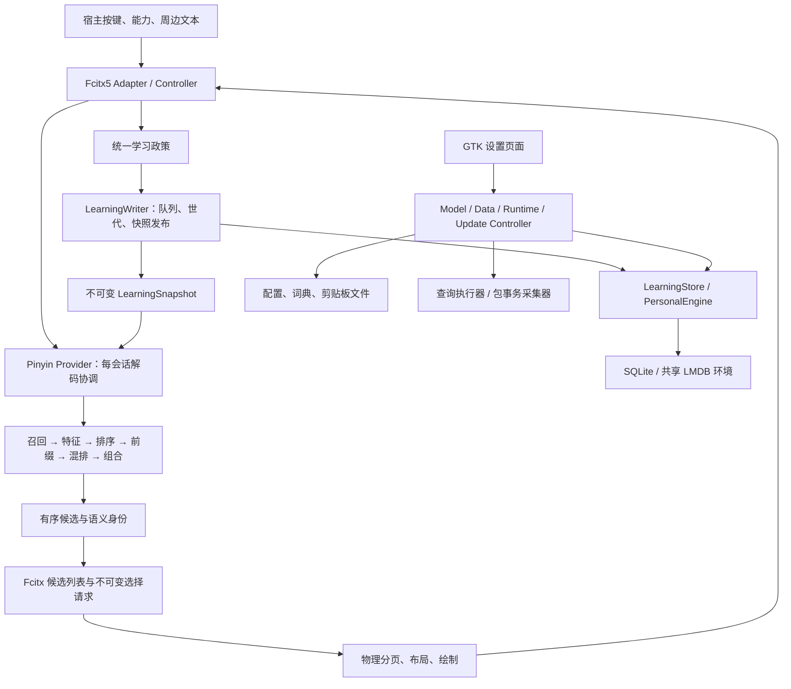

# ModernIME 架构与设计审查报告

审查日期：2026-10-26。对象：当前项目工作树。类型：跨模块架构、设计、数据边界与可维护性审查。

## 一、结论与处理顺序

**项目的总体分层有实际价值，目前最需要解决的是跨层连接处的契约缺口，以及少数仍能绕过新契约的旧入口。没有足够证据支持推倒重写、合并全部状态或继续机械拆分文件。**

候选身份、展示代次、清空世代、不可变学习快照、共享 LMDB 环境及独立包事务生命周期，分别解决不同问题。它们不能仅因复杂就被认定为过度设计。真正值得收敛的是重复的文件写入协议、查询执行机制、安装事实来源和没有真实消费者的编排分支。

本轮列出 **14 项主要发现：2 项 P1、12 项 P2**，另列 **2 项 P3 公共兼容接口问题和 5 组精简建议**。未确认需要立即停用整个项目的 P0。优先级是本报告的工程处理建议，不是漏洞评分；“已复现”仅指列明的隔离路径，不能扩展为真实桌面、全仓回归或性能验收通过。

建议先处理以下三组工作：

1. **发布前优先**：A01 候选对象生命周期、A02 剪贴板清空复活；一并修复 A03 私密临时文件权限。
2. **随后修复用户可观察边界**：A04/A05 可见候选与可选择候选不一致、A06/A07 文件编辑事实错位、A08 旧诊断状态误报、A11/A12 安装恢复与部署所有权。
3. **最后做精简与门禁收敛**：A09/A10/A13/A14，以及第五节设计债。先建立行为回归，再收敛重复实现，避免把精简本身当作验收结果。

### 主要发现索引

| 编号 | 优先级 | 问题 | 证据性质 |
|---|---|---|---|
| A01 | P1 | 特殊候选选择后读取已结束生命周期的对象 | 静态确认；未复现桌面崩溃 |
| A02 | P1 | 剪贴板清空成功后，运行端可写回旧历史 | 当前源码隔离并发复现 |
| A03 | P2 | 剪贴板临时正文文件创建时可为 0644 | 当前源码隔离复现；读取风险有目录权限前提 |
| A04 | P2 | 分页漏传读音提示，规划两项却只画一项 | 真实布局函数的合成复现＋适配代码核验 |
| A05 | P2 | 相同上下文通知使屏幕上的鼠标候选失效 | 真实控制器的合成复现＋宿主调用核验 |
| A06 | P2 | 词典编辑缺少完整读取状态及保存冲突边界 | 静态确认；未做桌面破坏性复现 |
| A07 | P2 | 保存后的设置值、hash、原始行来自不同时间点 | 静态竞争风险 |
| A08 | P2 | ModernIME 不可用时仍可能显示“已保存并应用” | 当前描述函数隔离复现＋探测路径核验 |
| A09 | P2 | 运行时查询另建无输出预算的执行器 | 静态确认；异常输出触发条件 |
| A10 | P2 | 用较晚活库条目数验证较早备份快照 | 静态确认；主要后果是误拒绝清空 |
| A11 | P2 | 回滚失败后，上层删除恢复备份 | 真实部署函数及包装入口隔离故障复现 |
| A12 | P2 | 两个部署事务没有共享前缀所有权 | 真实部署函数隔离并发复现 |
| A13 | P2 | CI、安装、发布使用不同强度的验收契约 | 配置核验＋合成门禁输入复现 |
| A14 | P2 | 资源目录整体安装会带入本机未跟踪文件 | 当前目录复制规则隔离复现 |

## 二、基线、范围与方法

### 2.1 代码与运行身份

- Git HEAD：`0e2eef72df69dd760dc3b0ffc0bd642f11db5ff5`。
- 分支：`codex/website-experience`；`CMakeLists.txt` 产品版本：`0.1.23`。
- 审查开始时有 15 个已跟踪文件被修改，涉及 README、候选排序回归测试、设置界面及 UI 布局/绘制；另有未跟踪文档和 `.mimosa`、`.v2c` 等本机目录。**本报告审查当前工作树，不等同于仅审查 HEAD，也不是某个已发布版本的验收。**
- `build/` 与 `build/install-debug/` 的 cache 均为 Release、Fcitx5/LibIME/GTK 设置客户端及测试开启；`MODERNIME_REQUIRE_FULL_TESTS=OFF`。目录名 `install-debug` 不代表 Debug 配置。
- 当时运行中的 Fcitx5 PID 为 `3910`，实际映射用户前缀下的 `modernime_fcitx5.so` 与 `modernime_ui.so`，对应 inode 为 `7096499`、`7096489`，映射无 `(deleted)`。已安装文件与 `build/install-debug/` 对应产物 SHA256 相同：引擎 `eef554f13bdd939a7664f3f93b4a851e68e7aca06e442b7799ff689e83be9964`，UI `1ad37f096a608b20012fa544c79d08b0c6c4de535e0f0bf1b07bfc2b19628344`。
- 上述只证明当时的磁盘/映射与构建产物关系，**不能证明这些二进制完全对应当前未提交源码**。未重建或替换用户插件，未重启输入法。
- 核对了 LibIME 的 CMake 查找路径、离线数据构建规则及模型搜索顺序；确认系统 `sc.dict` 存在、仓库英文释义二进制存在。未从运行中 Provider 采集最终模型命中路径，因此不对当前会话实际模型身份作完整背书。

工作树补丁、已跟踪文件 hash 和本轮检查结果保存在本机 `build/architecture-review-20261026/`。该目录是本轮证据，不是另一份长期架构台账，也不保证随 Git 克隆分发。

### 2.2 覆盖范围

| 范围 | 本轮重点 |
|---|---|
| core 候选与输入 | 输入状态、候选语义身份、消费范围、选择与学习政策 |
| algorithm/pinyin | Provider、召回/特征/排序/前缀/混排/组合、共享资源与会话状态 |
| adapter、UI | 宿主能力、周边文本、按键与鼠标、展示代次、物理分页、绘制投影 |
| 学习与持久化 | Writer、快照、清空世代、SQLite/LMDB、环境登记、事务与兼容迁移接口 |
| 设置客户端 | model、页面、异步数据操作、运行状态、查询、包事务与 D-Bus 导航 |
| 安装和发布 | 源码/便携安装、部署回滚、卸载清单、原生包钩子、签名仓库、CI 与发布工作流 |
| 数据、扩展与网站 | 离线词库构建、模型搜索、GNOME 扩展接线和生命周期抽查、网站覆盖规则及现有自动测试 |
| 维护文档和测试 | 护栏与实现一致性、必需测试 checker、注册与执行证据区分、既有保护的真实范围 |

方法包括代码与调用者追踪、职责/状态所有权核对、子审查交叉复核、隔离小程序及临时目录故障注入。重点是实际连接处，未逐条校验全部词库数据，也未穷尽每一条平台分支。未进行仓库级专门安全扫描、完整桌面 UX 审计或第三方依赖漏洞盘点。

## 三、架构现状与应保留的设计



这是一张职责图，不表示每个箭头只存在一个函数调用，也不表示本轮已验证所有箭头的完整端到端行为。

值得继续保留的部分：

1. **核心层与宿主隔离。** `core` 的 CMake 目标不反向链接 Fcitx5、GTK 或具体拼音实现。虽然核心同时承载存储实现，输入算法没有因此被迫依赖宿主 UI。
2. **语义身份与展示身份分开。** 文本、完整键、提交角色及消费范围构成候选语义；会话和展示代次约束可选权限。弱端点与不可变选择请求有助于防止旧页面选择新候选。A05 是失效后缺少重新发布，不能用删除代次校验解决。
3. **算法阶段已有实际分工。** 排序、部分候选自身证据、混排、最终组合分别有责任边界。没有理由把这些静态模块升级为动态策略框架；也不能因还有 Provider 大文件就认定拆分失败。
4. **学习输入热路径得到专门保护。** 差量事件、不可变快照、后台重建与释放，以及清空世代/快照版本的区分，都与 200,000 条容量和输入延迟有关。本轮没有证据支持撤掉这些机制或缩减容量。
5. **LMDB 资源寿命有明确设计。** 环境登记、生命周期门、revision 事务归属和锁外释放旧环境，均对应真实事故防线。A15 的遗留批量入口不等于这些保护整体失效。
6. **慢数据操作与 GTK 生命周期多数已分离。** 词典/学习页使用 Worker、代次和生命周期保护，并对列表渲染分批让出事件循环。应把这一模式补齐到确有慢 I/O 的缺口，而不是再创建通用任务平台。
7. **包事务复杂度有必要性。** Query 与真实 PackageTransaction 分离，Continuing/Uncertain、operationId、握手证据、独立采集器和有界结果队列，分别处理不同失败。页面简化为终端命令流程，不自动构成删除这些防护的依据。
8. **发布身份已有防线。** 标签绑定源码 SHA、生产签名、RPM 字节身份核对、Pages 共享发布锁和网站/仓库叠加保护值得保留。A13 针对测试证据协议分叉，不否定这些已有保护。

## 四、主要发现及最小整改建议

### A01 · P1：特殊候选刷新后继续读取失效引用

**位置：** [pinyin_candidate_provider.cpp:1063](/home/wsl/ModernIME/algorithm/pinyin/src/pinyin_candidate_provider.cpp:1063)、[刷新后读取:1076](/home/wsl/ModernIME/algorithm/pinyin/src/pinyin_candidate_provider.cpp:1076)。

`selectConfirmed()` 引用 `page_.items[request.globalIndex]`，对 `EnglishDefinition`/`Command` 候选先清空 context，再调用 `refresh()`；后者重建并清空旧候选，结束该对象生命周期。随后仍读取 `candidate.source` 来决定 `SelectionAction`。

这是静态可确认的对象生命周期错误。vector 保留容量时通常还能读到旧枚举，可能长期隐藏；本轮未复现真实桌面崩溃，不能把静态 UB 直接写成已发生崩溃。将其列为 P1，是因为该路径处于真实候选选择入口，且能以很小改动消除内存生命周期风险。

**建议：** 在刷新前把 action 固化到 outcome 值对象；刷新后不再使用旧候选引用。保留现有身份检查。验证命令候选进入剪贴板、释义正确提交且不学习，重复选择后组合与页面状态一致。

### A02 · P1：剪贴板清空与运行端保存没有同一事务边界

**位置：** [persistent_clipboard_history.cpp:149](/home/wsl/ModernIME/core/src/persistent_clipboard_history.cpp:149)、[clipboard_history_model.cpp:58](/home/wsl/ModernIME/tools/settings/clipboard_history_model.cpp:58)；运行端真实入口为 `inputmethod.cpp:766`。

运行端执行“stat 判断变化→必要时重读/重放→save”，设置页独立执行“load→clear/remove→save”。两者没有跨进程提交所有权。若设置清空发生在运行端 stat 已取得旧事实之后、save 之前，运行端会把包含旧历史的快照写回。

当前源码的隔离栅栏复现输出：

```text
settings_clear 1
runtime_exit 0 final_load 1 final_count 2
new-copy
old-history
```

即双方都报告成功，已经清空的 `old-history` 重新出现在文件中。这破坏用户明确的清空意图，涉及私密内容，所以建议发布前优先处理。运行端的外部变化检测与 pending-only 重放能保护顺序发生的操作，但不能保护检查后的竞争窗口。

另一个隔离交错确认双方会争用固定 `.tmp`：设置清空成功，运行端 rename 失败。该场景首先是保存失败和重试问题，不能夸大为已确认全部历史丢失。

**建议：** 两端复用一个事务入口，在同一跨进程提交边界内读取最新事实并应用复制/删除/清空；使用唯一临时文件。锁的职责应是保护这项文件事务，不能靠各页面增加 busy flag，也不能只换临时文件名。验证复制对清空、复制对删除、两个写者和失败重试的最终磁盘内容及返回值。

### A03 · P2：剪贴板正文先以默认权限写入，再收紧权限

**位置：** [clipboard_history.cpp:154](/home/wsl/ModernIME/core/src/clipboard_history.cpp:154)、[rename 与权限处理:193](/home/wsl/ModernIME/core/src/clipboard_history.cpp:193)。

`ofstream` 创建固定临时文件，写完正文并 rename 后，才把正式文件改为 0600。隔离探针在 umask 0022、rename 之前实测临时文件权限为 **0644**。当父目录允许其他本地用户遍历时，存在读取临时正文的窗口；异常退出还可能留下文件。

正式文件正常保存后确实会改为 0600；父目录若为 0700，其他用户通常无法沿路径读取，因此风险有明确前提，不应描述成剪贴板总是公开。

**建议：** 独占创建时即设置 0600，后续通过该文件描述符写入和检查，并清理失败残留。与 A02 的事务整改一起完成。验证创建瞬间、异常中止及最终文件权限，而非只 stat 保存成功后的文件。

### A04 · P2：分页与绘制消费了不同的候选展示投影

**位置：** [ui_addon.cpp:686](/home/wsl/ModernIME/ui/fcitx5/src/ui_addon.cpp:686)、[当前页重建:525](/home/wsl/ModernIME/ui/fcitx5/src/ui_addon.cpp:525)、[实际宽度度量:291](/home/wsl/ModernIME/ui/fcitx5/src/candidate_bar_layout.cpp:291)。

bulk 列表转换为分页输入时仅复制 text/annotation，遗漏 `readingHint`；之后当前页重建恢复了提示，最终布局会度量提示宽度。临界宽度下，分页认为本页容纳两项，绘制却在第一项后停止。数字键仍按该页边界选择，因而可能提交未绘出的第二项。

调用当前生产 pagination/layout 函数的合成探针得到 `planned_first_page=2 drawn=1`。探针模拟了适配处的字段缺失，并非真实 GTK/Fcitx 桌面端到端复现。源码调用链把这一差异接回真实消费者。

**建议：** 两处重建复用同一个展示投影，确保度量字段一致；不修改排序或语义身份。增加“提示恰好挤出第二项”的实际列表→UI 分页→绘制→数字/鼠标选择回归。

### A05 · P2：上下文失效与新页面发布没有形成完整操作

**位置：** [engine.cpp:424](/home/wsl/ModernIME/adapter/fcitx5/src/engine.cpp:424)、[宿主 watcher:522](/home/wsl/ModernIME/adapter/fcitx5/src/inputmethod.cpp:522)。

`setContext()` 在候选非空时无条件增加展示代次，即使收到完全相同的有效周边文本，也不重新 `publishPage()`。宿主周边文本 watcher 只调用该方法，因此屏幕上的 `FcitxCandidateWord` 仍持旧请求，鼠标选择被旧代次检查拒绝。数字键使用当前状态生成请求，可能与鼠标表现不同。

真实控制器合成探针：先设有效空上下文、输入 `n` 并记录展示请求，再重复同一上下文通知，得到 `context_update_republished=0 old_visible_request_accepted=0`。

**建议：** 无事实变化时不失效；确需失效时，同步生成并发布新页。保留旧请求拒绝机制，覆盖相同通知、真实上下文变化、敏感切换和键鼠一致性。未做真实宿主事件时序验收，具体桌面触发频度仍待测量。

### A06 · P2：词典召回的宽容读取被直接用于可覆写编辑器

**位置：** [UserDictionary::loadText:152](/home/wsl/ModernIME/algorithm/pinyin/src/user_dictionary.cpp:152)、[DataController::loadDictionary:84](/home/wsl/ModernIME/tools/settings/data_controller.cpp:84)、[saveDictionary:305](/home/wsl/ModernIME/tools/settings/data_controller.cpp:305)、`dictionary_page.cpp:341、350、757、981`。

这里有两个相连的缺口：

1. 文件打开失败返回空字典，非法行直接跳过，读取结束没有把完整性状态返回给页面。页面把结果视为成功并允许编辑保存。现存文件不可读或部分损坏时，新增一条后保存，可能用空/不完整视图覆盖原文件。
2. 页面保存整个内存 entries，没有 expected hash/revision。页面加载后由编辑器或外部进程新增的词条，可被稍后的 GUI 编辑、删除或合并导入覆盖。

现有页面 busy/代次保护同一页面的异步操作，临时文件 rename 防止半文件；GtkApplication 单实例减少 GUI 自身竞争。它们不能证明读取完整，也不能保护外部编辑。召回容忍坏行有可用性价值，不建议全局改成“遇到一行坏数据就停用词典”。

**建议：** 编辑读取返回内容、同次 hash、完整性和行诊断；存在但读取失败/不完整时禁止普通覆写。写入在明确的提交边界检查 expected hash，冲突保留草稿并提供刷新/合并。验证缺失文件与读取失败的区别，以及“页面加载→外部新增→GUI 保存”不会静默丢词。本项为静态确认，未用个人词典做破坏性复现。

### A07 · P2：设置保存后的值和 hash 不属于同一次事实

**位置：** [settings_model.cpp:102](/home/wsl/ModernIME/tools/settings/settings_model.cpp:102)，尤其 113–118 行；底层 [SettingsStore::save:376](/home/wsl/ModernIME/core/src/settings.cpp:376)。

保存成功后，model 把 `loaded_` 设为自己的 edited 值，另读磁盘计算 hash，再独立 load 取得 raw lines。外部写者若在这些步骤间替换文件，model 可以保留自己的值，却采用外部内容的 hash 作为下次写入基线。后续保存便可能通过冲突检测，覆盖未被正确展示的外部修改。

已有保存前 hash 冲突检测，正常单写者路径有效；风险在成功提交后重新拼装事实。此外底层 hash 检查与文件替换本身没有跨写者原子比较提交，固定 `.tmp` 也不是并发提交协议。本轮未做该窗口的动态复现，按静态竞争风险记录。

**建议：** 保存接口返回本次实际提交的内容/hash/raw lines；若选择重读，应一次返回一致事实，并显式处理其与刚提交值不同的情况。若需支持多个合作写者，再明确同一提交所有权。不得通过再加一次 hash 读取解决。验证提交成功后插入外部替换，model 的值与 savedHash 始终对应。

### A08 · P2：旧诊断 hash 可以冒充当前插件的应用确认

**位置：** [runtime_controller.cpp:322](/home/wsl/ModernIME/tools/settings/runtime_controller.cpp:322)、[状态读取:335](/home/wsl/ModernIME/tools/settings/runtime_controller.cpp:335)、[应用描述:419](/home/wsl/ModernIME/tools/settings/runtime_controller.cpp:419)。

探测到 Fcitx5 正在运行但 ModernIME 不可用后，仍读取磁盘 `runtime.state`。描述函数只根据 running、hash 和输入上下文作结论，没有要求 ModernIME 可用，也没有绑定状态文件与当前运行实例。

隔离调用描述函数，输入 `running=true、modernimeAvailable=false、inputContextAvailable=true`，并提供与保存值相同的旧 hash，输出 **“已保存并应用”**。这证明文案判定不完整；本轮没有模拟整套真实重启/保存桌面流程。

**建议：** 当前插件不可用时不能报告已应用。未绑定实例的诊断 hash 只说明历史事实；如果要承诺当前实例应用，应加入可验证的实例身份或直接运行时查询。保留状态文件不承担进程存活判断的现有设计。

### A09 · P2：运行时查询绕开已有的有界 Query 执行器

**位置：** [runtime_controller.cpp:131](/home/wsl/ModernIME/tools/settings/runtime_controller.cpp:131)，特别是 174 行；对照 [process_runner.cpp:703](/home/wsl/ModernIME/tools/settings/process_runner.cpp:703)。

更新侧使用有界 Query runner，运行状态/重载检查却另建 `GSubprocess` 路径，用 `communicate_utf8_async()` 收集全部双流输出。约 1.5 秒超时限制持续时间，不限制期间分配量；也没有采用 Query runner 的同套后代进程清理协议。

正常 `fcitx5-remote` 输出很短。问题需要异常包装器或故障输出触发，本轮未执行内存洪水或后代残留复现。已有独立 GMainContext 可避免 Worker 派发 GTK 回调，应该保留。

**建议：** 让运行时的有限查询复用有界 Query 契约；daemon 启动保留独立生命周期，真实包事务也继续遵守自己的超时语义。验证双流高输出、非法 UTF-8、继承 FD 和超时，避免为“统一”误杀需要继续运行的事务。

### A10 · P2：备份校验比较了两个时间点的活库和快照

**位置：** [data_controller.cpp:401](/home/wsl/ModernIME/tools/settings/data_controller.cpp:401)，尤其 406–415 行；词典备份也有 `282–296` 行的类似模式。

`backupTo()` 完成后才读取活库条目数，再与备份条目数比较。正常并发学习若新增条目，一份正确的一致性备份就会被误判失败；条目数相同也不能证明内容一致。这与项目护栏中“不要用不同时间活库行数替代备份自身验证”的要求不一致。

当前失败会阻断 `clear()`，所以首先是**安全失败导致操作误拒绝**，没有证据证明本路径已损坏用户数据库。也不能仅凭存在快照与 clear 之间的正常时间间隔，就声称任何这类产品语义必然错误。

**建议：** 验证备份自身完整性，并在备份接口捕获同一快照的元数据；明确备份与清空分别覆盖哪个时间点。用确定性交错在备份后新增学习记录，验证完整备份不会因活库继续变化被误判。

### A11 · P2：底层保留失败恢复材料，上层却无条件删除

**位置：** [install_lifecycle.sh:151](/home/wsl/ModernIME/scripts/install_lifecycle.sh:151)、[install.sh:368](/home/wsl/ModernIME/install.sh:368)、[便携入口模板:192](/home/wsl/ModernIME/scripts/generate_binary_installer.sh:192)、[共享包装入口:41](/home/wsl/ModernIME/scripts/install_binary_payload.sh:41)。

底层 rollback 失败时写 `FAILED_ROLLBACK` 并提示恢复文件已保留。源码 installer 的 EXIT 清理、生成便携入口的 EXIT 清理及共享包装入口，却会无条件删除事务目录。上层还可能统一提示“rollback completed”。

隔离复现使用真实部署函数与 `install_binary_payload.sh`，注入部署失败及恢复旧设置程序文件时的复制失败，得到：退出 1、旧程序文件不存在、事务目录已全部删除。底层日志仍声称恢复材料保留。源码/生成便携入口的同构删除路径经静态核验，未在真实前缀制造磁盘故障。

**建议：** 事务结果显式区分已提交、已回滚、回滚失败；只有前两种可清理。回滚失败保留备份及可定位记录，并把真实结果传给用户。保留回滚不覆盖用户数据库/配置的现有原则。

另有完整性债务：payload 成功后就删除备份，桌面整合、渠道元数据和 manifest 写入发生在后续步骤；后续失败不会恢复前面的部署。不要把目前的“payload 回滚”文案扩大为整套安装具有崩溃原子性。宜明确阶段与可恢复状态，而非备份整个用户前缀。

### A12 · P2：部署事务没有覆盖同一前缀的排他所有权

**位置：** [modernime_deploy_payload:11](/home/wsl/ModernIME/scripts/install_lifecycle.sh:11)、[rollback:109](/home/wsl/ModernIME/scripts/install_lifecycle.sh:109)，以及 install/uninstall 的实际调用入口。

每次安装有自己的事务目录，但没有覆盖同一规范前缀的跨进程事务锁。GUI 的包事务槽位及包管理器锁不能串行两个直接脚本安装，也不能保护脚本安装与卸载之间的交错。

隔离栅栏复现：A 写入后暂停并将失败，B 在期间成功提交，随后 A 回滚。结果为 `A=ROLLED_BACK、B=COMMITTED`，最终程序却是安装前的 `old`。这是两个真实部署函数调用的最小复现，未运行两套完整编译安装。

**建议：** 明确同一规范前缀的单个安装/卸载所有者，并覆盖备份、部署、元数据和清理阶段；不同前缀可以独立。回滚只能处理自己仍拥有的修改。验证两安装、安装对卸载及等待/拒绝时的错误传播，不以测试里的 `RESOURCE_LOCK` 冒充产品锁。

### A13 · P2：验收协议存在多份，发布没有消费最强的一份

**位置：** [.github/workflows/ci.yml:62](/home/wsl/ModernIME/.github/workflows/ci.yml:62)、[release.yml:87](/home/wsl/ModernIME/.github/workflows/release.yml:87)、[install.sh:343](/home/wsl/ModernIME/install.sh:343)、[verify_required_tests.py:223](/home/wsl/ModernIME/tests/verify_required_tests.py:223)。

- 日常 CI 使用 `MODERNIME_REQUIRE_FULL_TESTS=ON` 和 checker，但选 `stage=baseline`，未提交必需 GTest 套件的原生 XML 证据。
- Ubuntu 发布另写一个只有 5 个名字的必需项集合，再跑 CTest；未调用统一 checker，也未开启 full 强制依赖。它能捕获当前已注册测试失败，但不等价于项目文档要求的全部注册/执行/非法 skip/套件检查。
- 安装直接跑 CTest，允许缺少可选测试依赖时少注册目标；缺少的目标不会以失败测试出现。
- checker 自身即便选择 final 且提供 JUnit，也只有提供 `--gtest-xml` 才检查必需 GTest 套件。合成完整 CTest 名称及通过结果、完全不提供 GTest XML，final 检查仍返回成功。

最后一条是**对 checker 接口能力的合成反例**，不是本项目真实测试已通过或被绕过的运行记录。本轮未查询远程 workflow 执行结果，也未声称当前发行包已有缺测。

**建议：** 注册检查与执行验收明确为不同模式；发布执行验收要求相应 JUnit 和原生 GTest XML，消费统一契约，不另抄列表。保留 headless 白名单 skip，但显式报告。安装可以保留面向普通用户的较轻流程，不能把它的成功宣传为完整发布验收。Sanitizer、真实桌面和 200k 原生性能应作为各自证据，不能相互替代。

### A14 · P2：安装资源输入没有限制到可发布文件

**位置：** [CMakeLists.txt:86](/home/wsl/ModernIME/CMakeLists.txt:86)。

`install(DIRECTORY data/extensions/kimpanel@kde.org ...)` 无过滤复制整个工作目录。当前该目录下有未跟踪 `.mimosa/hook-state/...`，含 8 个本机状态/源文件快照。使用相同 CMake 目录复制规则向隔离前缀安装，8 个文件均被带入。

这会污染本地安装/打包产物，也可能把不应分发的本机记录带入包中。本轮未读取并披露这些状态文件正文，也未证明现有远程 Release 包含它们；干净的标签 CI checkout 一般不会有这些本机文件。

**建议：** 资源安装采用明确可发布集合，至少排除已知本机辅助目录；发布门禁核对产物文件来源。不要为修复打包规则而擅自删除用户当前辅助目录。单靠 `.gitignore` 不能阻止 CMake 整目录复制。

## 五、过度设计与可精简空间

### D01：英文资格事实被重复计算，接口还保留无消费者字段

**依据：** `pinyin_candidate_provider.cpp:1756–1846` 与 `candidate_composition.cpp:175–242` 都计算短码、完整匹配、词典身份及中文可信度。`CandidateCompositionInput` 的 `canonicalInput`、`hasPinyinCoverage`、`hasInvalidInternalPinyinSegment` 被赋值，却不被 Composer 消费。

两个阶段候选集合不同，不能直接删掉一处判断。建议先把原始语言事实与混排后的展示政策区分，再共享纯事实计算，删除确无消费者字段。保留中英仲裁原断言，不新增 EligibilityManager、注册中心或动态规则 DSL。本轮未确认由此已发生具体错排，按 P3 设计债处理。

### D02：更新页面保留了当前产品流程不可达的刷新编排

**依据：** `updates_page.cpp:35、52、193、456` 保留 RefreshCache 的请求、完成及提示分支，而 `startCheck():418–436` 只发 CheckOnly；全仓当前生产调用没有 `runSystemUpgrade()` 消费者。当前页面主要引导复制命令到终端。

建议明确哪些是兼容能力、哪些是待恢复功能，先移除页面不可达编排和不再适用的提示。独立包事务/采集器模块若保留，应有清晰消费者说明；不要一刀切删除其安全设计及回归测试。不能把源码仍有某 API 宣称成用户已能从页面使用该功能。

### D03：INTERFACE 源码聚合使设置组件被反复编译

**依据：** `tools/settings/CMakeLists.txt:13–47` 用 INTERFACE 的 `target_sources` 向每个消费者传播整组实现和 GTK/LibIME/UI 链接依赖。当前 compile database 中，`settings_shell.cpp` 编译 4 次、`process_runner.cpp` 6 次、`page_registry.cpp` 10 次；计数含专门测试目标，不代表各次都应消除。

这不是运行时 bug，但使模型/控制器测试依赖过宽，并让同一源文件在不同目标定义下产生多个构建身份。建议按业务/运行机制与 GTK 页面两层形成实际 STATIC/OBJECT 目标，对确需专用定义的测试保留例外；先消除不必要的重复编译，不建立多层插件式构建框架。

### D04：安装清单和环境整合事实重复维护

**依据：** CMake 的 install 规则、`install_lifecycle.sh:352–388` 手写 manifest、`uninstall.sh:92–122` 白名单，以及源码/生成便携入口的参数、碰撞检测、环境解析分别维护相近事实。实际已经出现 A11 的生命周期结果无法被上层正确消费。

建议从本次 staging 的实际 payload 生成安装清单，外部托管文件仍单独记录所有权；卸载保留独立边界校验，不能变成无约束信任 manifest。共享前缀/渠道/环境解析政策，但保留源码构建与便携部署机制的区别。无需引入系统级安装服务。

### D05：有些慢 I/O 仍在主循环，没必要另造调度框架

**依据：** `clipboard_page.cpp:182、322、380` 同步读取/清空/删除历史并重建 GTK 列表。上限虽为 30 条，但 `ClipboardHistory::kMaxEntryBytes` 允许每条 1MiB，合法数据可以让主线程处理数十 MiB；`settings_shell.cpp:772` 的设置保存也同步执行，但通常文件很小。

优先让剪贴板大内容复用现有 Worker＋代次＋生命周期模式，并限制显示投影成本。小设置文件先测量实际延迟，不应为了形式统一也引入复杂流水线。验证慢文件系统和大历史时事件循环仍能前进。本轮未做桌面响应时间测量。

### 应收窄的遗留公共接口（P3）

**A15：兼容全量 Flush 可回退清空世代。** [personal_engine.cpp:1593](/home/wsl/ModernIME/core/src/personal_engine.cpp:1593) 的 `FlushToLmdb()` 清空磁盘 words 后用本地 db 和 `reset_revision_` 全量覆盖，没有在同次写事务拒绝陈旧世代。双实例隔离复现：另一实例清空至 revision 1、0 条后，旧实例 Flush 成功，使 revision 回到 0、旧条目恢复。

当前正常输入链走 `LearningStore::recordBatch → RecordLearningBatch`，不调用该全量入口，事务世代检查仍在。产品中的相关路径主要是打开旧数据时自动迁移、显式迁移及兼容 API。因此本项不作为默认学习普遍复活数据的结论。建议给全量替换单独的基线契约，拒绝陈旧覆盖；显式恢复用户备份若允许改变语义，必须作为恢复操作表达。

**A16：同实例 RO→RW 返回成功却仍只读。** [personal_engine.cpp:1101](/home/wsl/ModernIME/core/src/personal_engine.cpp:1101) 的快速返回条件在请求 RW 时因 `!read_only` 恒真而直接返回。隔离复现得到 `ro_open=1、rw_reopen=1、write=0`。未找到当前产品对同一实例执行该切换的调用，已有第二实例升级回归并未覆盖这一语义。建议修正访问模式满足条件，保留受控环境升级流程；或明确不支持该转换并返回失败。

这两项的共同问题是旧公共写入/生命周期 API 仍能表达与新门面不同的契约。优先缩小可调用面和统一行为，不应再叠一层 Manager 掩盖差异。

## 六、验证结果、证据与局限

### 6.1 本轮实际执行

证据目录：[build/architecture-review-20261026](/home/wsl/ModernIME/build/architecture-review-20261026)。原始摘要为 [checks.json](/home/wsl/ModernIME/build/architecture-review-20261026/checks.json)、[probes.json](/home/wsl/ModernIME/build/architecture-review-20261026/probes.json)。

| 检查 | 实际结果 | 能证明的范围 |
|---|---|---|
| `python3 -B tests/required_tests_contract_test.py` | 退出 0；24 项 | 现有 checker 合同测试通过；不能证明未被测试的验收模式健全 |
| `python3 -B tests/website/website_test.py` | 退出 0；10 项 | 网站资源、部署政策及签名仓库叠加的现有测试 |
| 三个 Node 入口：app / install / motion | 各退出 0 | 当前模拟浏览器测试；app 入口还覆盖 install，无需重复累加为独立用例数 |
| 逐文件 `bash -n` | 15 个文件各退出 0 | 源码/卸载及主要 shell 脚本语法；不是安装行为验收 |
| `ctest --test-dir build --show-only=json-v1` | 退出 0；78 项注册；入口文件存在 | 当前注册事实；**78 项未在本轮执行，不能写为 78 项通过** |
| 候选控制器/布局合成探针 | 退出 0，复现 A04/A05 | 当前相关生产函数＋合成 Host/宽度；没有真实 GTK/Fcitx 事件 |
| 剪贴板源码并发探针 | 驱动退出 0；复现 A02/A03 | 用自有临时数据、系统调用栅栏控制竞争；固定 tmp 竞争中的运行子进程退出 2 是捕获到的保存失败 |
| 运行状态描述探针 | 退出 0，错误显示已应用 | A08 描述函数；真实 probe 生产路径另做静态核验 |
| 兼容存储探针 | 退出 0，复现 A15/A16 | 当前三个关键存储源码重编，其余依赖复用现有核心静态库；不是全新完整构建 |
| 安装恢复/并发探针 | 驱动退出 0，捕获预期失败及覆盖 | 所有文件均在独立临时前缀；不是实际用户安装 |
| 资源复制与 final checker 合成输入 | 驱动退出 0，分别确认 A14/A13 | 局部目录复制规则与验收接口行为；不是实际 Release 包或完整测试结果 |
| `git diff --check` | 退出 0 | 当时工作区空白检查；交付前再对报告及变更范围复核 |

源码探针保存在证据目录的 `probes/`；安装探针为 `install_probes.py`，结果为 `install-probes.json`。子审查最初编译运行命令保留在 `probes/复现.sh`、`probes/candidate-command-and-result.txt`，其中 `/tmp` 路径是当时执行位置；重新运行前应按当前环境重建，不能把已删除的临时路径当作可用产物。

### 6.2 未执行的范围

未运行全量 CTest、完整 GTest、200k Benchmark、ASAN/TSAN、`tests/verify_fresh_clone.sh`、真实 APT/DNF 旧客户端升级或 GNOME/Wayland/Qt 桌面端到端验证。未修改产品，因此没有为了报告重新构建、部署或清空用户输入数据；这些专项在本报告中均是**未执行**，不是跳过后计通过，也不是环境阻断。

没有以旧验收报告代替本轮结果。对模型命中、真实桌面触发频率、长期故障恢复及远程发布状态仍有明确局限。静态确认的问题应在整改时补成能在旧行为上失败的真实消费者回归。

## 七、整改验收建议

不建议把这些发现组织成一次横跨全仓的大重构。按契约分批，每批保持可回退、可独立验证：

| 批次 | 范围 | 完成判据 |
|---|---|---|
| R1 | A01–A05：候选与剪贴板 | 消除失效引用；显示页、请求代次及实际可见项一致；复制/删除/清空并发不复活旧记录；临时文件创建即私有 |
| R2 | A06–A10：文件编辑与运行事实 | 不完整读取不能普通覆写；并发编辑有明确冲突；内容与 hash 同源；旧诊断不冒充当前应用；查询输出有界；备份验证不比较不同快照 |
| R3 | A11–A14：部署和发布 | 失败恢复材料真实保留；同前缀事务串行且所有权明确；安装阶段状态可解释；发布消费统一执行契约；产物仅含允许分发文件 |
| R4 | A15/A16 与 D01–D05 | 遗留 API 不绕过世代/访问权限；删除无消费者状态；减少重复政策/构建成本；慢 I/O 有测量和针对性迁移 |

涉及算法、选择和持久化时，继续遵守现有 ALG/CAND 契约及原断言；不以降低 200,000 条能力、放宽原生延迟门限、跳过真实消费者或吞退出码实现通过。安装及较大架构整改完成后，再按项目规范执行全新克隆安装/卸载及对应发布门禁。

本轮交付只新增审查报告和本机证据，未实施上述整改，未替其他任务提交、推送或发布。
