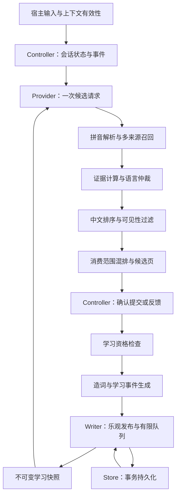

# ModernIME 算法架构与特性契约

> 日期：2026-10-15。本文以当前工作区（含当日个性化修复）为基线。
> 状态：**设计方案与维护规范**。现有代码位置已经核对；下文标为“目标”或“迁移”的接口、目录、回放框架和 CI 检查尚未实现。已落实的候选核心模块见第 3.1 节，其余目标接口仍按迁移计划实施。

## 1. 设计目标与文档分工

目标是让维护者增加、删除或调整一项特性时，能够回答：它在哪个阶段执行、能读取和修改什么、依赖哪些成熟行为、需要通过哪些验证。模块拆分服务于行为稳定，不能以“统一实现”为由改变已有排序、学习或数据保留规则。

文档按总览、子系统细化、变更流程和历史记录分工，避免多份方案互相覆盖。子系统文档只细化本领域职责，不另建学习库或演化台账：

| 文档 | 负责回答 | 更新时机 |
|---|---|---|
| 本文 | 当前模块在哪里、目标如何分工、每项特性必须保留什么 | 职责、契约、依赖或迁移状态变化 |
| [候选排序、混排与排版架构](候选链路架构.md) | 学习如何传到最终位置、派生证据如何合并、候选如何组合分页及正确选择 | 候选子系统职责、政策、晋升验收或迁移状态变化 |
| [算法变更指南](算法变更指南.md) | 新增、修改、停用、删除如何操作与验收 | 流程或验证入口变化 |
| [算法演化手册](算法演化记录.md) | 已经实现过什么、为什么、体验底线是什么 | 算法实现通过验证后追加历史 |

[2026-10-15 个性化审查](自学习复审-2026-10-15.md)是一次审查和修复的证据记录，不替代长期架构入口。历史设计保留在 `docs/superpowers/`，发生冲突时先核对当前构建、代码和测试，不能把旧设计直接当成已实现事实。

文档和测试可以降低并阻止已知退化，无法证明所有应用、词库和输入组合永远不变。保护方式是：明确契约、记录影响范围、验证组合行为、保留可回退路径；未来 CI 落地后再由自动检查阻止漏项。

## 2. 方案选择

| 方案 | 收益 | 成本与局限 | 选择 |
|---|---|---|---|
| 固定处理流程、明确契约，逐步提取策略 | 保留现有成熟算法；能按阶段验证和回退 | 需要先补差异回放，再小步拆分 | **采用** |
| 只把现有文件拆小、补目录说明 | 改动小、容易开始 | 相同语义仍可能分别实现，特性互相覆盖的问题仍在 | 只作为局部手段 |
| 改为动态算法插件和通用规则引擎 | 扩展自由度高 | 执行顺序、状态、版本与性能更难约束，当前没有必要 | 暂不引入 |

原则：**一个阶段有一个协调者，一份状态有一个写入所有者，一项成熟行为有一个稳定契约 ID。** 不要求把不同用途的公式合成同一个公式，也不要求一个特性只能在一个文件里实现。

## 3. 当前结构及问题所在

实际构建边界由 [core/CMakeLists.txt](../core/CMakeLists.txt)、[algorithm/pinyin/CMakeLists.txt](../algorithm/pinyin/CMakeLists.txt) 和 [adapter/fcitx5/CMakeLists.txt](../adapter/fcitx5/CMakeLists.txt) 定义。

| 当前模块 | 已有职责 | 需要约束的边界 |
|---|---|---|
| Fcitx5 `inputmethod.cpp` | 宿主事件、能力与敏感状态、周边文本采集 | 传递宿主事实，不追加另一套排序或学习规则 |
| `ModernIMEController`，`engine.cpp` | 按键、组合状态、提交、上下文有效性、删字证据 | 保留宿主相关状态机；学习政策不再不断堆入按键分支 |
| `PinyinCandidateProvider` | LibIME 会话、候选生成、英文仲裁、混排、提交学习协调 | 职责最多；逐步成为协调者，算法细节提取为可测策略 |
| Pipeline / Features / PrefixEvidence / Mixer | 分别负责召回合并、统一特征、前缀自身证据和中文多粒度席位 | 不在召回、前缀或 UI 中复制评分；Mixer 不访问学习存储 |
| `PinyinMatchPolicy` / `CandidateRanker` | 拼音匹配、中文排序与稳定性 | 保持无持久化 I/O；比较器必须保持严格弱序 |
| `PhraseFormationTracker` / 共享统计 | 组合内分段、跨组合重复造词 | 先通过学习资格判断，再修改跟踪器或共享统计 |
| `LearningSnapshot` | 不可变学习视图、索引、召回与学习增益 | 热路径按局部分片更新；已发布版本不可变化 |
| `LearningWriter` | 乐观快照、有限队列、异步持久化、清空代次协调 | 输入线程不承担后台整库重放和磁盘写入 |
| `LearningStore` / `PersonalEngine` | SQLite/LMDB 存储门面、事务与 LMDB 兼容接口 | 共享事件语义需有一致性测试；后端排序与剪枝差异要明示 |

当前并不是没有模块，而是跨模块约定多以分支、常量和调用顺序隐含存在。尤其需要避免：召回入口绕过屏蔽、学习关闭后跟踪器继续累计、重构时误把“显示来源”当成“学习角色”、统一衰减参数导致排序变化。

修复前已复现部分候选留在尾部、派生前缀覆盖自身证据的问题；本轮核心模块已落实晋升和证据修复，详见第 3.1 节及[候选架构第 0 节](候选链路架构.md#0-本轮落地的结构与扩展入口)。历史证据保留用于对照，不把旧错误位置冻结成兼容行为。

### 3.1 已落实的候选核心边界（2026-10-15）

Pipeline 负责采集/合并；`candidate_features` 统一所有中文来源的特征计算；Ranker 保持匹配与简拼资格，再计算有界先验、持久学习与近期意图；`candidate_prefixes` 独立形成前缀自身证据；Mixer 只编排中文多粒度席位；UI 只分页布局。Provider 保留协调与既有语言/模式策略，继续渐进瘦身。详见[候选架构第 0 节](候选链路架构.md#0-本轮落地的结构与扩展入口)。

后续加分项改 Features/Score；新来源改 Pipeline；中文席位改 Mixer；页面宽度改 UI。任何跨层特性必须补最终位置、消费和提交验收。移除近期模块时同时移除记录/清理接线与对应评分字段，不能留下隐式状态；持久学习不因此删除。

## 4. 目标数据流与执行顺序

下面是目标职责图，沿用现有接口作为迁移起点；图中的分阶段协调尚不是一套新实现。

### 4.1 候选读取流程

1. **采集事实**：宿主返回 `Valid`、`Unavailable` 或 `Invalidated`；敏感场景不读取周边文本。固定本次请求的时间和学习快照，避免一次评分混用多个版本。
2. **解析与召回**：全拼、简拼、混拼、纠错、LibIME、用户词典、个人词和英文分别产生候选证据。召回不能增加学习次数。
3. **计算证据与仲裁**：保留匹配等级、原生位置、词典先验、学习、上下文和语言资格。中文短码保护属于资格/优先级规则，不能被任意英文加分抵消。
4. **排序与过滤**：中文排序遵守当前匹配优先级、简拼提升和最终代价规则；所有可展示来源最终必须服从持久屏蔽。英文仲裁不能藏进中文代价公式。
5. **混排与提交校验**：区分整句、词和部分候选，生成消费字节数及候选页代次。提交必须对应当前候选页；只消耗候选声明的原始输入范围。

**顺序也是兼容性的一部分。** 当前中文管线先计算与排序，再由 Provider 过滤屏蔽项；不能直接把过滤提前到评分前，因为候选集合变化会影响解码分数归一化。迁移初期保留现有顺序。若未来希望提前过滤，须作为行为变更单独验证，不能包装成纯拆文件。

### 4.2 学习写入流程

1. Controller 提交事实或经过确认的反馈，Provider 在修改造词状态前检查学习资格。
2. 正常提交、负反馈、持久屏蔽是不同事件；取消预编辑、原始文本、命令和释义展示不能冒充中文选择。
3. Writer 在当前清空代次下更新乐观快照并入有限队列；旧快照继续可读。
4. Store 在事务内完成同批事件、上下文裁剪、容量剪枝和代次校验；失败不能留下半批结果。
5. 后台读取一致的“条目＋清空代次”，在输入锁外构造重放结果；版本仍匹配时发布。同代次的新输入不能被旧后台结果覆盖；更高的清空代次必须优先使旧事件失效。

现有事务重试保证同一批次正常重试不重复计数，**不等于已有跨崩溃的全局事件去重协议**。未来若引入持久事件日志，应另建契约并设计事件身份，不能把本地快照版本当成事件 ID。

## 5. 数据与状态的所有权

| 数据或状态 | 所有者与寿命 | 其他模块的权限 |
|---|---|---|
| 原始输入、候选页、选中位置 | 单个 Controller/Provider 会话 | 通过接口读取；不能跨会话共享可变页 |
| 周边文本、删字待确认状态、连续提交历史 | 当前会话；失效边界立即清理 | 只把本次允许使用的上下文交给算法 |
| LibIME 资源、用户词典、学习 Writer | `SharedResources` 共享资源 | 各 Provider 复用；不另开隐藏的学习写入口 |
| 组合内造词片段、连续提交序列 | 单个 `PhraseFormationTracker` | 不因共享统计而跨会话拼接片段 |
| 近期明确选择窗口 | 单个 Provider 的 `RecentChoices`，64 组 × 8 次 | Features 只读；不进入 SharedResources 或磁盘；显式会话边界清除 |
| 正常造词累计次数 | 共享 `PhraseFormationStats` | 敏感或禁学输入不修改；切换禁学清临时序列，保留正常统计 |
| 已发布学习快照及其分片/缓存 | Writer 发布、读者共享持有 | const 查询；新学习只生成新版本 |
| 待写、正在写的事件及发布版本 | Writer | Store 不回调修改 Controller；失败队列有界 |
| 持久记录、清空代次、存储模式 | Store/后端事务 | 设置清空和输入写入遵守同一代次协议 |

三个概念必须保持独立：存储 schema 版本表示数据格式；`resetRevision` 表示用户清空后的数据世代；`snapshotVersion_` 表示本进程乐观发布是否已被新输入更新。三者不能互换。

上下文限制也不能混为一个数字：宿主采集/Controller 连续回退窗口最多 32 字符，PersonalEngine 清洗窗口最多 12 个 UTF-8 字符；每词最多八个非空上下文变体，另保留通用变体。调整任何一层都需要检查其他层的匹配与隐私行为。

## 6. 身份、角色与策略配置

### 6.1 候选与事件身份

沿用 [CandidateItem](../core/include/modernime/core/candidate_model.h) 和 [CommitEvent](../core/include/modernime/core/commit_event.h)，迁移时区分以下字段的语义：

- `text` 与规范完整拼音表示词条身份；中文拼音保持全拼/分隔符兼容，英文按完整词学习。
- 原始击键和 `consumedInputBytes` 表示本次消费范围；英文补全键是完整词，但消费字节数仍是用户实际键入的前缀长度。
- `CandidateSource` 表示显示/召回来源；`CommitCandidateRole` 表示本次提交如何参与学习，不能相互替代。
- 页面 `generation` 表示展示版本，`sourceIndex` 表示原生候选位置；排序重排后不能把它们当同一种下标。
- 旧英文前缀键在召回时按规则聚合；精确 `entry()` 仍只返回指定键。不能为了兼容召回而扩大精确查询的语义。

### 6.2 命名策略，保留用途差异

以下名称是建议采用的策略名称，当前常量仍在原文件中。先给用途命名并冻结行为，再考虑集中配置；不能先统一参数。

| 建议策略名 | 当前实现与基线 | 作用范围 |
|---|---|---|
| `PersonalQueryRecency` | `PersonalEngine`，默认半衰期 7 天，α=1.2、β=2.5 | PersonalEngine 自身查询动态得分 |
| `SnapshotLearningRecency` | `LearningSnapshot::boostAt` 及召回，半衰期 30 天 | Provider 使用的快照学习增益，含频率平滑及负反馈 |
| `RankerDormancy` | `CandidateRanker`，半衰期 12 小时 | 同匹配等级候选相对最新选用时间的渐进提升折扣；并非距当前时间的词库遗忘 |
| `ChineseRankWeights` | `candidate_ranker.h` 中词典、学习、上下文及解码权重 | 中文候选最终代价；不是英文放行规则 |
| `EnglishEligibility` | Provider 与英文词典的短词、前缀及技术术语规则 | 英文是否可补全、展示或优先 |
| `LearningCapacity` | 默认最大容量 200,000；直接使用 PersonalEngine 时超限剪枝目标 160,000 | Snapshot/SQLite 保留到上限；LearningStore 的 LMDB 门面将容量和剪枝目标都设为上限；不能混同独立 PersonalEngine 的默认策略 |

上述三个时间机制相互补充，不能被一个全局 `halfLife` 覆盖。所有时间公式使用明确单位，并在测试中注入固定时间；半衰期使用 `tau = halfLife / ln(2)`。

### 6.3 热路径预算

以下是当前实现中的局部预算，不是整个候选页的统一数量上限。新来源必须声明自己的工作量与合并位置，不能假定每加一个有限循环，总耗时仍然有限到满足门禁。

| 当前预算 | 实现位置 | 迁移时需要保护 |
|---|---|---|
| 原生候选最多评分 128 个，纠错补充最多遍历 16 个 | `candidate_pipeline.cpp` | 保持常用候选覆盖；调整数量需同时验证简拼耗时与排序质量 |
| 快照前缀召回全局扫描预算 256、结果最多 16 个 | `learning_snapshot.cpp` | 是跨分片的全局预算，不能按分片顺序截断而漏掉有效词 |
| 不可变快照 512 个共享分片 | `learning_snapshot.cpp` | 局部更新、局部满容量淘汰；分片数调整需重测分布和复制成本 |
| 故障待写队列最多 100 条事件 | `learning_writer.h` | 故障持续时淘汰最旧待写事件；不保证断电后保留内存事件，不影响持久词库容量 |

这些数字不应散落为新模块各自的“优化常量”。提取策略时记录来源、用途和对应 Benchmark；确需修改预算时按行为与性能变更验收。

## 7. 成熟特性契约目录

ID 永久稳定。特性停用后保留 ID 和历史，不能把旧 ID 分配给新含义。表中的测试是现有入口，表示已有覆盖，不表示该契约所有组合均已穷尽；组合缺口须在具体变更中补充。

| 契约 ID / 特性 | 必须保留的行为 | 当前实现入口 | 现有验证入口 |
|---|---|---|---|
| `ALG-PINYIN` 拼音解析 | 全拼/简拼/混拼及无撇号兼容；`wangshaolong` 可生成 `wsl` | `pinyin_match.cpp`、快照索引 | `modernime_pinyin_match`；Snapshot 回归 `DigraphInitialsRemainIndexedAfterPublication` |
| `ALG-TYPO` 容错 | 重复元音与模糊补充不破坏正常中文；保留 CommonTypo 构建能力检查 | Provider、`candidate_pipeline.cpp` | `modernime_pinyin_quality`、`modernime_pinyin_provider` |
| `ALG-ZHEN` 中英仲裁 | `de/shi/qu` 高频中文保护；中文声母不被生僻英文抢占，已学技术词可补全；含内部非法音节的解码项不能作为完整精确拼音提前否决英文 | Provider、英文词典 | `modernime_english_arbitration`、`modernime_personal_engine_gtest` |
| `ALG-RANK` 中文排序 | 匹配等级与可信简拼规则优先；偶发选字不破坏常用字，重复学习能上位；模糊音组间晋升仅限全拼输入（简拼段数不得视为音节数）；比较器无环 | `candidate_ranker.h/.cpp`、管线 | `modernime_pinyin_match`（排列传递性）、`modernime_pinyin_quality` |
| `ALG-DECAY` 遗忘与频率 | 对数频率、各自时间机制、负反馈和近期学习保持原用途 | `personal_engine.cpp`、`learning_snapshot.cpp`、Ranker | `modernime_personal_engine_gtest`、`modernime_learning_store`；迁移须补齐三策略固定时钟对照 |
| `ALG-CONTEXT` 上下文 | 有效空文本清除旧上下文；仅不支持采集的连续输入可回退；失效状态丢弃待确认证据 | `inputmethod.cpp`、`engine.cpp`、学习清洗 | Controller 回归；`modernime_engine_state` |
| `ALG-GATE` 学习资格 | 密码/敏感和禁学场景既不入库，也不累计共享造词次数；恢复不补记 | Controller、Provider、Tracker | Provider 回归 `SensitiveRoundsDoNotContributeToSharedFormation`、`LearningToggleClearsTransientSequenceButKeepsNormalStats` |
| `ALG-FORM` 分段造词 | 正常三轮重复可成词；只学习已消费音节；取消和边界清临时序列 | Tracker、Provider、CommitEvent | `modernime_pinyin_engine`、`modernime_personal_engine_gtest`、`modernime_pinyin_daily_simulation` |
| `ALG-EXTRACT` 单字提取 | `[`/`]` 独立学习目标字；删词留字在下一正常输入确认；移动、敏感、继续删光不误学 | Controller、Provider | Controller 回归；`modernime_pinyin_provider`、`modernime_pinyin_engine` |
| `ALG-SUPPRESS` 持久屏蔽 | 系统、学习、英文来源都遵守；跨前缀/会话/重启有效；明确重选按规则恢复 | Provider、Snapshot、Store | Provider 回归、Storage 回归 `GenericSuppressionBlocksPrefixContextVariants` |
| `ALG-IDENTITY` 学习身份 | 英文完整词键；旧别名兼容且不混淆精确查询；消费范围独立 | CommitEvent、Snapshot、Store、Provider | Snapshot 回归 `ExactEntryDoesNotReturnEnglishPrefixAlias`；Provider 英文补全回归 |
| `ALG-CAPACITY` 容量 | 默认最大容量 200,000，保留 PersonalEngine 160,000 剪枝目标及后端现行边界；故障队列 100 不是词库容量 | Snapshot、Store、PersonalEngine、Writer | Snapshot 满容量回归、Storage 剪枝回归、Benchmark |
| `ALG-SNAPSHOT` 发布与延迟 | 旧快照不可变；局部分片更新；全局前缀预算；后台旧结果不覆盖新输入 | Snapshot、Writer | Snapshot 回归、`modernime_personal_engine_benchmark` |
| `ALG-STORE` 持久化 | 同批原子写入与有界重试；清空代次一致读取；旧事件不复活；旧格式可兼容 | Store、PersonalEngine、Writer | Storage 回归、`modernime_learning_store`、GTest、安装升级验证 |

源码链接：[匹配](../core/src/pinyin_match.cpp)、[排序](../core/src/candidate_ranker.cpp)、[Provider](../algorithm/pinyin/src/pinyin_candidate_provider.cpp)、[造词](../core/src/phrase_formation.cpp)、[Controller](../adapter/fcitx5/src/engine.cpp)、[Snapshot](../core/src/learning_snapshot.cpp)、[Writer](../core/src/learning_writer.cpp)、[Store](../core/src/learning_store.cpp)、[PersonalEngine](../core/src/personal_engine.cpp)。

回归文件：[快照](../tests/core/personalization_snapshot_regression_test.cpp)、[存储](../tests/core/personalization_storage_regression_test.cpp)、[Provider](../tests/core/personalization_provider_regression_test.cpp)、[Controller](../tests/core/personalization_controller_regression_test.cpp)。它们注册在同一个 `modernime_personal_engine_gtest` CTest 入口中。

## 8. 依赖与必须联测的交互

依赖分为“提供事实/数据”与“提供政策”。普通召回来源只提供候选，不拥有屏蔽、学习资格或清空政策；这些公共政策不能通过给新来源开旁路绕过。

| 修改对象 | 必须同时检查的契约与场景 |
|---|---|
| 拼音解析、索引或纠错 | `PINYIN + TYPO + RANK + FORM + IDENTITY`：全/简/混拼、zh/ch/sh、部分消费、同字不同拼音 |
| 中英仲裁、候选来源或分数 | `ZHEN + RANK + SUPPRESS + IDENTITY`：短码、已学英文、旧前缀键、被屏蔽系统候选 |
| 上下文和学习开关 | `CONTEXT + GATE + FORM + EXTRACT + STORE`：普通→敏感→普通、有效空文本、不可用、失效、清空后继续输入 |
| 频率、衰减或负反馈 | `DECAY + RANK + ZHEN + CAPACITY`：偶发/重复选择、短中文、固定时间推进、容量淘汰 |
| 快照、队列、后端或迁移 | `SNAPSHOT + STORE + CAPACITY + SUPPRESS + IDENTITY`：故障恢复、重试、清空竞争、旧格式、满容量 |

表中简称均指 `ALG-` 前缀的契约。涉及一行并不意味着只测这一行：沿数据依赖继续扩展到消费者；未影响的契约也应写明理由。

敏感输入、学习禁用、明确持久屏蔽、用户清空和消费范围正确性属于公共边界，优先于新特性的加分、召回或学习需求。关闭一个可选特性必须回到已定义基线，不能同时关闭这些公共边界。

## 9. 渐进迁移设计

以下阶段均为待实施，不能据此把当前代码描述为已完成重构。每阶段独立提交、独立验收；前一阶段未过关，不开展依赖它的拆分。

| 阶段 | 范围 | 验收与回退 |
|---|---|---|
| M0 固定行为证据 | 以现有测试为起点，建立固定时钟、词库版本、事件序列和旧数据夹具的差异回放 | 覆盖本目录 14 个契约及关键交互；输出、消费范围、学习状态和清空代次可比较；尚缺的覆盖明确列出 |
| M1 提取只读策略 | 从 Provider 逐项提取英文资格、身份归一化、候选证据与协调阶段；先保持公式及操作顺序 | 无意图行为变化的场景结果相同；每次只提取一种职责，可直接回退代码 |
| M2 提取学习决策 | 将资格判断、造词输入与反馈转换形成独立协调边界，宿主删字证据仍由 Controller 提供 | 敏感/禁学零副作用，普通造词与留字行为不变；不引入第二写入通道 |
| M3 收敛学习语义 | 为 Snapshot、SQLite、LMDB 建立同事件流一致性套件，再逐项提取共享归一化/事件变换规则 | 比较频率、屏蔽、上下文、别名与清空；后端明确允许的排序/剪枝差异单独断言，不能盲目要求全量相等 |
| M4 自动化准入 | 将契约引用、必需测试存在性、回放差异和独立 Benchmark 纳入 CI | 缺少必需测试直接失败；性能与功能分别留证据；文档检查不冒充语义验证 |

建议提取后的逻辑职责为 `recall`、`eligibility`、`ranking`、`composition`、`learning_policy`；这是职责划分，**不要求立即创建这些目录、重命名现有公共 API 或新增动态插件系统**。小规模策略可先留在现有构建目标中，验证稳定后再调整目录。

M3 的共同语义层只统一事件含义及规范化，不强制统一物理索引、得分公式、写事务或容量剪枝实现。先以一致性测试发现差异，再逐个判定差异是既有政策还是缺陷。

纯代码提取应不改变数据格式；若确需迁移数据，必须独立安排备份、格式兼容、失败恢复和旧版本读取策略。代码可回退不代表新数据可被旧程序安全读取，详见[变更指南](算法变更指南.md)。

## 10. 后续维护的最小动作

新增特性：先登记新 ID、阶段、状态权限及依赖，再补失败用例，实现后联测并追加演化记录。

调整成熟算法：列出现有 ID 和预期变化，只更新经过说明的断言；没有意图改变的场景保持原断言。

删除或停用：先区分“关掉算法行为”和“删除用户数据”，检查依赖者与历史数据读取兼容，保留退役 ID 和演化记录。

每次只改一个明确的行为目标。优化延迟不得缩小默认词库容量，改善英文召回不得削弱短码中文保护，减少状态不得让敏感输入进入共享统计。
