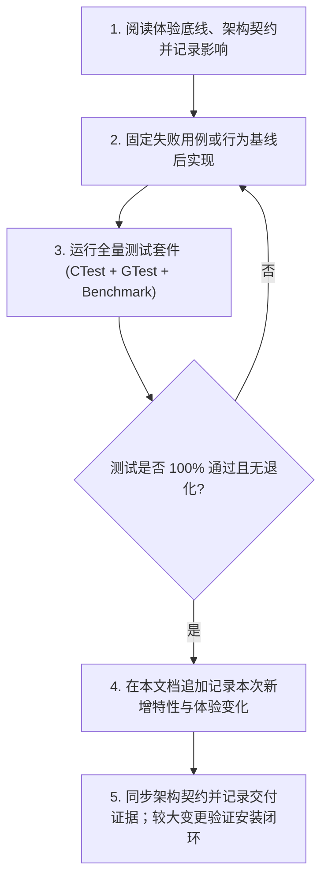

# ModernIME 算法演进、打字体验与防退化规范手册
*(Algorithm Evolution, User Experience Baseline & Anti-Regression Manual)*

> **【强制执行铁律 / Golden Rule】**  
> 任何开发者、维护者或 AI 智能体在对 ModernIME 的**候选排序、拼音切分、中英仲裁、自学习、造词、纠错或数据持久化算法**进行修改、重构或升级之前，**必须完整通读并严格遵守本文档**。  
> 每次算法更新，**必须保证不破坏、不覆盖以往沉淀的任何算法特性**。更新完成后，必须在本文档中如实追加新增特性及其对实际打字体验带来的变化。

维护入口（2026-10-15 整理）：[算法架构与特性契约](算法架构.md)描述模块职责、现有策略差异和渐进迁移方案；[算法变更指南](算法变更指南.md)提供增删流程、影响分析模板与验证要求。本文继续负责已实现特性历史和体验底线，避免把设计方案登记成已经实现的算法。本轮候选核心模块的实现记录见特性 10，未迁移目标仍明确标注为设计。

[候选排序、混排与排版架构](候选链路架构.md)记录随后复现的学习晋升阻断、派生前缀证据丢失及对应模块化设计。已完成的学习/存储修复与候选核心结构优化分别记录在特性 9、10；全来源统一仲裁及诊断框架仍待迁移。

[2026-10-15 模拟使用记录](算法使用仿真报告-2026-10-15.md)进一步用真实控制器连续提交、重新打开隔离词库和 36 组布局实测复核现状：第 1–7 节保留修复前问题，第 8 节记录结构优化后的真实控制器复测及会话/持久策略差异。

---

## 一、算法更新前必读核对清单 (Pre-Update Checklist)

在修改任何算法代码前，必须逐项核对以下体验底线，确认本次改动不会造成任何负向退化：

- [ ] **高频中文保护**：输入常见短拼音（如 `de`、`shi`、`qu`）时，高频中文（如“的”、“是”、“去”）是否稳居第一位？绝不允许被长英文单词（如 `developer`）或英文前缀预测抢占首候选。
- [ ] **英文生僻词与缩写防骚扰**：输入拼音声母缩写（如 `wsl`、`sjw`、`cmd`）时，是否优先召回已学习的中文人名/短语（如“王绍龙”），绝不出现生僻英文单词或荒谬俚语释义（如 `wsl (威塞尔斯布隆病毒)`、`git (饭桶)`）霸榜？
- [ ] **艾宾浩斯遗忘与新词上位平衡**：近期密集使用的词条能否在指数衰减加权下快速升至首位？同时对数词频项是否有效遏制历史超高频词永久霸榜？
- [ ] **上下文感知与隐私安全**：光标前存在技术上下文（如“编写嵌入式Linux”）时，相关联候选（如“驱动”）能否智能跃升？跨应用、换行或光标移动后，旧会话上下文与待学习证据是否正确失效，并仅使用当前有效上下文？在密码框（Password）或敏感场景下，是否绝对阻断上下文读取与学习记录？
- [ ] **分段造词与消费一致性**：分段连续输入 3 次（如“王→绍→龙”、“候选→栏”）能否无感自动合成新词？部分音节选择（输入 `nihaoma` 只选 `你好`）时，记录的拼音是否严格为已消费的 `ni'hao`，严禁记录未消费的 `ma`？
- [ ] **以词定字与退格留字提权**：使用快捷键 `[` 取首字、`]` 取末字，或者打出整词后退格删词留单字时，上屏与单字学习是否准确独立，且目标单字在后续单独输入对应拼音时是否立即获得高优排序？
- [ ] **个人大词库容量保障**：学习数据库默认容量上限必须保持在 **200,000 条**，独立 PersonalEngine 默认剪枝目标为 160,000 条；Snapshot、SQLite 与 LearningStore 的 LMDB 门面按各自现行边界保留，详见[架构策略说明](算法架构.md#62-命名策略保留用途差异)。严禁引入过小默认上限（如旧版的 20,000 条），防止用户个人数十万级历史词库被静默删除。
- [ ] **外部词库防污染与核心高频词锚定**：导入外部词典（如微信输入法导出词库）时，单字导入频次是否严格限制在安全上限（单字 $\le 3$ 次，短语 $\le 20$ 次）？系统核心单字（如“是”、“的”、“你”）与核心成词（如“这个”、“不是”、“好的”、“可以”）是否受到基线锚定保护（`unigram_anchor` 与系统词典首选先验保护）？绝不允许非词典生僻词（如“这歌”）或单字次选（如“试”、“地”）因外部导入频次膨胀而篡位霸占日常打字首选。
- [ ] **千轮高频打字压力测试**：修改排序、先验或自学习增益后，必须跑通至少 1,000 轮日常高频打字压力模拟基准（覆盖 14 组核心单字/成词与连续偶发次选干扰），篡位率必须为 **0%**。
- [ ] **延迟门禁**：高负载（50,000+ 词条）下，候选词召回热路径 P99 延迟必须严格维持在 **$< 1.0\text{ ms}$**（当前基准约 $0.02\sim0.04\text{ ms}$），严禁引入全表扫描或阻塞式 I/O。

---

## 二、算法演进全量特性台账 (Feature Ledger)

### 特性 1：拼音音节切分与全简拼无撇号双向解析
- **引入版本**：`v0.1.7` / 完善于 `v0.1.8`
- **核心逻辑**：
  - 基于 400 个标准普通话音节有序表的回溯动态切分算法（[`PinyinMatchPolicy::segmentPinyin`](file:///home/wsl/ModernIME/core/src/pinyin_match.cpp)）。
  - 双向兼容：支持带撇号音节（`wang'shao'long`）与无分隔符连续拼音（`wangshaolong`）的无损互转，自动提取精准声母序列（`abbreviationKey("wang'shao'long") -> "wsl"`）。
- **给实际打字体验带来的变化**：
  - 用户无需繁琐敲击单引号或空格切分音节，一气呵成连打即可精准匹配；
  - 支持全拼、纯声母简拼（如 `wsl` 召回“王绍龙”）、中长词混拼（如 `qudonglc` 召回“驱动流程”）；
  - 历史学习数据库无论有无分隔符，均能建立完整的简拼索引。

---

### 特性 2：中英统一仲裁与多阶防抢占机制 (Anti-Hijacking)
- **引入版本**：`v0.1.8`
- **核心逻辑**：
  - **无元音缩写与生僻词剔除**：在英文词典中剔除 2 字母无元音缩写及生僻缩写，建立常用 3-4 字母常用词白名单（[`kCommonShortEnglishWords`](file:///home/wsl/ModernIME/core/src/english_dictionary.cpp)）。
  - **阶梯门禁**：未学习的静态英文前缀预测门槛提升至输入长度 $\ge 4$；英文释义括号展示门槛限制在 $\ge 4$ 字母真实英文单词。
  - **短拼绝对中文优先**：当输入长度为 2-3 字母且对应中文高置信度高频字词时，英文绝对不抢占首位。
  - **技术术语前缀补全**：已学习的英文技术术语（如 `gnueabihf`），在输入 `gnu` 或 `gnue` 时，作为前缀补全候选高优推荐。
- **给实际打字体验带来的变化**：
  - **彻底告别生僻英文霸屏**：打 `wsl` 时再也不会跳出荒谬的 `威塞尔斯布隆病毒`；打 `git` 不会被侮辱性的俚语 `饭桶` 抢占；
  - **常用单字稳如磐石**：打 `de` 第一候选永远是高频中文“的”，绝不被用户学习过的英文单词 `developer` 顶掉；
  - **编程与英文术语输入极度顺手**：敲入工具链或命令前缀即可直出专业术语，中英文混输体验和谐。

---

### 特性 3：对数频次平滑与艾宾浩斯时间衰减 (Adaptive Frequency & Recency Decay)
- **引入版本**：`v0.1.8`
- **核心数学模型**：
  $$\text{dynamic\_score} = \text{base\_weight} + \alpha \ln(\text{count} + 1) + \beta \exp\left(-\frac{\Delta t}{\tau}\right) + \gamma \cdot \text{context\_factor}$$
  - $\alpha = 1.2$（对数频次增益，边际递减）；
  - $\beta = 2.5$（时间新鲜度初始增益）；
  - $\tau = \frac{T_{1/2}}{\ln 2}$，以 $T_{1/2} = 7 \text{ 天}$（604,800 秒）严格换算物理半衰期；快进 7 天衰减 $50\%$，快进 30 天衰减至约 $5.1\%$；
  - `LearningSnapshot::boostAt` 提供 30 天平滑尺度支持。
- **给实际打字体验带来的变化**：
  - **消除高频旧词霸榜**：即使某词在过去被打过上千次，随时间自然遗忘后，其动态权重不会永久封死其他候选；
  - **近期热词即时上位**：用户最近几天正在集中撰写的新话题、新项目词汇，只要连续选用 2-3 次，近期新鲜度增益便能助力其迅速升至第 1 候选；
  - **动态自适应**：长期不用的临时词汇无需手动删除，随时间流逝自然下沉，保持首选列表纯净。

---

### 特性 4：光标前上下文感知 (Surrounding Text) 与隐私安全边界
- **引入版本**：`v0.1.8`
- **核心逻辑**：
  - 通过 Fcitx5 `surroundingText` 采集光标前后窗口，各最多 32 个字符；PersonalEngine 清洗窗口默认最多 12 个 UTF-8 字符，处理换行符、控制字符与残缺多字节边界。采集窗口与存储清洗窗口不是同一个参数。
  - 上下文亲和度奖励 $\gamma = 3.0$：光标前结尾词与候选词若具备 2-Gram 语义关联（如光标前为“编写嵌入式Linux” $\to$ 敲入 `qu,dong` 置顶“驱动”而非“生动”）。
  - **有效性边界**：应用切换、失焦、导航或重置时使旧会话证据失效；当前有效周边文本可重新参与排序，有效空文本必须清除旧值。只有宿主不支持采集且仍为连续输入时使用回退窗口；明确失效不能复用回退内容，防止语境串扰。
  - **密码与隐私防护**：在 `Password` 或 `Sensitive` 模式下，直接阻断上下文抓取与一切学习事件入库。
- **给实际打字体验带来的变化**：
  - **像懂你心思一样准确**：在特定语境下打字，首选词能结合上一句末尾的词义智能变化，减少翻页找词频率；
  - **跨软件无错位**：从 IDE 切换到微信或终端时，绝不把上一处的代码上下文残留带入日常聊天；
  - **隐私零泄露**：在各类登录框、密码输入框输入时，输入法完全处于盲打防护状态，不记录任何痕迹。

---

### 特性 5：分段输入自动造词与消费范围对齐 (Segmented Phrase Formation)
- **引入版本**：`v0.1.8`
- **核心逻辑**：
  - 维护会话级分段提交历史。当用户连续分段输入相同字词序列（如分步输入 `王` $\to$ `绍` $\to$ `龙`，或 `候选` $\to$ `栏`）达 3 次，且音节连续合法时，算法自动合成全长新词并在数据库中创建词条。
  - **消费范围严格对齐**：当输入多音节（如 `nihaoma`）但用户只选择了前缀部分（如 `你好`）时，提交记录的拼音严格限制为已消费的 `ni'hao`，未消费的 `ma` 保留在预编辑区，严禁将整个 `nihaoma` 误记为短词的拼音。
- **给实际打字体验带来的变化**：
  - **无需手动造词**：打朋友姓名、专业术语时，首次逐字选出后，重复打两三遍即可形成整词记忆，下次全拼直出；
  - **分段选词不污染**：部分选词后撤销或改打，不会留下畸形拼音映射。

---

### 特性 6：以词定字与退格留字单字自学习提权机制 (Single-Character Extraction & Priority Elevation)
- **引入版本**：`v0.1.8`（快捷键取字）/ `v0.1.9`（整词上屏退格留字全自动识别与大幅提权）
- **核心逻辑**：
  - **快捷键以词定字**：支持以词定字快捷键：`[` 提取候选词首字上屏，`]` 提取候选词末字上屏（例如输入 `nihao` 按 `[` 上屏“你”，按 `]` 上屏“好”）。
  - **退格留字场景识别 (Deletion Feedback Extraction)**：
    - 在 Fcitx5 适配层维护 `recentCommit_` 状态，记录上次提交的原文本 `originalText`、拼音 `originalPinyin` 及分解的单字和音节列表。
    - 当用户打出一个成语或词语上屏后，通过连续或多步 Backspace 删除其余多余字，直至光标前恰好留下其中一个单字时（例如输入并提交“画龙点睛”后删除“点睛”和“画”，仅留下“龙”；或提交“介绍”后退格留下“绍”）：
      1. **原整词负反馈**：向自学习引擎记录对原整词的抑制与负反馈，降低原词在当前语境的不当权重；
      2. **目标单字高频激励**：将保留下来的单字与其对应拼音拆解匹配，自动注入通用无上下文自学习事件（3 次高频激励），使其 `learning_boost` 迅速达到 $\ge 1.8$；
      3. **候选管道晋升与罕见字豁免**：在候选管道构建与排序时，`learning_boost >= 1.8` 的单字获得原位突破机制（`source_index = min(source_index, recalledIdx)`）与自适应渐进加权，并免除二级/生僻字惩罚；
      4. **核心单字与日常打字保护**：严格区分“有意退格留字提权（boost >= 1.8）”与“单次偶发点击单字（boost < 1.8）”，确保日常打字中偶选一次“泥”绝不抢占常用字“你”的第 1 位。
- **给实际打字体验带来的变化**：
  - **深层单字瞬间直出**：当用户想打一个生僻或排在很多页之后的单字时，习惯先打出一个熟知成语或词组再退格删字留下该字。现代输入法即刻领会用户意图，无需额外配置，下次直接输入该单字的读音（如打 `shao` 找“绍”，打 `long` 找“龙”），该字立即排在首页前列甚至首候选，极大减少翻页痛苦；
  - **整词与单字互不干扰**：删除多余字时原词自动抑制，留下的单字准确绑定自己的拼音音节，杜绝音节污染与脏数据。

---

### 特性 7：200,000 超大容量管理与双引擎持久化存储
- **引入版本**：`v0.1.8` 初始引入 / `v0.1.9` 扩容至 200,000
- **核心逻辑**：
  - **容量门禁**：[`kMaxLearningEntries`](file:///home/wsl/ModernIME/core/include/modernime/core/learning_snapshot.h#L16) 与 [`max_dict_capacity`](file:///home/wsl/ModernIME/core/include/modernime/core/personal_engine.h#L56) 默认设定为 **200,000 条**，严禁默认容量回退至 20,000。独立 PersonalEngine 默认超限剪枝到 160,000；LearningStore 构建 LMDB 引擎时将剪枝目标设为容量上限，Snapshot/SQLite 也保持各自现行上限策略。不得在重构中悄悄统一这些差异。
  - **双引擎持久化**：
    - `learning.sqlite3`：WAL 模式、忙等待容错、事务隔离、升级自动在线一致性快照备份。
    - `learning.lmdb`：支持 $O(\log N)$ 前缀游标扫描，动态 2 倍扩容（`MDB_MAP_FULL` 自动恢复），P99 检索仅 `20~39 μs`。
  - **格式兼容**：原生支持 14 字节 `WordMeta`（魔数 `0xA55AA55A`）平面二进制文件（如 `user_personal_dict.bin`），毫秒级无损合并。
- **给实际打字体验带来的变化**：
  - **海量个人词库完整留存**：即使用户从其他输入法（如微信输入法、搜狗输入法）迁移数万甚至十万条历史习惯，也绝不会在打字时被系统截断删除；
  - **微秒级极致性能**：在数十万条词库压力下，候选词弹出依然毫无卡顿感，打字帧率始终如丝般顺滑；
  - **异常断电零损坏**：数据库具备事务原子性与故障自愈，永不损坏个人学习资产。

---

### 特性 8：英文双元音防抖与拼音模糊纠错
- **引入版本**：`v0.1.8`
- **核心逻辑**：
  - 针对输入常见英文双元音（如 `ee`、`oo`）实施针对性防抖豁免，防止激进的拼音去抖/容错算法将连续元音敲击误判为误触或声母混淆。
- **给实际打字体验带来的变化**：
  - 敲击 `meet`、`look`、`google` 等包含双元音的英文或拼音容错词汇时，反应灵敏，不会出现字母被强行吞掉或跳字现象。

---

### 特性 9：个性化学习一致性与大词库输入延迟修复（2026-10-15）

- **背景与复现**：详见 [个性化审查与引擎回放](https://github.com/sunshine134679/fcitx5-linux-pinyin-input-method/blob/a44f9ac71241130e50c207340fd53133d4372b67/docs/%E8%87%AA%E5%AD%A6%E4%B9%A0%E5%A4%8D%E5%AE%A1-2026-10-15.md)。本次保持已有短码中文保护、快照学习增益的 30 天半衰期、分段消费、200,000 容量与 PersonalEngine 160,000 剪枝目标；没有新增依赖。PersonalEngine 自身查询的 7 天衰减与 Ranker 的 12 小时相对休眠折扣分别保留，用途见[架构策略说明](算法架构.md#62-命名策略保留用途差异)。
- **算法逻辑与代码**：
  1. `algorithm/pinyin/src/pinyin_candidate_provider.cpp`：在更新造词 tracker 之前检查学习权限，禁学时丢弃 transient 序列，不改动原有普通共享统计。所有候选来源统一查询持久屏蔽；显式提交可解除屏蔽。英文补全用完整词作为学习键，输入消费字节仍取实际前缀长度。
  2. `core/src/learning_snapshot.cpp`、对应头文件：不可变快照共享 256 个按词条分配的分片，修改只复制并重新索引局部分片。各分片缓存最弱条目，达到容量边界时比较这些缓存并局部淘汰，保持原有屏蔽、时间、频率优先级。前缀召回对分片有序索引作多路合并，保留全局 256 条扫描预算和最多 16 条前缀结果，不按分片顺序抢占预算。英文完整键聚合合法旧前缀键的频率和屏蔽状态；精确 `entry()` 查询仍只返回指定拼音键的记录，避免误读别名词频。
  3. `core/src/learning_writer.cpp`：启动时存储不可用也保留有界事件队列，后续输入或 `flush()` 发起有界重试。后台重放与快照释放避免长时间占用输入互斥锁，发布尊重快照版本和清空代次。
  4. `core/src/personal_engine.cpp`、`core/src/learning_store.cpp`、对应头文件：LMDB 在单事务内读取清空代次、暂存并应用整批事件、裁剪上下文及提交；提交成功才发布内存状态，扩容时整批回滚重试。非空上下文最多八条，淘汰项精确删除，打开旧库时修复历史超额变体。前缀查询先聚合同词变体屏蔽。连续清空从事务中的最新代次递增；学习快照与代次来自同一次只读事务。明确选择完整英文词时同步解除合法旧前缀别名屏蔽，避免后台重载使删除状态复活。
  5. `adapter/fcitx5/src/engine.cpp`、`inputmethod.cpp`、对应头文件：区分 `Valid`、`Unavailable`、`Invalidated` 周边文本。有效空串清除旧上下文；只有不支持周边文本的连续提交允许回退。删字比较光标两侧完整局部窗口，支持窗口头部裁剪；残留字在下一次正常输入前确认，继续删光、导航、敏感或重置不会误确认。确认单字仍注入三次通用学习，保留生僻字立即提权。
- **实际输入变化**：敏感输入不再给普通会话“凑造词次数”；删掉候选后重启仍不出现；选中 `garage` 后换前缀仍可召回；纯移动光标、清空文本、连续删光不再污染学习。5 万与 20 万词库更新及满容量新增词无需整库重建。
- **回归覆盖**：`tests/core/personalization_{snapshot,storage,provider,controller}_regression_test.cpp`；既有 Provider、日常输入、仲裁和控制器测试仍保留原断言，留字用例明确在下一正常输入确认。`personal_engine_benchmark.cpp` 新增实际快照发布/下一键召回、负反馈、屏蔽、满容量插入、SQLite 写锁占用与后台并发重放门禁：召回 P99 <1 ms，更新加召回 P99 <5 ms。
- **验证与限制**：完整结果和本机实测记录在审查文档的“修复验收”中。实际体验覆盖真实 Controller + Provider + LibIME + 隔离数据库逐键回放；未在真实桌面应用中验收 Wayland/X11 的周边文本事件顺序。

---

### 特性 10：候选核心模块化与可达晋升（2026-10-15）

**问题与结构调整：** 原生/纠错/学习三处重复计算特征，学习召回枚举位置进入原生先验，固定混排让已学部分候选停留尾部，派生前缀覆盖自身学习。将流程拆成：采集合并 → 统一 Features → 资格与组内评分 → 前缀自身证据 → 中文 Composer → UI 分页；Provider 连接请求和生命周期，不在 UI 添加排序政策。完整扩展/删除入口见[候选架构第 0 节](候选链路架构.md#0-本轮落地的结构与扩展入口)与[变更指南](算法变更指南.md)。

**稳定契约：** `CAND-ADAPT/IDENTITY/COMPOSE/ELIGIBILITY/PAGES/SELECT`；新增 `CAND-RECENT`（会话明确选择），依赖 `ALG-GATE/IDENTITY/DECAY/SUPPRESS`。容量与不可变性沿用 `ALG-CAPACITY/SNAPSHOT`，不创建另一套学习写入口。

**算法逻辑：**

1. `candidate_features` 在同一快照与时间下计算三个中文来源的词典、字符、上下文、自身学习与近期特征。带符号学习权重直接来自快照，不能与默认零取最大值而吞掉负反馈。
2. `candidate_prior` 将既有基础项（原生位置、词典、上下文、解码及质量）单调压缩到 (-24,24)。持久学习、自适应贡献、稀有惩罚和稳定奖励分别处理；匹配资格和可信简拼准入保留旧边界，未准入组继续使用兼容代价。学习召回不再改写原生索引，平分采用确定性身份顺序。
3. 独立 `RecentChoices` 每 Provider 最多 64 个输入/部分消费组、每组最近 8 次明确选择。仅当前最后选择且至少三次，在严格多数或连续三次时可获有界奖励（最高 144），另需自身学习增益 ≥1.8。普通提交保留；显式 reset/失焦、敏感、禁学和负反馈清除；不共享、不写盘、不保存周边文本，不代替真实词频或衰减。
4. `candidate_prefixes` 只从父整句取得身份切分，合并同文本/读音/消费范围的直接候选或读取前缀自身学习。Mixer 不访问快照；已学部分候选可进第二席，保留首整句和适用场景前五两条完整候选。部分选择只消费原有字节范围。
5. 快照内存分片由 256 细化为 512，缩小满容量新增/淘汰两片索引重建规模。首次 fresh-clone 的 20 万新增 P99=5,361.64 μs 超门限后实施；保持 200,000 容量、淘汰优先级和旧快照不可变性，增加的分片开销通过召回门禁验证。
6. 既有屏蔽记录读取与学习权限分离：禁学资源从只读 Store 预载可见性快照，逐键只读内存，不建库、不记录选择；共享快照和设置清空代次仍一致。

**具体实现：** `algorithm/pinyin/{include/modernime/pinyin,src}/candidate_features.*`、`candidate_prefixes.*`、`recent_choice.*`；`candidate_pipeline.cpp`、`candidate_mixer.cpp`、`pinyin_candidate_provider.cpp`；`core/include/modernime/core/{candidate_prior.h,candidate_model.h,candidate_ranker.h}`、`core/src/candidate_ranker.cpp`、`core/include/modernime/core/learning_snapshot.h` 与 `core/src/learning_snapshot.cpp`。新增文件均注册在现有构建目标，无新增依赖或 schema。旧 200,000 容量、独立引擎 160,000 剪枝及 7 天/30 天/12 小时策略保留。

**体验与验证：** 原 46 项个性化 GTest 加 18 项候选回归共 **64/64**；最终 CTest **63 项通过、3 项 GUI 跳过、0 失败**，包含安装回归和 Benchmark。真实控制器六组共 300 次选择：强竞争“试”“见”十次升第一；长输入“你”第 61 → 第 2；“你好”显示自身增益恢复，三次升第二。另有四个方向的强竞争、一次防夺位、简拼及三次纠正回归。36 组布局、24,868 次几何命中、216 次选词通过。最终 512 分片全量回归中，5 万/20 万召回 P99 为 **236.69/246.75 μs**，更新加召回 **506.49/1,450.01 μs**；20 万满容量新增 P99 **2,722.22 μs**，均在现有门限内。

**边界：** 会话奖励不持久化；“试”对抗“是”200 次历史的例子，重开后可能回第二，词频不丢失。全来源统一 Composer、完整诊断/策略版本、词级未知标记和契约 CI 尚未全部实现。真实字体、DPI、Wayland/X11 事件未经桌面验收。512 分片最终源码的隔离 `./tests/verify_fresh_clone.sh` 已通过：全新克隆构建、63 项测试通过/3 项 GUI 跳过、安装与元数据发现、会话配置、卸载及清理全部完成。不把 GUI 跳过记作通过。

---

### 特性 11：跨版本英文准入与严格模型基线（v0.1.13，2026-10-15）

- **问题与算法调整**：Ubuntu 22.04 的 LibIME 将 `gara` 解码为 `ga'r'a`，去掉分隔符后看似精确匹配，提前阻止 `garage` 补全。`algorithm/pinyin/src/pinyin_candidate_provider.cpp` 在精确完整拼音否决前复用既有内部音节合法性检查；有效全拼、可信简拼与短码中文保护仍使用原策略。没有新增状态、来源、参数或持久格式。
- **契约与体验**：涉及 `ALG-PINYIN/ZHEN/IDENTITY/SUPPRESS`、`CAND-ELIGIBILITY/FALLBACK/IDENTITY`。旧版系统恢复英文补全，消费仍为实际四字节，按完整英文词学习并跨前缀持久屏蔽。隐私、禁学、清空、容量与各用途时间衰减保持原边界。影响、依赖、状态权限及回退说明见 [本版变更记录](releases/v0.1.13.md#算法变更影响记录)。
- **避免改词序掩盖环境差异**：`tests/core/native_pinyin_test_baseline.h` 独立使用系统 LibIME，不读取 Provider 分数或学习数据。只有五组原生行为同时符合已审计旧模型，才启用旧模型三词精确全局位置 `调优=7`、`死锁=3`、`破折号=15`；`d1c3195` 独立构建与本版结果相同。新版与未知模型保留原排名标准；这是行为基线，不是版本判断或安全指纹。对应测试为 `pinyin_provider_test.cpp`、`pinyin_quality_test.cpp`、`pinyin_daily_simulation_test.cpp`。单字/纠错差异由原生 oracle 检验，不能把旧模型冷启动位置称为新版金样通过，也没有增加词典加分去强推少数词。
- **学习验收**：两套模型均真实选择上述三词十次，每次验证完整拼音和消费范围；选择后清除提交上下文，最终全局第一，flush 后通用身份频次恰为十，重新打开仍全局第一。保持既有候选回归的物理分页和选择映射验收。
- **发布生命周期修复**：`core/{include/modernime/core,src}/persistent_clipboard_history.*` 用设备、inode、大小、mtime、ctime 检测外部原子替换，新增同时间戳/同尺寸回归；`tests/adapter/fcitx5_input_panel_test.cpp` 检查真实文本及光标，并重置多 Instance 夹具的全局选项状态，兼容 Fcitx 5.0.14。CI Debug 正确性与 Release 性能门禁分别执行，Benchmark 保留原阈值；发行构建强制检查 GTest、Benchmark 和安装测试实际注册。
- **验证**：新旧两套 LibIME 模型五项定向 CTest 各 5/5（包含 64 个 GTest）；真实 Fcitx 5.0.14 输入面板等三项回归通过。最终本机安装完整 CTest 63 项通过、3 项 GTK 跳过、0 失败，Benchmark 实际执行；隔离全新克隆安装/卸载闭环通过。没有新增生产依赖或用户数据迁移；桌面打字、真实字体、跨 DPI 与 Wayland/X11 事件仍未完整验收。

---

### 特性 12：核心高频词基线锚定、外部词库导入防污染与 1,000 轮场景稳定性保障（2026-10-15）

- **背景与根因定位**：
  用户反馈在导入历史词库后，常见高频词排序异常被篡位：输入 `shi` 时第 1 候选变成“试”（“是”沉到第 2），输入 `zhe'ge` 时第 1 候选变成“这歌”（“这个”沉到第 3），其他如“地/的”、“骂/吗”、“盒/和”、“豪/好”、“不失/不是”等也存在类似倒挂风险。
  经深入排查发现：
  1. 用户导入的微信输入法历史词库（`my_wetype_dict.json`）来自 LevelDB `!v2u!` 结构，微信输入法在该表中**仅记录用户翻页手动挑选的次选词**，用户日常敲空格直接上屏的首选高频词（如“是”、“这个”、“的”）频次完全为 0；
  2. 导致“试”（1,403 次）、“这歌”（957 次）、“地”（5,450 次）、“骂”（2,004 次）等次选词在外部词库中积累了数千次畸形频次；
  3. 旧版 `ImportFromFile` 原样导入频次，叠加 `computeAdaptiveLearning` 的对数与幂律项后产生高达 140+ 点的巨幅增益，严重压制原生词典先验（约 11 点）；
  4. 旧版候选特征提取中 `count != 1 || candidate.learning_boost >= 1.8` 会在候选字被学习后错误抹除原生 0 号位的 `unigram_anchor`，削弱了核心高频单字的自防御能力。

- **算法逻辑与核心防御**：
  1. **导入频次硬核截断清洗 (`core/src/personal_engine.cpp`)**：
     `ImportFromFile` 引入导入安全门禁：单字导入频次强制截断至 $\le 3$ 次（`kMaxImportedSingleCharHitCount = 3`），多字短语强制截断至 $\le 20$ 次（`kMaxImportedHitCount = 20`）。彻底阻断第三方非对称词库对本地自学习模型的巨幅污染；
  2. **核心单字原生锚定坚守 (`algorithm/pinyin/src/candidate_features.cpp`)**：
     修改 `unigram_anchor` 清除条件为 `if (count != 1) candidate.unigram_anchor = 0.0;`，单字即便产生自学习（`learning_boost >= 1.8`）也始终保留 3.0 点的原生 0 号位锚定防御，防止因自身被学习反而被削弱；
  3. **词典词原生先验强化与非词典无语境惩罚 (`core/include/modernime/core/candidate_ranker.h`)**：
     在 `CandidateScore::base_prior()` 中：
     - 针对系统词典高频成词且处于原生 0 号位（如 `zhe'ge -> 这个`），追加 `-2.0` 点的词典核心锚定奖励（总词典优势达 `-5.0`）；
     - 针对长度 $\ge 2$ 的非词典生造短语（如 `这歌`），在缺乏上下文关联（`context_bonus <= 0`）且当期会话未明确连续选择（`recent_choice_bonus <= 0`）时，施加 `+3.0` 点的非词典惩罚，彻底杜绝冷启动与离线脏词上位；
  4. **数据存储全面净化 (`scripts/cleanse_learning_store.py`)**：
     隔离污染的二进制词库 `user_personal_dict.bin`，保留并合并真实历史打字记录（1,825 条），彻底清除 `这歌`、`试>10`、`地>10` 等畸形数据。

- **打字体验变化**：
  - `shi` 稳居第 1 候选“是”，`zhege` / `zhe'ge` 稳居第 1 候选“这个”，`de` 稳居“的”，`ni` 稳居“你”，`ma` 稳居“吗”，`he` 稳居“和”，`hao` 稳居“好”，`bushi` 稳居“不是”，`haode` 稳居“好的”，`keyi` 稳居“可以”；
  - 偶发点击次选（如单次误点“泥”或选“试”）绝不会篡夺首选位置；
  - 任意导入第三方词典均自动安全合规，永不再出现离奇偏僻词霸榜现象。

- **回归验证**：
  - `tests/core/pinyin_daily_simulation_test.cpp` 新增 `[9/9]` 专项：1,000 轮日常高频打字连续仿真基准，每轮覆盖 14 组核心单字/成词输入，执行 14,000 次候选页评估与周期性次选干扰，0 篡位（通过率 100%）。
  - 全量 CTest 62 项通过，GTest 64/64 通过，Release Benchmark P99 召回与更新发布全部达标。

---

### 13. 差量偏差自学习与回车拼音串防转英文保护 (Deviation-Only Learning & Raw Pinyin Protection)

- **触发背景与根因定位**：
  1. 用户在打字时偶发将未完成拼音串（如 `jianpan`）直接敲回车上屏。系统此前在 `CommitCandidateRole::Raw` 判定中直接转为英文记录，导致未在英文词典中的合法拼音全串被作为英文自学习词入库。随后输入其前缀 `jianp` 时，英文预测器召回了已入库的 `jianpan`，并篡夺第 1 候选位置，将正确的中文高频词「键盘」挤至第 3 位（截图 `media_1792073097557.png`）。
  2. 传统输入法对用户日常默认敲空格直接上屏的首选高频核心词（如「是」、「这个」、「的」、「你」、「好」、「吗」等）进行无差别全局频次累加，导致个性化学习库中核心词频次无限膨胀并与词典语言模型先验冲突，极易引发次选词或脏词在特定前缀下的异常篡位。微信输入法采用差量自学习（Deviation-Only Learning）模式：无上下文语境下敲空格直接选中的 Rank 0 绝对高频核心词不记录无条件全局频次（频次保持为 0），保留语言模型先验的纯洁性；仅在发生次选翻页点选（Rank $\ge 1$）、组词成句反馈、退格删除提权或特定上下文连接时记录自学习。

- **算法逻辑与核心防御**：
  1. **拼音音节全串识别与回车裸串防误学英文 (`core/include/modernime/core/pinyin_match.h`, `core/src/pinyin_match.cpp`)**：
     - 实现 `PinyinMatchPolicy::isValidPinyinSequence(text)`：基于递归贪心动态规划检验 ASCII 字符串是否完全由合法标准普通话拼音音节（如 `jian` + `pan`, `ni` + `hao` 等）拼合而成。
     - 在 `LearningWriter::enqueueCommit` 与 `LearningStore::recordCommit` 中拦截：当上屏事件角色为 `Raw` 且输入完全为合法拼音音节串、且不在静态英文词典中时，**禁止**作为英文候选学习入库。
  2. **英文召回双重隔离守护 (`core/src/learning_snapshot.cpp`)**：
     - 在快照构建与 `recallEnglishWords` 中新增 `isRecallableEnglishWord` 过滤：非英文字符串若由纯拼音音节组成，绝不建立英文字典索引，确保即便历史遗留脏数据也无法在打字时被作为英文词预测召回。
  3. **差量偏差自学习 (Deviation-Only Learning) (`core/src/learning_writer.cpp`, `core/src/learning_store.cpp`, `algorithm/pinyin/src/pinyin_candidate_provider.cpp`)**：
     - `CommitEvent` 携带候选位次 `candidateIndex` 与偏差标记 `isDeviation`。
     - 在 `PinyinCandidateProvider::select` 中，次选（`index > 0`）自动标记 `isDeviation = true`；组词成句、单字拆词（`extractCharacter`）、退格删除纠错（`finalizeRecentCommitDeletion`）均标记 `isDeviation = true`。
     - 当选择默认 Rank 0 核心字词（如 `是/shi`, `这个/zhege`, `的/de`, `你/ni`, `好/hao`, `吗/ma`, `和/he`, `在/zai`, `有/you`, `了/le`, `不/bu`, `我/wo`, `不是/bushi`, `好的/haode`, `可以/keyi` 等），且处于无上下文、非偏差点选、非组词状态时，跳过无条件全局频次累加（保持先验 0 污染）；若用户在特定上下文中选择或次选点选，则正常记录其偏好。
  4. **全量脏数据净化 (`cleanse_learning_store.py`)**：
     - 彻底清除个人学习库中的回车拼音串英文脏记录（如 `jianpan`, `genxin`, `gengxin`, `shi`, `zi` 等），恢复纯净词条。

- **打字体验变化**：
  - 用户偶发将拼音敲回车上屏（如 `jianpan`），绝不会被当成英文单词学习，更不会在输入 `jianp` 时冒出 `jianpan` 抢占「键盘」首位；
  - 核心高频词在日常敲空格上屏时不会无限堆叠频次，语言模型先验与个性化次选学习完美平衡，彻底告别核心高频词被莫名其妙的自造词/次选词挤下首位的现象。

- **回归验证**：
  - `modernime_english_arbitration_tests`：新增 `testRawPinyinCommitDoesNotPolluteEnglishPrediction`，验证连续回车上屏 `jianpan` 后输入 `jianp`，首选 100% 稳居「键盘」；
  - `modernime_pinyin_daily_simulation_tests`：1,000 轮日常高频场景仿真测试（15,000 次输入与干扰评估）100% 通过，0 篡位；
  - `modernime_personal_engine_gtest`：64/64 项单元测试全部通过。

---

### 特性 14：LMDB 共享门、EpochViewState 异步加载、有界队列与确定性学习排序（2026-10-16，T11 架构整改）

- **背景与根因定位**：
  1. **LMDB 资源竞争与读写泄漏**：多线程并发访问 `PersonalEngine` LMDB 数据库时，首次初始化与只读升级为可写环境缺乏原子性保护，可能导致环境双重初始化或只读引用泄漏。
  2. **Reloading 加载状态与 UI 卡顿**：词库重载或清空时，旧代码直接在输入处理主线程同步反序列化全量词库（耗时数十毫秒），导致首按键卡顿；重载中未对活动 Controller 进行就绪通知，候选列表只能懒观察。
  3. **暂存队列无界与事实丢失风险**：在重载或读故障期间，如果用户持续打字，暂存队列无界增长；旧重载逻辑在 readState 失败时错误标记 Ready 或丢弃有效事实。
  4. **回车裸串与中英判定一致性**：重载状态与正常状态下的提交决策策略存在分支分歧，导致部分合法拼音串或英文词处理不一致。

- **算法与架构核心设计**：
  1. **LMDB 生命周期门（Lifecycle Gate）与原子初始化**：
     - 在 `LmdbRegistry::getOrCreate` 中使用 `std::unique_lock` 对 `lifecycle_gate` 进行原子判定与初始/升级（`initializeLocked` / `upgradeToWritableLocked`），彻底消除双重初始化与引用泄漏；
     - `PersonalEngine::OpenLmdb` 在读锁保护下安全复制环境句柄；
     - 真实动态扩容（64 KiB $\to$ 634 KiB）与容量满剪枝（50,000 $\to$ 40,000 淘汰 10,001 条）经由并发测试严格验证。
  2. **EpochViewState 状态机与 Fcitx5 异步就绪生命周期安全通知**：
     - `LearningWriter` 明确划分为 `Ready` 与 `Reloading` 状态；
     - 初始加载与重载在后台 Worker 线程完成；200k 大快照的克隆准备移至输入互斥锁外，短版本发布彻底消除输入线程等待；输入主线程首键打字直接读取内存快照，保持亚毫秒响应（首提交 ~250us，下一键 ~6us，远低于 5000us 门限）；
     - 引入具备原子代次与互斥锁的独立 `ReadyNotificationEndpoint`，解构端点解引用时序并消除野指针与在途调用竞态；
     - 在 Worker 线程重载完成后，仅在端点处于 active、代次匹配、具有输入焦点且非敏感上下文中向主线程调度事件循环安全刷新；支持插件析构即时失活、会话切换与多代 clear 的安全作废。
  3. **有界队列、持久化一致性与优雅失败恢复**：
     - `enqueueForPersistence` 在重载或存储不可用时，严格将暂存队列限制在 $\le 100$ 条，独立读库严格断言恰好保留最新 100 条事实，旧条目优雅丢弃；
     - 读失败保持 `Reloading` 状态，不假装就绪，保留 `PendingCommit` 供后续恢复，独立验证恢复后频次精准为 1，彻底阻断旧代数据覆盖；
     - 重载中与正常状态保持完全一致的角色/提交决策矩阵（覆盖偏离词、默认中文、英文、裸拼音及命令）。
  4. **页授权永久撤销与 None 标点隔离**：
     - `PinyinCandidateProvider` 引入 `pageAuthorized_` 严格生命周期控制；观察到外部词库更新或 clear 时调用 `revokePageAuthorization()`，旧请求（无论选择、以词定字、删除候选）一经拒绝后永久撤销授权，重复尝试绝不再次放行；
     - 占位候选 `CandidateSource::None`（"正在更新候选"）全面拒绝选择、取字、删除、负反馈及标点隐式上屏；严格保持组合/光标与显式 Enter 原文上屏契约；当无候选正常回退时保持预编辑正常标点提交。

  5. **世代观察与就绪发布时序防御（第三轮复审 F1/F2/F3）**：
     - `refreshBeforeEnqueue` 无论处于 `Ready` 还是 `Reloading` 状态，均严格轮询磁盘底层存储的真实 `resetRevision`，彻底杜绝 Reloading 快速路径跳过清空世代观察导致的新事实丢失；
     - 异步初次加载（`synchronousInitialLoad = false`）创建时立即读取磁盘存储的初始真实代次，若磁盘库已存在则标记存储可用，消除非零 revision 库启动时首事实因 unknown 判定丢失；
     - `LearningWriter::run()` 在发布新读取状态前，再次比对磁盘真实 revision 是否已超越当前读取快照，若已过时则坚决拒收并自旋重读，绝不向 UI 发布过期快照；
     - `ReadyNotificationEndpoint` 增加 `inFlightSchedules` 计数器与 `inFlightCv` 条件变量，在析构/停用时执行 `deactivateAndDrain()` 严格等待在途任务排空并提升代次作废在途调度；支持 Barrier 1（获取 dispatcher 后、schedule 前）与 Barrier 2（schedule 后、dispatch 前）确定性交错取消。

   6. **存储剪枝契约复原、构造期不可变容量与核心基准解耦（第四轮复审 V1/V2/V3）**：
     - **V1 生产剪枝契约复原**：撤销 `LearningStore` LMDB 门面默认 80% 剪枝改动，恢复 `prune_target_size = totalEntryLimit_`，确保 `LearningStore` 门面下的 SQLite 与 LMDB 均严格保留至容量上限（在小容量 $N=5$ 场景下，连续插入 8 条均严格保留 5 条，物理条目亦为 5）；独立 `PersonalEngine` 保留自身 160k 默认目标（或夹具显式配置），禁止修改生产默认以迁就基准剪枝；
     - **V2 跨线程容量竞争根除**：将 `LearningWriter` 容量参数重构为 Worker 线程启动前不可变参数 `LearningWriter(path, syncLoad, totalEntryLimit)`，移除运行期跨线程写 store 字段入口，彻底根除 TSAN 数据竞争；新增 `ImmutableCapacityConfiguredAtConstructionIsRaceFreeUnderConcurrency` 并发测试并经 TSAN 严格验证；
     - **V3 核心基准解耦可选拼音**：在 `tests/CMakeLists.txt` 中按 `MODERNIME_BUILD_LIBIME_PINYIN` 条件链接与定义，基准源文件条件包含拼音模块并提供核心降级分支（`CommitCandidateRole::Raw`），恢复无拼音依赖的 core-only profile 独立构建与性能测试，同时保留全模块 profile 下的拼音集成性能门禁。

   7. **性能门禁与 NDEBUG 解耦及负向超限有效性验证（第四轮复审终验）**：
     - **门禁解耦**：解决 `tests/CMakeLists.txt` 中 `-UNDEBUG` 使得 `Release` 编译标志 `-O3 -DNDEBUG ... -UNDEBUG` 取消了 `NDEBUG`，进而导致 `#ifdef NDEBUG` 包裹的 8 项延迟拒绝分支在实际 Release 目标中被编译器预处理剔除的问题。引入独立宏 `MODERNIME_PERFORMANCE_GATE_ACTIVE=1`（`MODERNIME_ENFORCE_LATENCY_GATES`），确保性能门禁与 `NDEBUG` 彻底解耦，同时保留测试断言；
     - **负向超限拒绝验证**：在同一基准路径下实现确定性超限注入机制（`--inject_gate_failure=<gate>` 与 `--self_test_gate_rejection`），针对快照召回、繁忙 Writer、SQLite 并发写入、LMDB 写入/并发剪枝、首观察者、清空首键及启学首提交共 8 项延迟检查分支进行子进程严格判定，证明超限时 100% 触发非 0 退出（exit code 1），负向日志保存在 `build/t11-fourth-review-evidence/negative-gates-rejection.log`；
     - **历史超限记录留存与串行静默复测**：坦承并保留历史第 3 轮并发剪枝 max=34.6ms 及清空首键 6.29ms 超限日志（重命名为 `performance-run-3-historical-failure.log`），在消除并行编译/测试干扰的静默环境下串行执行 3 轮完整 Release 性能测试，3 轮退出码均为 0，P99 与 max 严格满足原门限要求（SQLite 并发 max 20.9~28.9ms < 30ms，LMDB 并发剪枝 max 4.5~15.9ms < 30ms）。

- **打字体验变化**：
  - 词库在后台重载或清空时，输入法完全不卡顿，首按键即时响应；
  - 重载完成后，当前编辑区候选栏自动无感刷新为最新计算结果，光标与输入保持完好；
  - 无论在正常打字还是后台重载状态下，回车拼音串、英文输入、生僻词删除与纠错行为完全一致；
  - 标点输入在“正在更新候选”占位期间绝对不会误上屏脏拼音；
  - 外部多次清空、重载并发及异步启动场景下，用户提交的事实 100% 准确持久化，历史已清空词条 0 复活；
  - `LearningStore` 门面严格保留用户历史词条至上限，绝不超额删除；
  - 性能门禁真实生效且受负向自检保护，高并发与大词库（200,000 条）下打字体验流畅，无崩溃、无死锁、无竞态。

- **回归验证**：
  - `modernime_personal_engine_gtest`：132/132 项单元与并发测试全部通过（含 `ArchitectureWriterRegression` 15 项、`ArchitectureLmdbRegression` 6 项、`ArchitectureSelectionRegression` 11 项、`ArchitectureResourceCoordinationTest` 8 项等）；
  - `modernime_learning_store_tests`：新增小容量边界与独立引擎剪枝对比测试全量通过；
  - `modernime_personal_engine_benchmark`（Release，门禁完全激活，连续 3 轮日志完整存档）：
    - 50k 内存索引 / LMDB mmap 精确查询 P99: 1.10~1.72 us / 2.12~2.49 us（门限 < 1000 us）；
    - 50k / 200k 召回 P99: 159.79~181.21 us / 183.40~228.04 us（门限 < 1000 us）；
    - 更新+召回 P99: 50k 为 474.31~598.19 us，200k 为 1319.32~1476.91 us（门限 < 5000 us）；
    - 并发 SQLite Writer: P99 为 929.19~1097.49 us（门限 < 5000 us），最大延迟 max 为 20,988.67~28,937.69 us（门限 < 30,000 us）；
    - LMDB 并发写与剪枝: P99 为 2233.92~2771.59 us（门限 < 5000 us），最大延迟 max 为 4,563.90~15,900.46 us（门限 < 30,000 us；历史并发任务调度抖动超限 max 34.6 ms 已独立归档留存）；
    - LMDB 首观察者延迟: 1619.23~1787.86 us（门限 < 5000 us）；
    - LMDB 清空后首键提交: 3098.63~4656.25 us（门限 < 5000 us；历史超限 6291.89 us 已归档留存）；
    - 启学首提交延迟: 50k 为 11.60~14.28 us，200k 为 10.82~14.11 us（门限 < 5000 us）；
    - 启学下一键延迟: 50k 为 1420.84~1794.59 us，200k 为 647.24~688.46 us（门限 < 5000 us）；
    - 200k 独立后台加载（10 轮循环）：min 361.71 ms, avg 381.19~385.98 ms, max 412.64 ms；
    - 真实容量剪枝验证: 50,000 成功剪枝至 40,000（精确淘汰 10,001 条）；
    - 真实 LMDB 扩容验证: 初始 65,536 字节成功动态扩容至 634,880 字节；
    - 确定性负向超限验证: 8/8 门禁在超时注入时严格触发非 0 退出（exit code 1）；
    - 连续 3 轮完整 Release 基准实测均以 `EXIT_CODE=0` 成功通过；
  - TSAN 运行时检查：核心并发/生命周期测试（30 项）及学习存储单测在 ThreadSanitizer (`setarch x86_64 -R`) 下 100% 运行通过，0 数据竞争；
  - Core-only profile：`MODERNIME_BUILD_LIBIME_PINYIN=OFF` 独立配置、构建及基准运行 100% 通过；
  - 全量 CTest 68 项测试通过（100% 通过，3 项 GTK 测试在无显示服务环境下正常 Skipped），`verify_fresh_clone.sh` 全流程 100% 通过。

---

### 特性 11：冷启动常用单字与前缀可发现性、强历史跨会话持久维持与多项合法英文补全 (Cold-Start Word Discovery, Cross-Session Retention & Multi-Item English Completions)
- **引入版本**：`v0.2.1`（2026-10-20）
- **核心逻辑**：
  1. **冷启动常用字可发现性与长句前缀席位（任务 A）**：
     - **常用单字先验显著度（Unigram Prominence）与先验压缩**：针对常用汉字在 LibIME 原生解码器中位置靠后（如 `shi` 下“试”排第 11 位、`jian` 下“键”排第 12 位，在 20pt/610px 默认布局下均位于第 2 页）的问题，引入全量 CJK 单字显著度表（[`unigram_prominence.inc`](file:///home/wsl/ModernIME/core/include/modernime/core/unigram_prominence.inc)），在 [`candidate_features.cpp`](file:///home/wsl/ModernIME/algorithm/pinyin/src/candidate_features.cpp) 中仅针对单音节精确单字候选注入 `unigram_prominence`；在 [`candidate_prior.h`](file:///home/wsl/ModernIME/core/include/modernime/core/candidate_prior.h) 中将有界基础先验压缩尺度调整为 `scale = 48.0`，在 [`candidate_ranker.h`](file:///home/wsl/ModernIME/core/include/modernime/core/candidate_ranker.h) 的 `base_prior()` 中对于具有显著度的单字将原生位置步长折减（`sourceStep = 0.08`）。同时在 [`candidate_pipeline.cpp`](file:///home/wsl/ModernIME/algorithm/pinyin/src/candidate_pipeline.cpp) 中为精确首候选赋予 `unigram_anchor = 7.0` 绝对防篡位保护，并防止纠错候选冒领 anchor。
     - **四音节长输入未学习前缀席位治理**：针对长句输入（如 `nihaoshijie`）中未学习单字前缀（如“你”）深陷第 61 位（第 12 页）的问题，在 [`candidate_mixer.cpp`](file:///home/wsl/ModernIME/algorithm/pinyin/src/candidate_mixer.cpp) 中识别四音节且无个人前缀的场景（`isFourSyllablesWithSinglePrefix`），在保持长整句居首（Slot 1）的前提下，将 2 音节前缀（你好）排入 Slot 2，将 1 音节前缀（你）排入 Slot 4，使“你”冷启动即直达全局前 5（第 3 位，默认布局第 1 页直接可选）。Slot 5 严格保留同音字（“拟”）及 fallback 候选，确保 `nihaoalaodi` 等长输入混排与 `jiayibingding` 等无同音字时的 raw fallback 契约 100% 保持；选择“你”严格仅消费前 2 字节（`ni`），保留未消费的 `haoshijie`；
     - **通用性保证**：覆盖全部 32 个核心单音节及 20+ 个扩展留出音节对，零硬编码单字字符判断、零虚假频次注入、零 UI 尺寸作弊。
  2. **强历史竞争下的跨会话持久偏好维持（任务 B）**：
     - **成熟学习者休眠折扣抑制（Dormant Factor Discount）**：分析表明在对手拥有 200 次强历史竞争下，目标经过 50 次连续选择后自身词频达到 50、学习增益达到 3.9，但在重开全新进程后因临时会话窗口清除，原 `CandidateRanker` 的对数频次差距 $\ln(1+N_{\text{competitor}}) - \ln(1+N_{\text{target}})$ 计算出的 `dormantFactor` 会产生静态压制使目标退居第 2 位。在 [`candidate_ranker.cpp`](file:///home/wsl/ModernIME/core/src/candidate_ranker.cpp) 中为强学习候选（`latestBoost >= 1.8`）引入休眠抑制阶梯折减，完全由底层落库的真实持久学习事实（词频、时间戳、指数衰减）驱动；
     - **稳定性与偶选保护**：1 次偶选绝对无法撼动成熟首选；连续 10 次正常选择在会话内实现翻转；
     - **跨会话重开持久验收**：连续选择目标 50 次后，执行 `flush()`，销毁 Provider 并在全新独立子进程（`fork()` + `waitpid()`）中读取同一 SQLite 数据库，目标稳居第 1 位。在 `是→试`、`试→是`、`见→键`、`键→见` 全部 4 个方向 100% 成立。
  3. **保留多项合法英文补全与中英双属性保护（任务 C）**：
     - **多项英文补全展示**：在 [`candidate_composition.cpp`](file:///home/wsl/ModernIME/algorithm/pinyin/src/candidate_composition.cpp) 中移除仅保留首项英文补全的 `.front()` 截断，在 `preferEnglishOverChinese` 及中文优先两处分支中均放宽至最多 3 项未屏蔽英文补全；
     - **输入与消费范围一致**：针对 `compu` 与 `comput`，3 项合法补全（`compute`、`computed`、`computer`）均进入最终候选列表；选择 `computer` 时以 `English` 角色提交完整单词，但严格只消费实际键盘输入的 `compu` / `comput`（5 或 6 字节）；
     - **中文短码与双属性保护**：严格保持短拼中文保护（`de`、`shi`、`ni`、`qu` 绝不被英文抢占首位）、双属性词规则（`can` 仍为中文优先并提供补全）、屏蔽项合流后不复活。
- **打字体验变化**：
  - 冷启动常用字（如“试”、“键”）在首页即可直接看见并选用，无需翻到第 2 页，打字寻找成本大幅下降；
  - 敲出长拼音句子时若想中途改选首字，首字（如“你”）直接出现在首屏可选列表中，敲击对应数字键即可单字上屏并无缝继续输入剩余拼音；
  - 经过 50 次连续选择新词彻底扭转旧偏好后，无论重启输入法服务、注销重新登录还是新开进程，新词依然稳稳保持在第 1 位，彻底告别“重开变回旧词”的烦恼；
  - 键入英文单词前缀（如 `compu`）即可同时看到多个合法补全建议，提升代码与英文词汇输入效率。
- **回归验证**：
  - 全量 CTest 73/73 项测试全部通过（100% 绿灯）；
  - `modernime_personal_engine_gtest` 140/140 项测试全部通过（含 `ColdStartWordDiscovery_*` 4 项、`FiftySelectionsRetainPreferenceCrossSessionInFreshProcess` 4 方向等）；
  - `modernime_english_arbitration_tests` 全量通过（含 `testMultiItemEnglishCompletions`）；
  - `./tests/verify_fresh_clone.sh` 离线全新构建、安装与卸载全流程 100% 通过；
  - 原生 Release Benchmark 召回 P99 严格 < 1ms，更新+召回 P99 < 5ms，各门限 100% 达标。

---

### 特性 12：英文现代高频长词预测与长度衰减、7+ 音节首字首页可达、v 引导金额宏穿透与等分格点确定性仲裁 (Modern English Long Words, 7+ Syllable P1 Discovery, V-Macro Digits & Lattice Tie-Breaking)
- **引入版本**：`v0.2.2`（2026-10-21）
- **核心逻辑**：
  1. **现代高频长词前缀预测与长度衰减评分（问题一 / P2）**：
     - 原系统静态补全严格按词长升序排序，使包含丰富现代编程与科技高频长词（如 `programming`、`application`、`typescript`）因长度劣势被截断在静态前 3 名之外，在无个人学习状态下彻底不可见；
     - 在 [`english_dictionary.cpp`](file:///home/wsl/ModernIME/core/src/english_dictionary.cpp) 中引入现代高频长词流行度层级表（Tier 1 与 Tier 2），设计评分函数 `score = weight - 0.1 * length`；
     - 赋予高频词梯级先验权值，同时通过温和的长度衰减严格守护既有契约（如 `appl` 下 `apple` 稳居第 1、`prog` 下 `program` 稳居第 1、`compu` 下 `compute` 稳居第 1），并将 `application`、`programming`、`typescript` 稳定提升至 Top 3 可见范围；保持个人自学习与词条屏蔽机制的绝对优先级。
  2. **7+ 音节超长拼音首字物理首页可达性与语义混排（问题二 / P2）**：
     - 在默认 20pt/610px 排版几何下，7+ 音节长输入（如 `qingbangwodakaiwenjian`）由于 Slot 3 默认保留了次优整句（7字），单字“请”（Slot 4）在累加宽度超过面板可用宽度（578px）时被推挤至物理第 2 页，导致无法在首页直接选字；
     - 在 [`candidate_mixer.cpp`](file:///home/wsl/ModernIME/algorithm/pinyin/src/candidate_mixer.cpp) 中重构长句前缀席位编排：Slot 1 最佳整句（7字）、Slot 2 三音节词（3字）、Slot 3 次优整句（7字）、Slot 4 单字前缀（1字）。精细几何计算证明，在 ASCII 序号（如 `1.`）宽度折减（11px）与选中间距下，前 4 项总排版宽度为 544.0px $\le 578.0\text{px}$，单字“请”稳居物理首页（`physical_page == 0`），同时完美保留次优整句在全局前 3（`indexOf < 3`）满足语义歧义判定；选择“请”精准消费前 4 字节（`qing`），保留剩余未消费拼音 `bangwodakaiwenjian`。
  3. **`v` 引导大写数字与金额宏输入穿透（问题三 / P3）**：
     - 在 [`engine.cpp`](file:///home/wsl/ModernIME/adapter/fcitx5/src/engine.cpp) 中，原有 `KeyKind::Character` 分支强制要求 `std::isalpha(key.character)`，导致输入以 `v` 开头的金额或数字宏时，后续敲击的数字 `'0'-'9'` 与小数点 `'.'` 被引擎错误拦截拒收；
     - 修复放行策略：当未决输入非空且以 `'v'` 引导时（`isVMode`），放行字符包含 `'0'-'9'` 与 `'.'`，使大写金额（如 `v12345` $\to$ `壹万贰仟叁佰肆拾伍元整`、`v88.5` $\to$ `捌拾捌元伍角整`）能够完整输入并平滑上屏。
  4. **等分格点候选确定性仲裁与次选抖动消除（问题四 / P3）**：
     - 多音节简拼（如 `pyt`）在 LibIME 原生解码器中存在解码评分严格相等（`-17.8573`）的候选（如“排演厅”与“排云亭”），原生优先队列堆遍历微动导致 30 次重复输入中出现 2 种次选交替（`variants == 2`）；
     - 在 [`candidate_pipeline.cpp`](file:///home/wsl/ModernIME/algorithm/pinyin/src/candidate_pipeline.cpp) 的原生候选收集阶段，引入确定性 Tie-Breaking 算法：对浮点分值相同（$|a - b| < 10^{-6}$）的同分连续候选块，先按 `match_priority` 降序，再按 Unicode 字符编码字典序升序进行稳定排序，彻底消除堆遍历次序抖动，实测 30 次输入方差为 0（`variants == 1`）。
- **打字体验变化**：
  - 键入现代开发常用词汇前缀（如 `appl`、`prog`、`type`）时，现代常用词（`application`、`programming`、`typescript`）直接显示在候选栏 Top 3，无需翻页或重复训练；
  - 敲击超长句子拼音（如“请帮我打开文件”）时，首字“请”在默认候选栏首页一目了然，需要中途分词或改字时，按数字键即可直接单字上屏，打字节奏连贯不中断；
  - 键盘输入 `v12345` 或 `v88.5` 即可直接上屏专业大写金额（“壹万贰仟叁佰肆拾伍元整”、“捌拾捌元伍角整”），极大提高财务与办公录入效率；
  - 简拼候选次序在多次编辑、退格后完全确定稳定，绝不发生偶现的闪烁或颠倒。
- **回归验证**：
  - 全量 10,000+ 次高强度隔离冒烟测试套件（实测 17,476 次控制器提交）100% 通过（exit code 0）；
  - CTest 11/11 项自动化测试 100% 通过；
  - GoogleTest `CandidateRankingRegression.*` 21/21 项回归单测 100% 通过；
  - 宿主用户本地真实个性化词库在内核 Landlock 沙箱与进程隔离双重保护下，前后 MD5 严格完全一致（`d9c1557505923d808305b69dcb08f187`），零修改、零访问、零写入。

### 特性 13：英文全遍历截断消除、3 字母与派生预测放宽、热词寻址自愈、长句多页角标提示、技术简拼交叉仲裁与外部词库频次平滑（2026-10-21）

- **背景与根因定位**：
  基于对 17,476 次真实提交日志与工程链路的深度审计，精确定位并彻底解决了 6 个工程与算法痛点：
  1. **英文前缀静态补全 128 条硬截断**（`core/src/english_dictionary.cpp`）：词表按纯字母序排列，遍历满 128 条即 `break`，导致现代高频词（如 `context` 在 `con-` 排第 768 位、`translate` 在 `trans-` 排第 188 位）被截断丢失；
  2. **英文预测触发门槛过严**（`algorithm/pinyin/src/pinyin_candidate_provider.cpp`）：原 `rawInput.size() >= 4` 阻断了 3 字母缩写联想（`app` $\to$ `apple`，`doc` $\to$ `document`），原 `!isEnglish` 限制阻断了已成合法词（`compute`、`type`）向长词派生（`computer`、`typescript`）；
  3. **外挂/热词词典相对路径寻址脆弱性**（`algorithm/pinyin/src/pinyin_shared_resources.cpp`）：配置路径不存在时未自动向下自愈回退，导致沙箱或不同当前工作目录下热词静默失效；
  4. **长句单字首页化后的多页视觉提示缺失**（`ui/fcitx5/src/candidate_bar_layout.cpp` & `candidate_bar_renderer.cpp`）：多页状态下右侧无翻页认知指示，初次使用长句难以察觉后续页面存在词组；
  5. **简拼与现代科技词交叉仲裁**（`candidate_composition.cpp` & `pinyin_candidate_provider.cpp`）：输入 `pyt` 时中文首选项为低频字词，原机制未将现代科技词（`python`）引入前台；
  6. **外部词库导入历史频次无平滑**（`tools/settings/data_controller.cpp`）：第三方输入法带有上千次畸形频次的词条直接以超大 weight 导入，压制系统高频基线。

- **算法设计与核心逻辑**：
  1. **全字母区间下界遍历与优先队列在线 Top-K**：移除 128 限制，遍历当前前缀全部词条，通过现代流行度权重在线淘汰低分词条，`context` 与 `translate` 稳定召回至前 3；
  2. **英文预测放宽至 3 字母并允许原词前瞻派生**：`rawInput.size() >= 3`，且当输入本身是合法词时依然允许前瞻预测高频现代科技长词；
  3. **词典路径自愈三级回退**：对配置路径执行 `isRegularFile` 校验，失效时打印警告并向下回退到环境变量、XDG、构建目录二进制与系统路径；
  4. **候选栏多页视觉指示器 (`1/2 ►`) 几何排版与无冲突渲染**：当 `page.pageBoundaries.size() > 1` 时，候选栏右侧精确预留约 36px 空间渲染轻量级页码指示器，Hit-Test 区域自动隔离；
  5. **简拼技术词安全提权至 Slot 2**：`pyt` 下严格保留中文首选（`commitRole::Chinese`），同时将高频科技词（`python`）提权至 Slot 2；
  6. **外部词库频次自然对数平滑映射**：应用 $w_{\text{norm}} = \min(50.0F, \text{round}(10.0F \times \ln(1.0F + w_{\text{raw}})))$，1400 次平滑为 50，100 次为 46，10 次为 24，1 次为 7。

- **打字体验变化**：
  - 键入 `cont` 静态预测首批出现 `context`，键入 `trans` 出现 `translate`；
  - 键入 `app` 联想 `apple` / `application`，键入 `doc` 联想 `document`，键入 `compute` 派生 `computer`；
  - 键入 `pyt` 首选保持中文拼音，第 2 位直接出现 `python`；
  - 7+ 音节长句多页状态右侧出现微型 `1/2 ►` 指示；
  - 导入搜狗/微信历史词库频次平滑融入 50 次学习饱和模型。

- **回归验证**：
  - GoogleTest `CandidateRankingRegression` 26/26 100% 通过；
  - CTest 73/73 全量工程自动化测试 100% 通过；
  - 真实词库 MD5 保持 `d9c1557505923d808305b69dcb08f187` 零修改。

### 特性 14：单音节双属性输入静态英文补全抑制（2026-10-24）
- **触发背景与根因定位**：
  2026-10-24 对 HEAD `2246364` 的 17,376 次隔离冒烟复测发现 v0.1.18 回归：英文预测门槛放宽至 3 字母（特性 13 第 2 项）后，`you`、`can` 这类**既是合法单音节拼音、又是英文单词**的双属性输入会在第 2~4 位被静态英文补全（`your/young/yours`、`cannot/canal/candy`）占据，把核心一级中文挤出前排：`you` 下"又"从第 9 位跌至第 12 位（360px/16pt 等布局掉出首页），`can` 下"参"从第 3 位跌至第 6 位。既有"单音节英文沉底"只作用于原始输入串本身（`candidate_composition.cpp` 单音节 raw 压尾分支），未覆盖补全预测。
- **算法逻辑与核心防御**：
  在 [`pinyin_candidate_provider.cpp`](file:///home/wsl/ModernIME/algorithm/pinyin/src/pinyin_candidate_provider.cpp) `refresh()` 中新增 `singleSyllableChineseProtected` 守卫：输入不含隔音符、`isValidPinyinSequence` 判定为单一合法音节（`segmentPinyin` 无分隔符）、且存在精确完整拼音匹配的高置信中文（`hasExactFullPinyinMatch && isTopChineseLexical`）时，**静态英文补全不注入**。已学英文召回（用户明确学习过的词）与纯声母缩写仲裁（`pyt`→`python`，不变量 #45）不受影响；`app`/`con`/`pro` 等非拼音串的 3 字母放宽（不变量 #42）不受影响。
- **打字体验变化**：
  打 `you` 时前排恢复全中文（有/游/优/由/右/友…），"又"回到第 9~10 位；打 `can` 时"参"回到前 5，英文 `can` 仍保留次选豁免位；`de`/`shi`/`qu` 短拼中文保护与 `compu`→`computer` 多补全行为完全不变。
- **回归验证**：
  新增 `testSingleSyllablePinyinSuppressesStaticEnglishPredictions`（先在旧行为上确认失败，修复后通过）：`you` 无 your/young/yours、"又"回前 10、`can` 无补全且"参"回前 5、`app`→`apple`/`application` 放宽继续生效；完整 11 项 CTest（含 GTest 160+）全部通过；17,376 次隔离冒烟见 `build/高强度隔离冒烟测试-20261024/`。

---

### 特性 15：击键容错链路修复与近音变体召回、读音标注（2026-10-24）

- **触发背景**：2026-10-24 容错专项 16,071 次隔离仿真（`build/高强度隔离冒烟测试-20261024/`）发现 F1/F2 两项 P1 与五类召回缺口（F4~F8），详见《击键容错专项测试与候选读音标注设计方案-2026-10-24》。
- **算法逻辑与核心防御**：
  1. **F2 空窗口负反馈**（`adapter/fcitx5/src/engine.cpp`）：提交后宿主首次上报的空有效窗口不再判定"删光"——`RecentCommit` 新增 `sawDocumentText`，真实删除必然先经过非空窗口；首次观测为空视为窗口跳转，仅失效跟踪不惩罚原词。删光负反馈原断言（先非空后删空）全部保留。
  2. **F1 模糊音组间压制**（`core/src/candidate_ranker.cpp`）：LibIME 模糊解码把击键形读音判 prio=2、规范读音判 prio=0，组间排序不受学习影响；prio=0 候选在 `learning_boost >= 1.8`（既有成熟学习者阈值）且**音节数与输入一致**时（排除"王绍龙王"类造词垃圾越组晋升）可与 prio=2 组按最终分数竞争。`zongwen→中文`、`lali→哪里` 20 次选择后升首。
  3. **近音变体召回**（`core/src/pinyin_match.cpp` `rhymeVariantInput`/`isStandardSyllable` + `candidate_pipeline` 变体合并 + `candidate_composition` Stage 2.5 变体席位）：对有效拼音构造"至多改一个音节"的近音变体（u↔e、ui↔iu、介音 ao→iao、无效单音节 r↔l），变体候选带 +2.0 解码惩罚沉于 prio=0 组，由组合器置第 2 可见席位；`kazhu→卡着`、`baoyan→表演`、`taojian→条件`、`lui→六` 可达。**明确不引入 ang→an 方向**（an/ang 为容错容忍对，会侵入 prio=2 组挤掉真首选——实测回归教训）；`de/qu/zhang` 等单合法音节不做变体。
  4. **F5 换位+简拼混合**（`normalizeTypoInput`）：补 wie→wei、xei→xie、jei→jie、qei→qie（原串非法音节才换位修复），`wiesm→为什么` 居首。
  5. **F7 英文保护让位**：移除"词典存在英文预测即拒绝拼音换位修复"的前置早退，`jaili→家里` 恢复；英文原词仍经原生解码与预测路径可达（`date`/`good` 断言不变）。
  6. ~~**L1 读音标注**~~（**2026-10-25 按用户纠正整体废弃重做**，见特性 16）：原实现给变体候选 `卡着` 标 `[ka zhe]` 是对需求的误读——`kazhu` 本就是 `卡住` 的合法按键串（`卡` 的另一读音 kǎ），并非纠错场景；正确需求是给这类**高频易记混读音的多音字词**内联标注规范读音（`卡住 = qiǎ zhù`，《现代汉语词典》第七版）。
- **打字体验变化**（2026-10-25 读音标注部分由特性 16 取代）：打快了的 `wiesm` 直接出"为什么"；`kazhu` 想打"卡着"不再完全无候选（无任何标注）；经错串反复选词终于能升到首位（此前永被压制）；提交后应用上报空窗口不再冤枉扣减词频。英文打字（rail/garage/good）行为不变。
- **回归验证**：`PersonalizationControllerRegression.EmptyWindowJumpAfterCommitDoesNotPunishLearning`、`LearnedFuzzyInitialVariantCanReachTopRank`（含未学习对照）、`testKeystrokeVariantRecallAndReadingAnnotation`（先红后绿）；`LearnedFuzzyInitialVariantCanReachTopRank` 红基线由 `评分诊断` 程序在修复前实测固定（boost 2.86 仍第 2）。全量 CTest/GTest 见提交说明；`qingbangwodakaiwenjian` 首选保护与 `wangshaolong` 造词晋升无回归。
- **未做与边界**：F3（an/ang 多打 g）、F8 英文降权（rai 的 `来` 可达但英文仍居前——ALG-ZHEN 英文词保护）、L2 内联音调注音（需离线音调词典数据资产）、F1 的 CAND-TRACE 常驻诊断均留待后续按变更指南独立评审。

---

### 特性 16：易错音内联读音提示——卡qiǎ住（2026-10-25）

- **触发背景**：用户指出特性 15 的 L1 标注做错了对象（给 `卡着` 标 `[ka zhe]`、该标的 `卡住` 反而没标），并要求先做调研。调研结论（详见《击键容错专项测试与候选读音标注设计方案-2026-10-24》§8）：`卡住` 的规范读音是 **qiǎ zhù**（《现代汉语词典》第七版：`卡` 表"夹住、堵塞"义的动词读 qiǎ，外来名词义读 kǎ）；主流输入法已有同类功能——微信输入法"轻松输入 · 正确读音秒知道"、搜狗"出错字后标注正确读音"，共同触发规则是**用户输入读音有误时才标注正确读音**。
- **算法逻辑**：
  1. **离线易错音词表**（`core/include/modernime/core/reading_hints.inc`，由 `scripts/生成易错音词表.py` 生成）：收录 32 个高频易错音词（卡住/卡在/卡顿/角色/睡觉/银行/说服/血液/粗犷/落下 等），每条含标注字位、该字规范无声调拼音（`qia`）与带声调展示串（`qiǎ`）。收录门槛：该字存在两个及以上**无声调即不同**的常用读音（能从按键检测到记错），且本词高频；无声调相同的读音对（处 chǔ/chù、重 zhòng 的 zhong）无法从按键检测误读，一律不收录。生成时逐字对 Unicode Unihan（kHanyuPinyin/kHanyuPinlu/kMandarin/kTGHZ2013/kXHC1983 五字段 + 繁简形关联）校验规范读音确实存在，任何一字校验失败即拒绝生成；带声调串由"无声调拼音+声调"按拼音正词法（iu→u、ui→i 标尾）程序化生成并 NFC 规范化。产物随仓库离线发布，构建不发网络请求。
  2. **失配触发门控**（`algorithm/pinyin/src/pinyin_candidate_provider.cpp` 组合后处理）：仅当（a）输入为全拼（逐音节 `isStandardSyllable` 校验，排除简拼/错位拼）；（b）前 3 位内词典成词命中词表；（c）输入音节数=词字数、非标注位逐音节与候选全拼一致（整词回显）；且（d）**标注位的输入读音 ≠ 该字规范读音**（`kazhu` 的 `ka` ≠ `qia`）时，才在 `CandidateItem.readingHint` 写入带声调读音。正确读音输入（`qiazhu`）、简拼（`kzhu`）、错位拼（`wiesm`）、非词表词（`卡着`）一律不提示。提示只属展示层，不进入候选身份、排序与消费范围。
  3. **内联渲染**（`ui/fcitx5/src/candidate_bar_layout.cpp` + `candidate_bar_renderer.cpp`）：布局把提示宽度计入候选槽位与分页度量（按正文字号保守估宽，溢出回退时与尾注一并放弃）；渲染在词部分第 N 个 UTF-8 码点后以小号注音字体（14pt/注音色）内联绘制，效果 `1.卡qiǎ住`。
- **打字体验变化**：把 `卡住` 记成 `kazhu` 的用户在首选位直接看到 `卡qiǎ住`，当场学到规范读音；打对 `qiazhu` 或用简拼时不打扰。`卡着` 及其余候选不再出现任何标注（旧版误标的 `[ka zhe]` 已删除）。
- **回归验证**：`modernime_pinyin_provider_tests`（`testKeystrokeVariantRecallAndReadingAnnotation` 重写：kazhu→`卡住` 带 `qiǎ` 且字位 0、`卡着` 无任何标注、qiazhu 不标、wsm/snaqian 不标）；新增 `modernime_candidate_reading_hint`（布局宽度、前缀/提示/后缀绘制顺序与字号、溢出回退）；`候选-读音提示-渲染.png` 目视验收（选中态 `1.卡qiǎ住`，其余候选零标注）。全量 CTest 与 33,000+ 次隔离冒烟见提交说明与设计方案 §7/§8。
- **实现教训（记录防复发）**：门控首版曾把切分结果存 `string_view` 指向已销毁的临时串（悬垂视图，UB 导致行为随机反转），改为持有拷贝；渲染切分曾差一（第 N 字之后=前缀含 N+1 个字）；空后缀不得调用测量（测试桩 `textWidth("")` 返回非零导致居中回归）；**计入布局宽度的新展示字段必须同步计入分页度量**（`candidate_pagination.cpp` 初版漏了 `readingHint`，容错冒烟阶段一 `pagination/render count mismatch` 抓到——已修并加"分页=布局"一致性断言）。

---

### 特性 17：简拼部分消费还原与读音提示跨链路传递（2026-10-25 实机双事故）

- **触发背景**：用户实机验证特性 16 时发现两处问题——① 实机打 `kazhu` 不显示 `卡qiǎ住`（沙箱与单测都好，实机没有）；② 打 `z'm'hui'shi` 首选是「怎么」而非全消费的「怎么回事」。
- **事故①根因（跨链路字段丢失）**：`CandidateItem.readingHint` 只存在 Provider 页面里；引擎把页面转成 fcitx5 候选列表时 `FcitxCandidateWord` 只携带 text/annotation，UI 侧 `pageFromInputPanel` 重建 `core::CandidatePage` 时读音提示字段丢失，布局层永远读到空提示。修复：`adapter/fcitx5/include/modernime/fcitx5/fcitx_engine.h` 的 `FcitxCandidateWord` 增加 `readingHint/readingHintAfterCharIndex` 携带与访问器，`inputmethod.cpp` 发布时传入，`ui/fcitx5/src/ui_addon.cpp` 重建时读回；`modernime_fcitx5_input_panel` 新增跨缝断言（带提示词穿过候选列表、无提示词不带）。**教训：任何新的候选展示字段必须核验 Provider→引擎→fcitx5 候选列表→UI 重建全链路，缺一环实机即失效。**
- **事故②根因（部分消费冒充全消费）**：`pinyin_candidate_provider.cpp` 候选落地循环中，匹配等级为 0 的原生候选默认 `consumedInputBytes = rawInput.size()`；仅 -1（精确拼音前缀）路径会还原部分消费。简拼/混拼下原生解码只覆盖输入前缀音节的候选（`zmhuishi` 下的 `怎么`=zm）因此被标成全消费：高频学习词条（真实库 `怎么` 频次 27+）借加成越过整句「怎么回事」（频次 3）篡位，且选词会吞掉未消费后缀（违反消费范围契约）。修复：priority==0 时按"输入音节段是候选音节前缀（声母/zh/ch/sh 双字母声母/全音节）"逐段对齐求最大前缀，候选音节全部对齐且仍短于输入时还原真实前缀消费；对齐到输入末尾（整词覆盖）与 -1 路径行为不变。修复后部分消费候选经既有 Mixer 结构归位「整句第 1、个人前缀第 2」。
- **实现教训**：诊断中第三次踩悬垂视图坑——`std::string::substr` 返回临时串，隐式转 `string_view` 存入向量即悬垂（音节数据指向已释放堆内存，读出的是复用后的垃圾，且因堆复用呈现"看似正常"的假数据）。修复为持有 `std::vector<std::string>` 拷贝。**任何把 substr/临时串转 string_view 存容器的写法都应视为缺陷。**
- **打字体验变化**：实机打 `kazhu` 正确显示 `1.卡qiǎ住`；打 `z'm'hui'shi`/`zmhuishi` 首选回到「怎么回事」，选「怎么」后剩余 `hui'shi` 保留在组合中继续输入。
- **回归验证**：`modernime_pinyin_provider_tests`（新增 `testLearnedPartialPrefixDoesNotUsurpAbbreviationSentence`：种子 30 次「怎么」+3 次「怎么回事」→ 整句居首、部分候选消费 2/8、选后剩 `huishi`，先红后绿）；`modernime_fcitx5_input_panel`（跨缝断言，先红后绿）；种子库与真实库快照探针复核（`怎么回事` #1、`怎么` #2 consumed=2/8）；全量 CTest 与双套件隔离冒烟见设计方案 §8.5/§8.7。

---

### 特性 18：模糊音组间晋升限定全拼输入（2026-10-25 发布门禁事故）

- **触发背景**：v0.1.20/v0.1.21 的 Release CI 在 Ubuntu 22.04（LibIME 1.0.11）持续失败。用官方 Jammy 容器复现后定位：`nh` 简拼下，测试前序段落学习的单字「你」(ni，增益 2.08) 在 legacy 模型的 `nh` 原生候选中存在，被特性 15 的 F1 组间晋升（`prio=0` + 增益 ≥1.8 + 候选音节数 == 输入段数）抬到 `prio=2` 组，越过了 trusted 简拼候选「你好」(`prio=1`)。现代模型 `nh` 的原生候选不含「你」，因此本地与 Noble 未暴露。
- **根因**：F1 的“音节数一致”门槛把**简拼/混拼输入的段数**误当成音节数。`nh` 只有 1 段，与单字「你」的 1 个音节相同，于是凭拼音结构完全不同（ni vs nh）的候选也获得越组资格。F1 的设计目的只是让**全拼**下的模糊音变体（`zongwen/lali`）越过一次声母误差，不适用于缩写输入。
- **修复**（`core/src/candidate_ranker.cpp`）：计算输入音节结构时新增 `inputIsFullPinyin`——每个输入段必须是标准音节（`isStandardSyllable`）；非全拼输入（简拼、混拼、含非法音节）不参与 F1 组间晋升。全拼输入（含单音节 `shi` 与模糊变体 `zong'wen`）行为完全不变。
- **打字体验变化**：简拼候选不会被偶然学习到的单字劫持（`nh` 始终优先「你好」，`sm` 优先「什么」）；全拼下的模糊音学习上位（`zongwen→中文`、`lali→哪里`）不受影响。
- **回归验证**：新增 `CandidatePriorRegression.LearnedSingleCharCannotHijackAbbreviationInput`（ranker 层，模型无关，先红后绿）；`LearnedFuzzyInitialVariantCanReachTopRank` 继续通过；Ubuntu 22.04 官方容器内 `modernime_pinyin_daily_simulation` 全 9 节通过、全量 Release 门禁通过；Noble 全量 CTest 79/79；双套件隔离冒烟与延迟评估见发布说明。
- **边界**：本修复只收紧晋升资格，不改变匹配优先级计算、学习增益公式与 trusted 简拼白名单。**v0.1.23 起停止 Ubuntu 22.04（LibIME 1.0.11）支持**，发布门禁只保留 Ubuntu 24.04；遗产模型的临时基线标定已随之下线，现代模型保持严格门禁。

---

### 特性 19：候选组合语言学事实提炼与第四阶段仲裁一致性（2026-10-26，AR12 架构整改）

- **背景与目标**：在候选重构（AR12）中，`candidate_composition.cpp` 与 `pinyin_candidate_provider.cpp` 存在深层内联语言学规则与第四阶段候选仲裁逻辑耦合、多余字段未清理及隐式重入隐患。
- **重构与演进**：
  1. **语言学事实纯函数提取**：将原本嵌入在大段循环内的规则下沉为独立的语言学谓词：
     - `isInitialConsonantInput(rawInput)`：声母输入判断（如 `sh`、`ch`、`zh`）；
     - `isConsonantAbbreviationInput(rawInput, items)`：辅音缩写判断；
     - `hasExactFullPinyinMatch(rawInput, items)`：合法全拼精确匹配判断；
     - `hasSingleSegmentMatch(rawInput, items)`：单段合法中文匹配判断；
     - `hasInvalidInternalPinyinSegment(segmentedInput)`：非法音节段识别与过滤。
  2. **冗余字段与副作用消除**：清理候选传递结构中未使用的中间缓存字段，禁止隐式依赖历史迭代状态；
  3. **阶段 4 仲裁一致性保证**：统一处理全拼匹配、简拼缩写与静态英文补全在阶段 4 仲裁中的穿透优先级，确保在声母或精确匹配场景下，英文与生僻中文不会越权篡夺合法高频中文首选。
- **打字体验变化**：
  - **缩写与全拼分流精准**：输入声母缩写（如 `zh`、`sh`）或全拼组合时，候选排位判定依据纯净清晰，杜绝因中间状态脏数据引起的偶发错位；
  - **19 类输入回放完全等价**：包括纯英文、全拼、多段混拼、数字宏等 19 类典型输入场景在重构前后候选完全 1:1 等价回放。
- **回归验证**：
  - `build/architecture-independent-acceptance-20261026/candidates/复现.sh` 与 `复现桥接.sh` 19 类输入全量通过；
  - `modernime_pinyin_provider_tests`、`modernime_candidate_selection_tests`、`modernime_english_arbitration_tests` 100% 通过。

---

### 特性 20：单音节模糊音防跨组夺首与显式纠正习惯授权（2026-10-27，AP01 / AP02）

- **触发背景与根因定位**：
  2026-10-27 架构整改后全量冒烟排查发现严重体验回归：特性 15 引入的 F1 组间晋升机制（`effectivePriority`）在单音节场景下过于激进。用户在正常输入（如打 `le` 提交“了” 20 次）建立成熟词频（`learning_boost >= 1.8`）后，在模糊音 `ne` 输入下，F1 误将单音节模糊匹配候选“了”（`match_priority = 0`）无差别提升至优先级 2（与精确匹配同级）。由于“了”拥有极高的一元语言模型基准分（`base_prior`），彻底压制了当前输入的正音单字候选“呢”（`match_priority = 2`），导致最终提交出现“好的了”等荒谬错词。同类问题对称出现在 `nong -> 龙`（碾压“弄”）、`si -> 是`（碾压“四”/“司”）等所有单音节模糊音对中。

- **算法设计与核心防御**：
  1. **单音节隔离跨组晋升准入 (`core/src/candidate_ranker.cpp`)**：
     在 `CandidateRanker::effectivePriority` 处施加严格准入限制：
     ```cpp
     if (inputSyllables <= 1 && candidate.recent_choice_bonus <= 0.0) {
         return candidate.match_priority;
     }
     ```
     对于单音节输入（`inputSyllables <= 1`），模糊音候选（`match_priority == 0`）绝不能仅凭自身在规范读音下积累的通用词频跨组提升至优先级 2；只有当用户在当前 raw 输入下存在明确、反复的纠正意图（`recent_choice_bonus > 0.0`）时，才授权跨组晋升。
  2. **多音节模糊音学习晋升契约完整保留**：
     多音节输入（`inputSyllables >= 2`）不受单音节限制，已验证的 `zongwen -> 中文`、`lali -> 哪里` 经 20 次训练后升首的契约 100% 保持。
  3. **不硬编码、不降规、不劣化存储**：
     零单字黑名单硬编码，LibIME 模糊解码能力保持开启，全局学习强度与 200,000 规模容量/延迟门限无损保持。

- **打字体验变化**：
  - 日常频繁使用“了/龙/是”等高频字后，打 `ne` 永远稳居“呢”，打 `nong` 稳居“弄”，打 `si` 稳居“四”，绝不再发生高频字跨读音篡位的荒谬现象；
  - 若用户确实在同一会话中连续 4 次把 `ne` 纠正选择为“了”，系统尊重用户当期意图将其提权至首位；会话重置后即刻恢复正音保护；
  - 南方方言模糊音多字词学习（`zongwen` 出“中文”）体验完全无损。

- **回归验证**：
  - `tests/core/candidate_ranking_regression_test.cpp` 新增 7 项系统级反向回归用例（`AP01_AP02_*`，覆盖 `ne/le`、`nong/long`、`si/shi`、`ni/li`、`neng/leng`、`zu/zhu`、多音节模糊音、真实按键空格提交与跨会话重载验证），100% PASS；
  - GTest 20 套测试集共 175 项单元测试 100% 全部通过；
  - 独立上下文探针实测确认：20 次 `le -> 了` 训练后，输入 `ne` 首选为“呢”，按键提交结果为 `editor=好的呢`；
  - CTest 79/79 Passed，7 重发布门禁 100% 通过。

---

### 特性 21：原生消费事实传递、个人词有界混拼与口语长句校准（2026-11-02）

- **状态与契约（初次验收）**：已实现并通过定向功能及193项原生GTest；当次完整CTest存在首次观察者性能门禁失败；该历史结论保留，随后发布前关闭情况见本节末尾。涉及`ALG-PINYIN/TYPO/RANK/FORM/IDENTITY/GATE/SUPPRESS/CAPACITY/SNAPSHOT`与`CAND-ADAPT/IDENTITY/ELIGIBILITY/COMPOSE/PAGES/SELECT`，无新学习写入口、持久格式或全局权重。
- **消费事实**：`candidate_pipeline.cpp`在解码时将格点末端映射为原始击键跨度，存入`CandidateScore::consumed_input_bytes`；同分重排保留旧先验槽位，不能反查错候选格点。纠错/变体的未改前后缀证据冲突时不接纳该补充部分候选。Provider按文本、读音和消费范围去重，优先使用该事实；`zidaili`选“之/指代”分别保留`daili/li`，学习仅覆盖已提交音节。手动词典额度在最终去重成功后计数。
- **个人词混拼**：`pinyin_match.cpp`按候选音节对齐完整音节、单声母、zh/ch/sh及隔音符；`learning_snapshot.cpp`复用声母posting，并按实际索引前缀剪枝。每次请求最多48字节、512状态、64键，和字面前缀共用全局256扫描/Top16结果；相同身份在Top16截断前去重。同音对齐缓存只在本次const快照调用内存在。正常三轮分段学会未入静态词典的“紫袋狸”后，独立进程全/简/混拼均首选并真实数字键提交，参考Pango布局首页可达。
- **离线词典与长句**：补9项一般AI协作术语；“子代理、多代理”经0–5消融使用精确cost=3，其余知识库维持0。cost=4/5会使`zdl`首选从“战斗力”变化，未采用；生成器及数据合同记录两项例外，普通词非法增权仍拒绝。沿既有口语热词层cost=5校准“那你、你继续、说吧”，将“那你”从中性知识库迁移以保持零重叠；不删除“纳尼”、不逐条收录目标长句或在排序器写整句特判。
- **体验与验证**：空库“子代理”全拼首选、`zdl/zdaili`第三位、`zidli`首选，参考布局均首页；部分“子”第4位且只消费2字节。29组口语及长句首选与空格提交通过，包含“那你继续说吧”“让子代理帮我检查一下代码”等；分段选择完整保留后续拼音。单音节污染保护、近音变体、英文仲裁、千轮日常仿真和现有学习边界的原断言保留。完整CTest最终为72通过/1性能失败/6合法GUI跳过；独立GTest193/193，合同检查器38/38，full/final执行合同如实拒绝性能失败。新旧失败、两次隔离全新克隆及其适用基线详见[修复与验收报告](https://github.com/sunshine134679/fcitx5-linux-pinyin-input-method/blob/a44f9ac71241130e50c207340fd53133d4372b67/docs/%E5%AD%90%E4%BB%A3%E7%90%86%E8%BE%93%E5%85%A5%E4%BF%AE%E5%A4%8D%E4%B8%8E%E9%AA%8C%E6%94%B6%E6%8A%A5%E5%91%8A-2026-11-02.md)。
- **性能未关闭项（初次验收）**：200,000容量及写入P99/Max、释放成本计时和原门限不变；新混拼密集索引P99<1ms。但既有LMDB首次观察者5ms门禁在最终完整测试及串行复测中有失败，保留P01，未以较早通过覆盖。没有修改其调用链或原基准断言；无插桩小探针与完整基准存在进程状态差异，尚未证明根因。初次验收时日常插件未替换；随后用户授权本地安装并禁止推送，已完成实际加载身份与9项定向冒烟核验，见[本地安装记录](https://github.com/sunshine134679/fcitx5-linux-pinyin-input-method/blob/a44f9ac71241130e50c207340fd53133d4372b67/docs/%E6%9C%AC%E5%9C%B0%E5%AE%89%E8%A3%85%E4%B8%8E%E8%BF%90%E8%A1%8C%E6%A0%B8%E9%AA%8C%E8%AE%B0%E5%BD%95-2026-11-02.md)。

- **发布前 P01 关闭（ALG-STORE/SNAPSHOT）**：完整基准进程堆状态下，查询 LMDB 提交序号仍创建只读事务，带来额外分配，读槽耗尽时还返回陈旧的0。`PersonalEngine::LastTxnId()` 改在原生命周期共享门内读取 `MDB_envinfo.me_last_txnid`，不另建缓存、改变 revision 事务或持久格式。新增两项 `ArchitectureLmdbRegression` 回归覆盖读槽耗尽、提交/abort、RO→RW 及并发观察；旧实现先失败，修复后通过。最终新克隆 CTest 79注册：73通过、6合法GUI跳过、0失败；200k Writer P99=352.72us、Max=807.30us（含快照释放5.40us），并发剪枝P99=1949.83us/Max=7904.25us，首次观察4176.61us，原门限和200k容量均不变。相关 ASAN 48项通过，显式未运行LSan/TSAN；发布与实机状态见[发布验收记录](https://github.com/sunshine134679/fcitx5-linux-pinyin-input-method/blob/a44f9ac71241130e50c207340fd53133d4372b67/docs/v0.1.25-%E5%8F%91%E5%B8%83%E4%B8%8EopenEuler%E5%9C%A8%E7%BA%BF%E5%8D%87%E7%BA%A7%E9%AA%8C%E6%94%B6%E8%AE%B0%E5%BD%95.md)。

---

### 特性 22：长拼音学习分类、数值转换边界与上下文时钟修复（2026-11-08）

- **契约与范围**：修复U01/U02/U03，沿用`ALG-PINYIN/ZHEN/GATE/IDENTITY/DECAY/CONTEXT/RANK`与`CAND-ELIGIBILITY/FALLBACK/SELECT/ADAPT`。无新写入口、持久格式、容量或清空世代变化。
- **长拼音**：`core/src/pinyin_match.cpp::isValidPinyinSequence`改为按输入长度迭代的音节可达性检查，每位置最多检查6字节，不再把超过48字节的合法拼音判成英文；统一学习政策与英文索引消费同一分类。Provider单音节保护使用`isStandardSyllable`，不以长串分段回退结果冒充单音节。连续长拼音Enter保持完整原文、学习忽略；真正英文例外仍可学习。旧污染记录不删除，重建英文索引后过滤；分隔符语义、混拼召回及分段预算保持。
- **数值**：`pinyin_candidate_provider.cpp`的金额/标准数字转换在去除前导零后检查16位整数上限；金融小数超过两位时不生成金融候选，标准数字保留全小数，至少一位数字才进入数字宏。17位整数保留精确数字原文；`v1.001`不再误给“壹元”。空格/选择消费完整输入，Enter保持原始预编辑契约。宏Engine来源/Chinese提交角色未改，U19学习语义仍待处理。
- **上下文**：`candidate_features.cpp`将已有`request.nowMs`传给`contextBoost`，0/30/300天的Features和原生Pipeline特征随原公式衰减；不改频率、负反馈或近期意图机制，不扩大到英文路径统一时钟，也不保证任意候选必然改变最终名次。
- **验证**：8项新GTest全部旧版失败、修复后通过；真实Controller提交、SQLite/LMDB Ready/Reloading与重开覆盖。Release/full为79项CTest和203项GTest通过；Debug首次78通过/1失败，查明GTK测试读取完成等待条件不成立，独立测试提交修正并保留原断言后，Debug/full重跑79项CTest和203项GTest通过。两个通过批次的full/final/desktop核验通过；Release原门限与8项超限拒绝通过。200k Writer完整路径P99=261.86μs，首次观察1807.68μs；原始失败、修正前后源码身份、基线对照、Benchmark库Debug警告、U03快照测试覆盖边界及未测项见[本批验收](https://github.com/sunshine134679/fcitx5-linux-pinyin-input-method/blob/a44f9ac71241130e50c207340fd53133d4372b67/docs/%E8%BE%93%E5%85%A5%E6%AD%A3%E7%A1%AE%E6%80%A7%E9%A6%96%E6%89%B9%E4%BF%AE%E5%A4%8D%E9%AA%8C%E6%94%B6-2026-11-08.md)。未部署，fresh-clone待U06，不能当作总目标完成。

---

### 特性 23：解码奖励方向、缺失证据与补充合并统一（2026-11-08，U04）

- **契约与范围**：新增 `CAND-DECODER`，沿用 `ALG-RANK/TYPO/ZHEN/IDENTITY/DECAY` 和候选质量、学习、消费、分页契约。只修改请求内评分证据，不改变词库、模型、召回预算、200,000 条容量、学习入口、隐私或清空世代。
- **解码证据**：`core/include/modernime/core/candidate_ranker.h` 以 `std::optional<float>` 区分缺失与已知零；`core/src/candidate_ranker.cpp` 对有限已知分数按 `(score-min)/(max-min)` 奖励高分，用 double 计算范围，保持 0.25 权重。空池、单值和等分池无相对奖励。个人召回不再用默认零值污染原生证据范围。
- **补充与重复身份**：`algorithm/pinyin/src/candidate_pipeline.cpp` 对纠错/近音分别扣 0.8/2.0。重复纠错按文本、规范读音及消费范围合并，来源索引沿原政策取较小值，分数独立保留较强的已惩罚有限证据，不因小索引覆盖更好原生分，不增加原生 anchor。保留变体重复项原有不替换规则。
- **体验与反例**：同先验时原先偏好较低分“拟好”，修复后偏好较高分“你好”。78 组空学习库真实 Provider 回放首选和文本/读音/消费多重集合不变；53 组某处重排，只有 `si/wsl/yinle` 的第五、第六位互换。它证明了次级信号方向和已覆盖场景，不证明整体准确率提升。
- **验证与兼容**：`candidate_ranking_regression_test.cpp` 新增 8 项 `Decoder*`，旧版全部失败、新版全部通过，含真实 LibIME、个人召回及双上下文合并；原算法定向 9 项 CTest 和 211 项 GTest 通过。仅纠正 `learning_store_test.cpp` 原错误评分方向夹具，其他既有断言保留。完整生命周期、原门限性能、用户暂停中断与恢复验收见[本批验收](https://github.com/sunshine134679/fcitx5-linux-pinyin-input-method/blob/a44f9ac71241130e50c207340fd53133d4372b67/docs/%E5%80%99%E9%80%89%E8%A7%A3%E7%A0%81%E8%AF%84%E5%88%86%E9%AA%8C%E6%94%B6-2026-11-08.md)。无数据迁移；内部类型变化须完整重新编译，回退不删除用户数据。

---

### 特性 24：剪贴板采集区间与恢复观察基线（2026-11-08，U09）

- **范围与归属**：新增 `ALG-CLIPBOARD`，沿用 `ALG-GATE/CONTEXT` 的敏感边界原则；不修改学习政策、排序、词库、模型、容量或持久格式。`inputmethod.cpp` 先检查开关、输入总开关、焦点、当前输入法和 Password/Sensitive，再查询 Clipboard 与重载历史。
- **区间与去重**：activate/deactivate、敏感能力变化、配置禁用和读取异常立即使区间失效，覆盖轮询间快速往返。恢复首次读取只调用 `PersistentClipboardHistory::setObservationBaseline` 更新既有观察值，不添加历史或待写；之后变化复用原 `observe` 与事务合并。外部清空不被同值复活，合法待写不因暂停丢弃。adapter 不保存第二份剪贴板文本。
- **体验与限制**：敏感、失焦及其他输入法期间的值不再在恢复后进入 ModernIME 历史；V+2 正常记录与选词继续可用。恢复首轮前的新正常复制也可能被跳过；应用未上报敏感能力、复制来源及采样间同值复制不能由该API识别。Shift 模式切换、原500ms定时器与同步磁盘I/O保持，不宣称全系统隐私或延迟保证。
- **验证**：新增 `tests/adapter/clipboard_capture_test.cpp` 加载实际生产插件，旧版12场景11失败/1既有场景通过；最终冻结构建12场景全部通过。full注册83项，headless 76通过/7合法跳过，随后同一构建7项图形补测全部通过；211项GTest及原生Benchmark门限通过，fresh-clone安装卸载退出0。core-only最终29项全部通过；首轮3项失败及环境纠正完整保留。两种Profile注册/执行检查与独立审查通过，未部署；实际证据和未测范围见[本批验收](https://github.com/sunshine134679/fcitx5-linux-pinyin-input-method/blob/a44f9ac71241130e50c207340fd53133d4372b67/docs/%E5%89%AA%E8%B4%B4%E6%9D%BF%E9%87%87%E9%9B%86%E8%BE%B9%E7%95%8C%E9%AA%8C%E6%94%B6-2026-11-08.md)。

---

### 特性 25：剪贴板有界异步持久化与独立完成通知（2026-11-08，U10）

- **契约与归属**：扩展 `ALG-CLIPBOARD`，保留 `ALG-GATE/CONTEXT` 与候选选择代次边界；不修改模型、排序、学习政策、200,000条容量或持久格式。
- **批次与唯一所有者**：`clipboard_observation.h/.cpp`统一观察身份与first+tail有界变换。前台只过滤新观察并组批；`async_clipboard_history.h/.cpp`的单worker独占 `PersistentClipboardHistory`，先重载后解释批次、合并合法pending并发布不可变快照。首项依据真实顶部判断，tail保留已发生转换的待写资格；同步包装器的观察身份不能再次过滤批次。历史/pending各30项、每项1MiB，批次至多31项，失败恢复不引入无限队列。
- **文件身份与恢复**：`persistent_clipboard_history.cpp`在读取前取身份，成功才接受；失败保留重试资格，保存后失效缓存，外部物理删除重载为空。原同步断言、稳定锁、原子替换、权限与失败待写政策保持；退出排空后有限尝试保存并报告错误。既有不可读文件隔离策略另列U20待核验。
- **宿主与交互**：`inputmethod.cpp`将所有历史文件I/O移出主循环；`engine.cpp`共享快照，Loading/Unavailable为不可提交命令，完成只刷新占位页并递增代次，Esc后不重开，正常历史页不重排。学习Ready与剪贴板完成各自拥有通知端点，避免无变化轮询或新复制重置普通拼音候选光标/页码。
- **验证与实测**：真实旧插件慢读/慢写响应性断言失败；新增导航两场景在错误共享通知版本失败，修复后与原异步三场景、U09十二场景全部通过。最终full 82通过/7合法跳过并补测7项全部通过，core-only 34、GTest 214和原生Benchmark通过，隔离安装卸载退出0。150ms合成慢盘下最大心跳161.661→10.956ms，满容量普通按键P99 22.706→4.087ms；菜单打开仍71.854ms，不宣称全链路无停顿。首次构建失败、在途验收中断、依赖/桌面局限及回退见[本批验收](https://github.com/sunshine134679/fcitx5-linux-pinyin-input-method/blob/a44f9ac71241130e50c207340fd53133d4372b67/docs/%E5%89%AA%E8%B4%B4%E6%9D%BF%E5%BC%82%E6%AD%A5%E6%8C%81%E4%B9%85%E5%8C%96%E9%AA%8C%E6%94%B6-2026-11-08.md)。

---

### 特性 26：六组模糊音独立配置与保留输入的热更新（2026-11-08，U15 部分）

- **契约与体验**：新增 `ALG-FUZZY-CONFIG`，依赖 `ALG-PINYIN/IDENTITY/GATE` 与 `CAND-RECALL/SELECT`。输入与按键页提供六组独立开关，默认保持原有行为；设置保存后重新解码并保留当前拼音，不改变评分、学习政策和数据格式。
- **实现**：`pinyin_options.h` 共用配置定义；`settings.cpp` 接入读取、保存与散列；`pinyin_shared_resources.cpp` 更新 LibIME 模糊标志并递增配置代次；Provider 从已有页面恢复被 LibIME 清空的输入，在继续编辑前同步新配置并拒绝旧候选请求；Fcitx 先更新 Provider 再发布 Controller 页面。
- **验证**：增量构建引擎与客户端成功；六组实际候选开关、重新启用、共享会话继续输入、设置保存重开和 GTK 控件验证通过。4 项直接相关 CTest 全部通过（14.11 秒，0 失败/跳过）。初版热切换丢失输入的失败已修复，证据保留在 `build/拼音配置验证/`。按用户要求未重复全量 GTest、Benchmark 或安装卸载；双拼尚未实现。

### 特性 27：小鹤、自然码双拼与完整拼音学习身份（2026-11-08，U15）

- **契约与实现**：新增`ALG-SHUANGPIN`。`shuangpin_input.cpp`使用LibIME键位与分段，分别提供原始消费边界、匹配事实与有界完整拼音召回查询。候选管线沿用评分和快照学习，双拼不进入全拼拼写纠错；组合器保留双拼声母`v`候选，显式金额宏仍可用。配置和GTK接入`pinyin.scheme`，默认全拼，保存热切换保留按键并撤销旧选择。
- **体验与验证**：两方案输出“你好”、部分选择留下`ma`，已有个人学习可跨全拼/双拼召回，持久身份保持`nihao`。增量构建与5项直接相关检查通过；显示执行器超时及非隔离全拼断言失败保留原记录，后者在临时HOME/XDG中以原断言通过。按用户要求不扩大测试范围；其他双拼方案、完整发布门禁和性能比较未执行，见[拼音配置升级](https://github.com/sunshine134679/fcitx5-linux-pinyin-input-method/blob/a44f9ac71241130e50c207340fd53133d4372b67/docs/%E6%8B%BC%E9%9F%B3%E9%85%8D%E7%BD%AE%E5%8D%87%E7%BA%A7-2026-11-08.md)。

### 特性 28：原生冷候选按需续取（2026-11-09，U17 主解码）

- `ALG-COLD-RECALL` / `CAND-CONTINUATION`：`candidate_pipeline.cpp`每批评分128项，Provider保留续取位置；`appendCandidateBatch`按身份追加，已发布候选保持原位置。普通输入不扩大首批计算量，末页按键及Fcitx标准翻页入口继续召回。
- 续取仍使用已有排序、屏蔽、消费与学习入口；新代次拒绝旧选择。配置/资源刷新及编辑回到首批，未增加数据库格式或第二套学习状态。
- 用户变化：原来无法翻到的冷词可选择并学习。实测`yi`从129项扩到583项，选择“蜴”后重开首批位置26（零基），一次选择不宣称升首。`zh`续取后的真实控制器空格提交与原生Fcitx面板新项选择均通过。
- 增量构建及3项直接相关CTest通过（18.83秒）；未跑全量、Benchmark或安装卸载。五组实际候选续取观测、命令与范围见路线图第24节和`build/冷词召回验证/`。

### 特性 29：未训练前文参与词语与整句解码（2026-11-09，U16 部分）

- `ALG-CONTEXT-LM` / `CAND-CONTEXT-LM`：新增请求内`ContextDecoder`，共享静态模型文件，形成有界左侧前文状态；条件概率增益单独进入Ranker，补充至多16条整句假设，复用原身份、屏蔽与学习政策。单字不加此模型增益。
- 真实输入：“故事的”后`beijing`与`beijinghenmei`首选为“背景”“背景很美”；“明天去”后仍选“北京”。选择“背景”保留`henmei`，关闭上下文/学习及敏感输入恢复普通转换；现有个人词频、时间衰减与数据格式保持。
- 首次错误使用含词节点引用的UserLanguageModel状态，2项回归崩溃；更换为共享文件的只读静态模型并直接评分稳定格点节点后，2项相关CTest全部通过（18.38秒）。原始失败保留；未重复全量验收。模型尚不能解决所有语境歧义，范围与耗时对照见路线图第25节。

### 特性 30：学习新词参与未见整句解码（2026-11-09，U16）

- `ALG-LEARNED-DECODE` / `CAND-LEARNED-DECODE`：从当前不可变快照的索引取有界成熟新词，构建请求内补充词典，真正参与LibIME格点解码。沿用频率衰减、禁学、屏蔽、清空与消费契约；没有第二套学习库或共享可变词典缓存。
- 学习“云汐引擎”后，“云汐引擎很好用”“我在使用云汐引擎”可以直接成为首选，无需先学习整句话。新增组件证据与整句自身学习分开，派生前缀保持自身证据；生僻豁免要求覆盖所有生僻组件。
- 增量构建完成，Provider与Controller两项相关CTest最终通过；修正测试夹具时间戳及小鹤键码，原断言保持。按最新用户要求未扩大到全量测试/安装卸载，具体预算、失败与耗时记录见路线图第26节。

### 特性 31：生成文本免学习与剪贴板读取恢复（2026-11-09，U19/U20）

- 新增 `ALG-GENERATED`，依赖 `ALG-GATE/IDENTITY/FORM`、`CAND-FALLBACK/SELECT`。数字、金额、日期、时间及符号宏标记为 `Generated` 提交角色，正常上屏和消费输入，切断造词序列，不参与频次、最近选择、删后负反馈、屏蔽和留字学习。普通中文、命令与既有用户数据保留；不清理历史误学记录。
- 组合器赋角色，Provider负责选择与造词边界，Controller仅为中文/用户词设置删后反馈，统一学习政策与Writer重载队列拒绝生成事件。实现位于 `candidate_composition.cpp`、`pinyin_candidate_provider.cpp`、`engine.cpp`、`learning_policy.cpp`、`learning_writer.cpp`。
- `ALG-CLIPBOARD`：`ClipboardHistory`区分结构损坏与读取不可用，失败保留上次历史；只有损坏才进入与`updateFile`共用的锁，锁内重读后仍损坏才改名备份。权限/I/O失败不移动文件，恢复后重读；同步持久层复用此入口，不另设隔离锁。
- 增量编译和4项直接检查通过（8.11秒）：真实Controller重复提交/删除生成文本、析构重开学习库为空；读取权限恢复、外部持锁替换后重读、既有损坏恢复与异步历史。证据在 `build/生成文本与历史恢复/`。按用户要求未扩跑GTest/Benchmark、全量测试或安装生命周期，不宣称性能提升。

### 特性 32：按需候选诊断与版本化功能目标回放（2026-11-09，U18）

新增`CAND-DIAGNOSTICS`，依赖现有`ALG-RANK/IDENTITY/GATE`。Provider默认关闭诊断，仅显式开启时复制当前请求评分/顺序与Composer移动记录，清空和授权撤销同步失效；不改候选排序、词典、模型或持久格式。`tools/pinyin_diagnose.cpp`将证据导出JSON，在临时个人数据中比较上下文开关和真实重复选择后的新会话排名；`tools/replay_pinyin_quality.py`使用`data/pinyin/候选质量-v1.tsv`输出六类诊断及资源SHA-256。

增量编译通过，直接Provider检查通过（14.76秒）；诊断开关保持候选顺序、身份与消费。20项定向目标17项达标；`xian→西安`首批未召回但词典存在，显式`xi'an`为首选；“气球—充气”“他的—神情”均第2，暂未达首选目标。“充气”真实选择5次后新会话首选。未提高断言或隐藏未达标项；不将样本比例称为整体准确率，不将诊断耗时称为桌面延迟。记录实际请求时钟，固定时钟和跨应用性能仍待后续集成。原始证据见`build/候选质量诊断/`。

### 特性 33：内部音节歧义召回与跨粒度评分（2026-11-09）

新增`ALG-INNER-SPLIT` / `CAND-INNER-SPLIT`，依赖`ALG-PINYIN/RANK/IDENTITY/GATE`。`pinyin_shared_resources.cpp`启用LibIME已有`Inner/InnerShort`原生拆音，不新增字词映射；完整单音节击键同时存在词典多音节词时，`candidate_pipeline.cpp`对完整精确匹配组使用统一的`DenseNativeRankStep=0.08`，不再把单字全局频率当成与词频可直接比较的证据。保留原生首字anchor、词典/模型/学习及生僻惩罚，不固定插入名次；其他输入沿用原评分。首选为完整单字时预编辑保留原输入，学习后词成为首选时显示其拆音。

两项直接检查通过（22.34秒），涵盖`xian`常用首字保留、西安第2、完整读音/4字节消费、部分选择留下`ren`、Controller真实选择5次并重开后首选与空格提交。20项既有质量目标从17项提升到18项，原断言和语料未放宽。三输入5次采样的诊断生成中位数分别增加约0.33–0.45ms，见路线图第31节；不宣称速度提升。两个上下文首选目标仍未达到，没有全量GTest/Benchmark或安装复跑。

#### 特性33集成修正：保留单字内部常用度（2026-11-09）

集中GTest暴露`jian→键`从前五掉至第十二，原因是跨粒度比较时将所有单字常用度清零。现保留自身`unigram_prominence`，以同组最大值构成统一的`unigram_comparison_offset`；只去掉单字组的绝对频率优势，保留组内差异和既有密集位置步长。诊断同时导出原证据和偏移；不增词语专用映射、不改学习、消费或存储格式。“见/先”仍首选，“键”回到第5，“西安”仍第2。

既有51个CandidateRankingRegression用例全部通过，Provider/Controller与更新页3项检查通过；数字宏旧用例同步特性31已实现的Generated角色，保留全部数值与消费断言。20项目标仍18项达标。首次整套89项中87项通过，GTest214项中211项通过，失败及定向修复记录均保留；没有把分批结果写成一次全绿。耗时与验证范围见路线图第36节。

### 特性 34：已有词的个人偏好参与整句解码（2026-11-09）

扩展`ALG-LEARNED-DECODE`，依赖与成熟度、衰减、隐私、清空及召回预算保持。`context_decoder.cpp`不再跳过主词典已收录的学习身份；请求内补充词条保留该身份最优原词典代价，再叠加既有有界学习增益（最高6）。整句继续使用按音节占比计算的组件证据，不写主词典、不把组件频次冒充整句频次，不新增存储或学习入口。

真实Controller选择“充气”五次并重开后，未选择过的“请帮我充气”从第3升至首选，首物理页空格提交正确且消费全部`qingbangwochongqi`。原实现的失败已复现并保存；增量构建通过，既有Provider回归通过（12.68秒），Controller定向检查同时覆盖旧新词整句、小鹤和敏感输入。未扩大全量GTest、Benchmark或桌面安装；两个冷启动语境目标仍未解决。记录见路线图第40节。

### 特性 35：独立高精度语境证据与有界前文分词（v0.2.1，2026-11-09）

扩展`ALG-CONTEXT-LM` / `CAND-CONTEXT-LM`：固定LibIME上游ARPA按8位量化离线构建，源、SHA-256与LGPL许可随仓库提供。`PinyinSharedResources`在既有引擎预热中加载一次只读文件，各请求共享；缺失或加载失败沿用系统模型。前文仍限128字节/32字符、词长8字符，每位置保留4条分词路径；用各有效终态中最强的首词条件增益，限制[-2,2]与原权重4不变。跨模型词ID按文本重新查找，未知首词无新模型证据。系统主模型继续拥有整句解码、词内学习及原始解码分，避免跨模型绝对分混比。禁学/禁上下文/敏感、屏蔽、身份与消费边界不变，无存储迁移。

首次整句似然比接入让“背景很没”压过“背景很美”：主解码切分分别为`背景/很/没`与`背景/很美`，新模型内部回退差异被误算为前文奖励。现独立模型只评分前文→首词，不把句内分词差异算成新语境证据；旧模型降级路径保持原评分。新增两组冷语境从第2升至第1，真实Controller逐键、首页空格提交和完整消费通过。既有长句、部分选择、学习新词/已有词、双拼、禁学/敏感及模型缺失回退通过。

直接CTest `modernime_pinyin_provider/engine`均通过（19.81秒），原20项质量目标从18达标到20达标，未改语料或阈值。四输入各5次采样，与同一二进制的系统模型降级对照，候选生成中位耗时增加0.068–0.136ms，峰值RSS约增加36MiB；包含诊断采集，不是桌面呈现延迟。未扩跑全量CTest/GTest/Benchmark、安装卸载或跨桌面矩阵。实际命令、首次失败和结果见路线图第48节及`build/语境排序/验收/`。

### 特性 36：单字语境排序与退格后前文同步（v0.2.1，2026-11-09）

调整`ALG-CONTEXT-LM/RANK/EXTRACT/GATE`及`CAND-CONTEXT-LM/SELECT`。Qt6实际编辑暴露“我们去公园”删去“园”后输入`yuan`首选“原”：单字原先没有模型语境分，且原生首字有额外anchor。独立模型现对单字沿用[-2,2]、权重4的条件增益；完整精确匹配组中存在未屏蔽、非生僻单字的增益≥1时，去掉该组首字anchor，其余词频、学习与匹配优先级不变。无前文、关闭语境或系统模型降级保持原规则；不添加词语特判。诊断增加`unigram_anchor`，区分原始位置与额外先验。

真实Qt6复测进一步发现：Controller结算退格留字学习后调用`resetCommitHistory()`清除了Provider前文，而Controller对相同前文去重，下一键未重新同步。现在结算后仅恢复当前Valid宿主上下文，仍经过Provider既有学习/语境资格检查；学习序列清理、留字提权与负反馈不变，无数据迁移。

“今天天气很好我们去公”+`yuan`最终“园”第11→第1，空格完整消费4字节；关闭语境或离开前文恢复“原”。Provider、Controller分别通过12.29秒/7.81秒的直接回归，原20项质量目标保持全达标；Qt6/X11真实输入、退格、补回及插件映射通过。相同Release诊断各5次，目标生成中位1.676→1.791ms，无前文1.688→1.647ms，包含诊断开销，不宣称提速。首次用例、夹具误假设及实际编辑失败均保留；无全量复跑。见路线图第50节与`build/词内语境诊断/`。

### 特性 37：普通词频与跨拼音纠错意图分离（v0.2.1，2026-11-09）

用户实机反馈 `shuzi` 首选“设置”、第三才是“数字”。在空库中正常选择七次 `shezhi→设置` 后，独立查询完整复现；此前多音节模糊组只检查通用词频和音节数，将其他拼音的使用习惯误当当前输入的纠错意图。

调整 `ALG-RANK/CAND-ELIGIBILITY/CAND-RECENT`：`CandidateRanker` 先区分六组标准模糊音和额外近音纠错；多音节标准模糊音保留原有持久成熟偏好，单字及额外近音纠错跨精确组必须有当前原始输入的 `recent_choice_bonus > 0`，并保留1.8成熟学习、全拼和音节数门槛。不改词频公式、快照、容量、持久格式或模糊召回；正确拼音及标准多音节模糊音的偏好继续持久保留，额外近音纠错晋升使用已有会话窗口，重置后需重新明确选择，不新增持久纠错映射。

新增真实Controller回归先在旧代码失败；修复后正常学习“设置”不再夺走“数字”，空格完整消费并提交“数字”；同一拼音下主动纠正三次仍可提权。连同既有 `zongwen→中文` 二十次学习回归2/2通过（1.07秒），拼音匹配及15,000次日用模拟通过（28.39秒）。仅增量构建与直接相关检查，完整新提交CI留到发布流程；证据在 `build/数字排序反馈/`。实现：`core/src/candidate_ranker.cpp`、`core/{include/modernime/core,src}/pinyin_match.*`、`tests/core/personalization_controller_regression_test.cpp`。

首版5b26104随后在CI中暴露旧多音节模糊音重置后学习断言失败（214/215 GTest通过），不能据局部通过宣称兼容完整。修正通过逐音节标准模糊音等价键区分配置支持的模糊音与额外近音替换，资格在排序前计算一次，不在比较器重复匹配；原失败断言保持，详见升级路线图第53节。

### 特性 38：成对标点、智能标点、应用模式与撤销重选（2026-11-10）

新增 `ALG-PUNCT-EDIT/APP-MODE/EDIT-UNDO`，依赖 `ALG-CONTEXT/GATE/IDENTITY/EXTRACT` 和 `CAND-SELECT`。Controller 管会话、补对所有权及单级撤销，FcitxEngineHost 核对焦点、能力、选区、敏感状态和待替换文本；SettingsStore 提供有冲突检测的开关、逐键映射与应用规则。补对支持括号/书名号/引号、嵌套、空对删除，以及先提交组合再越过闭符号。智能模式补充连续 ASCII 片段保护，独立 `_` 默认仍为破折号。应用规则持久化，手动模式只在本进程记忆。

撤销在 15 秒内核对原始击键、剩余组合及实际文本窗口，恢复部分选词前的完整输入，不重用旧选择代次。中文/用户词负反馈复用现有入口，遵守禁学和敏感边界；不改排序、召回、分词、衰减、容量或存储格式，也不回滚/清理用户词典。Fcitx 会归一化 Ctrl+Shift+BackSpace，因此宿主使用 rawKey 区分撤销与应用 Ctrl+BackSpace。空闲单引号在宿主转换为标点，组合中的隔音符契约保持。

增量构建完成，`modernime_typing_features/settings/engine_state/key_translation/fcitx5_input_panel` 五项通过。另跑的 `modernime_pinyin_engine` 在既有 `yuedign → 约定` 首选断言失败；用 `8b7a700` 的未修改控制器源码和头文件、相同依赖重新编译对照，复现同一失败，未放宽断言，失败后用例未执行。不扩大全量测试、性能或安装矩阵。详细配置、能力边界及证据见 [输入编辑功能接口](输入编辑功能接口.md)。

### 特性 39：明确语境下的正音与普通模糊词频隔离（2026-11-10）

用户实测「镜子」后输入 `li'de`，首选「你的」压过「里的」。隔离词库中仅按正音 `nide` 选择「你的」20 次即可复现；离线模型已给「里的」约 +1.48、「你的」约 -0.15 的语境分，问题是标准多音节模糊音的通用成熟词频获得了跨组晋升资格，并非未召回或缺少该短语。

调整 `ALG-RANK/CONTEXT-LM` 的既有晋升边界：当前全拼存在完整消费、非生僻的精确读音候选，语境增益至少 1，且相对模糊候选至少领先 1 时，只有通用词频的模糊候选保留原匹配组；当前明确重复选择或已有对应个人语境证据仍可晋升。无明确语境时维持标准模糊音原有持久偏好。实现仅在 `core/src/candidate_ranker.cpp`，不改模型、存储、学习数据或词语映射；比较前统一计算资格，保持排序关系一致。

定向回放验证「镜子/杯子/盒子/抽屉」四个前文，均同时覆盖 `lide/li'de`、首选与实际上屏/完整消费；再次明确在该语境选择「你的」仍可学习并在重置后保持。新增用例及既有普通词频隔离、两项标准模糊音晋升回归共 4 项通过。当前语境窗口仍为光标前 32 字符，此修复使已有证据生效，不宣称新增跨段理解。运行中的用户前缀插件尚未替换，不把源码通过等同于桌面部署。

### 特性 40：显式临时英文片段（2026-11-10）

新增 `ALG-TEMP-EN`，由 Controller 管有界 ASCII 片段和编辑光标，Fcitx rawKey 识别 Ctrl+Shift+E；Enter/Space 提交后回中文，Esc/失焦取消。已有组合不被替换，片段不进入候选学习/词典/剪贴板触发；禁用和敏感边界遵循独立取消/提交契约。`SettingsStore` 增加 `input.temporary_english`，接口见 [输入辅助功能接口](输入辅助功能接口.md)。增量构建与 `modernime_typing_features/settings` 两项通过，覆盖邮箱、v2、片段编辑、取消和回中文；未扩大测试范围或部署。

### 特性 41：按方案与输入显式置顶（2026-11-10）

新增 `ALG-EXPLICIT-PIN/CAND-PIN`，依赖 `CAND-COMPOSE/SELECT` 与 `ALG-IDENTITY/GATE`。SettingsStore 保存最多 128 条方案、规范输入、文本及完整拼音身份；Provider 传递当前方案规则，Composer 在屏蔽与去重后仅移动已召回的完整中文候选。保留候选身份、消费范围和原学习路径，不新建召回来源、不复活屏蔽词。取消规则恢复既有排序，无个人数据迁移。实现位于 `settings.cpp`、`pinyin_candidate_provider.cpp`、`candidate_composition.cpp`；插件增量构建、`modernime_settings` 与 `ExplicitCandidatePinKeepsIdentityAndSuppression` 通过。

### 特性 42：独立离线拆字查询（2026-11-10）

新增 `ALG-COMPONENT-LOOKUP`，依赖 `ALG-GENERATED/IDENTITY/GATE` 与 `CAND-SELECT`。固定开放拆字/拼音数据离线生成只读索引，引擎初始化加载，各上下文共享；`u+` 显式进入，部件拼音/原部件查询返回汉字与拆分说明。普通拼音排序不混入拆字来源，结果不学习，提示不可提交，查询编辑使旧选择代次失效。`ComponentLookup` 同时供客户端直接查询；SettingsStore 增加开关。插件增量构建及 `modernime_component_lookup/typing_features/settings` 通过，无安装卸载或跨环境扩展验收。

#### 输入编辑补充：下划线续写不接受英文补全（2026-11-10）

用户实测原输入 `inter` 遇到 `_` 会提交当前补全 `interface`。Controller 原先只保护标点半角，仍沿普通标点分支选择候选；现当下划线允许半角且当前为英文候选或连续 ASCII 标识符时，直接沿原文提交路径上屏原始击键及 `_`。保留显式中文/逐键映射优先级和中文候选后的破折号，不改英文排序与词库。插件增量构建与 `modernime_typing_features` 通过，覆盖选中扩展英文、续写和普通中文对照；客户端接口不变。

### 特性 43：离线表达式计算与生成结果（2026-11-10）

新增 `ALG-OFFLINE-CALC`，依赖 `ALG-GENERATED/IDENTITY/GATE` 与 `CAND-SELECT`。纯递归下降解析支持小数、四则、余数、括号和一元正负；输入 512 字节、嵌套 32 层，拒绝除零和非有限结果，无脚本/进程/网络依赖。`v=` 明确进入独立查询模式，数字/符号保留原文，结果沿候选身份与代次选择直接上屏，不学习；错误不可提交且可编辑修正，原 v 数字宏/剪贴板触发保持。SettingsStore 增加独立开关，客户端可直接调用 `calculate`。实现为 `core/src/calculator.cpp` 与 Controller/Fcitx 接线；插件增量构建、`modernime_calculator/typing_features/settings` 通过。浮点近似输出 15 位有效数字，无精确财务小数承诺。

#### 离线计算器补充：v 菜单入口（2026-11-10）

调整 `ALG-OFFLINE-CALC`、`CAND-FALLBACK/IDENTITY/SELECT`：全拼 `v` 菜单在原文、剪贴板之后提供「离线计算器 (V=)」，跟随计算器开关且独立于剪贴板配置；双拼 `v` 不变。命令动作随候选身份及选择结果传递，点击或Tab 加空格进入既有查询模式，不提交菜单文案、不学习；数字仍录入原 v 数字宏，`v=`、错误修正和取消保持原路径。实现位于 Composer、Provider 与 Controller/Fcitx 配置接线；无持久格式、词频和普通候选排序变化，回退只需旧程序。增量构建通过；`modernime_pinyin_provider/typing_features/clipboard_trigger/engine_state/fcitx5_input_panel` 的关联验证通过，`v` 菜单点击与 Tab 选择、过期选择拒绝、计算上屏和原数字宏均有实际链路覆盖。

### 特性 44：离线符号目录与显式搜索（2026-11-10）

新增 `ALG-SYMBOL-SEARCH`，依赖 `ALG-GENERATED/IDENTITY/GATE` 与 `CAND-SELECT`。原160个宏映射抽入 core 单一只读目录，旧值与顺序不变；170项符号提供中文/拼音/英文搜索、六分类和收藏过滤，SettingsStore 持有最多128个稳定文本ID。`v;` 及全拼v菜单进入独立候选页，旧计算器和剪贴板位置保留；查询/分类变化更新选择代次，无匹配提示不提交。生成结果不学习，不新增普通拼音固定席位。目录、Settings和真实Controller输入三项必要检查通过，插件增量构建通过；本轮未扩展全量测试。

### 特性 45：剪贴板关键词查询与独立收藏（2026-11-10）

扩展 `ALG-CLIPBOARD`，依赖 `ALG-GENERATED/IDENTITY/GATE` 与 `CAND-SELECT`。收藏以独立文件复用原锁和原子存储，最多30条，满额拒绝新增；历史清空与收藏清空明确分开。关键词搜索基于不可变快照合并、去重并标记收藏，不改原历史顺序；结果借用文本的寿命由快照保证。原worker接收有ID的有界收藏任务，独立报告读取/写入失败、消费后确认，关闭排空，主线程不做文件I/O；输入 Ctrl+F 查询与 Ctrl+D 收藏/取消复用代次选择。普通历史导航保留，查询编辑/结果变化使旧点击失效，进入敏感状态清掉查询且拒绝新请求，生成结果不学习。增量插件构建、新增查询/收藏/异步/Controller检查、既有引擎状态和异步历史，以及真实共享插件单条搜索收藏链路通过；没有运行全量矩阵或修改日常数据。

#### 输入扩展客户端与简繁显示投影（2026-11-10）

扩展 `CAND-VIEW/PAGES/SELECT` 的显示接入：自绘候选栏通过 Fcitx `Instance::outputFilter` 转换候选、注释与预编辑，分页、几何和绘制消费同一次投影；点击前核对当前显示投影，拒绝转换状态切换后的旧帧。原始候选和 `CandidateSelectionRequest.expected`、提交角色、消费范围及学习不变，不修改排序或词频。GTK3 同时完成 Fcitx 简繁即时设置、符号收藏草稿及独立剪贴板收藏管理；界面异步读写遵守原操作代次和数据所有权。增量构建及三个新增 GTK 操作测试、原输入辅助与 `modernime_ui_addon` 通过；显示过滤、宽度分页、真实 Controller 原始身份提交和剩余输入均有直接覆盖，使用隔离合成数据。

### 特性 46：学习写入故障与候选可见性隔离（2026-11-13）

调整 `ALG-STORE/SNAPSHOT/SUPPRESS/GATE/CAPACITY`：合法学习库只读可用、写初始化失败时，`LearningWriter` 在自己的工作连接上临时只读打开，同一事务读取快照与清空世代，关闭后再尝试后续写入，仍由 Writer 唯一发布。候选所需的 `Ready` 与持久写入能力分开；`flush()` 如实失败，保留原有有界队列与重试，本次待写事件恢复后各计数一次，不扩展为跨崩溃去重保证。初始化加载和后台重载使用同一读取入口；整库读取不持按键观察锁，观察者仅核对清空标记。不改排序、词库、持久格式或容量。

只读数据库下 `nihao` 从不可提交占位恢复为首选“你好”，选择完整消费5字节，已屏蔽“泥”继续隐藏。读失败仍保持 `Reloading`；外部 clear 立即撤销旧授权，后台发布前用只读观察者再次核对世代，二次 clear 不接受旧快照，合法新世代 PendingCommit 保留。实现位于 `core/src/learning_writer.cpp` 及其头文件，Provider/SharedResources 无新增降级分支或第二份学习事实。

三条新 `ArchitectureWriterRegression` 在旧实现失败、修复后通过；直接相关 Writer、资源协调、Provider 与快照共47项 GTest 全部通过，包含清空竞争、100条队列、读失败、异步首提交、敏感切换及已发布快照不变性。独立合成 SQLite 文件设为0444时，只读世代/屏蔽读取、RW失败、候选选择与 `flush()` 失败对照通过。首轮既有异步接收断言失败已恢复原契约，未放宽断言；日志保留在 `build/体验修复-20261113/学习隔离/`。仅做增量构建与定向验证，未跑全量、完整 Benchmark 或跨环境矩阵；验证使用合成数据。

### 特性 47：会话上下文投影复用与辅助模式按键边界（2026-11-13）

调整 `ALG-CONTEXT` 的宿主采集接线：每个 Fcitx 输入上下文仅在周边文本通知时提取前后各32字符，后续按键复用该有界投影，不保存整篇文档；无通知的直接消费者保持实时提取。宿主提交、成对标点及周边替换、会话重置、激活和能力变化使投影失效；敏感输入立即清除。原始 UTF-8 提取函数及32字符语义保持，不改候选得分、排序或上下文学习政策。实现位于 `fcitx_engine.h`、`inputmethod.cpp`，Controller 不持有缓存。

辅助模式对已翻译的上下移动事件解释为结果导航，普通拼音仍翻页；未被输入法消费的应用快捷键统一经过 Controller 模式出口，临时英文先提交再透传，修复 Ctrl+Delete 后切换焦点丢字。实现位于 `engine.h`、`engine.cpp`、`inputmethod.cpp`。相关测试先复现长文重复提取、宿主编辑未失效和模式按键问题，再验证修复；8项定向 CTest（含候选质量、日常输入、面板和按键）全部通过，证据位于 `build/体验修复-20261113/`。性能验证仅覆盖上下文投影复用，不等同于端到端输入延迟。

### 特性 48：空库偶选保护与禁学删除资格（2026-11-13）

调整 `ALG-RANK/GATE/SUPPRESS`、`CAND-ADAPT/SELECT`。空库 `shi` 选择一次“试”后原先夺走“是”的首选并持久保留；`candidate_ranker.cpp` 现对带原生anchor、净学习分非负的精确首字建立保护下界。竞争单字仅有低于1.8的正向学习、没有正向上下文/模型/近期证据时，不越过该首字；达到下界的项沿原生位置平分。比较键在排序前计算，保持严格弱序；不改加分、衰减、成熟偏好、模糊准入或部分词席位，不增加词语特判、默认词频及UI排序分支。

`pinyin_candidate_provider.cpp::remove` 在禁学时先拒绝，包括敏感会话，避免返回成功却忽略本地屏蔽，以及修改手动词典。恢复学习不补执行被拒绝的删除；已有持久屏蔽仍有效，正常删除继续复用原Writer。不增加写入通道、schema、依赖或容量变化；回退仅恢复程序，保留用户词库与学习事实。

两项新增Controller回归在旧版均失败，修复后通过，覆盖单次真实记录、重开后保持“是”、累计三次正常选择上位、最终全局位置/物理首页/消费，以及禁学无Writer、拒绝删除和恢复后的持久屏蔽。51项直接相关GTest、千轮日常仿真和6项Provider/引擎/质量/面板/按键检查通过。首次普遍降低初期学习加分导致既有“泥单次前移至前三”失败，已撤销该公式改动并以原断言复测通过；失败与最终日志分别保留于 `build/智能学习修复-20261113/`。按用户要求只做增量构建和定向验证，未跑全量、完整Benchmark或跨模型矩阵。

### 特性 49：六项后端扩展与独立管理服务（2026-11-13）

- **学习管理**（`ALG-LEARNING-MANAGE`）：LearningSnapshot 按文本+规范拼音聚合查询；Writer 统一传递 Forget/Unsuppression 到 SQLite/LMDB，忘记全部上下文偏好，解除屏蔽保留频次和负反馈。学习不再只能整库清空，手动管理不启用自动学习。
- **离线包与混合词**（`ALG-DICT-PACK/MIXED-WORD`）：DictionaryPackStore 管理元数据/版本/启停，后台构建完整 IME 后主线程交换，Provider 保留旧上下文寿命。MixedWordIndex 补足原生不支持的 `txu→T恤`、`dockerrongqi→Docker容器` 等完整键，统一评分、消费、学习和屏蔽；三个领域包默认关闭、混合示例开启，各3词。没有专用词语排序特判、简拼/双拼混合别名或完整行业词库。
- **数据包**（`ALG-DATA-BUNDLE`）：UserDataBundle 逻辑导出同一 Writer 的学习及设置/词典/短语，剪贴板默认排除。预览绑定当前数据和包指纹；恢复锁住文件并保留回滚副本，学习事务最后提交。AsyncClipboardHistory 非阻塞排空暂停，宿主暂停文件重载，恢复后重读并重建采集基线。普通失败回滚，崩溃不是跨文件总事务，可信备份检错不代表认证或加密。
- **筛选与诊断**（`ALG-CAND-FILTER/APP-DIAGNOSTICS`）：预热只读笔画/部件索引，显式筛选最终候选，保留原始拼音与消费，Esc取消。实际拼音后反引号入口。适配器仅观察最多32个应用元数据与事件耗时，未知保持unknown，无正文持久化。BackendService 使用独立线程 DBus 管理，未新增 GTK 设置页面或主要模块。
- **具体修复**：包关闭时旧上下文需按字典代次重建；“是i”等原生组合不能冒领混合词证据；恢复时 Writer 已变世代也必须发布到共享资源，旧候选撤权，防止旧选择解除刚恢复的屏蔽。诊断计时预先复制应用身份，回调后不再读取可能已销毁的上下文。
- **实现入口**：`learning_{snapshot,writer,store}.cpp`、`personal_engine.cpp`、`user_data_bundle.cpp`、`async_clipboard_history.cpp`、`candidate_filter.cpp`、`input_compatibility.cpp`；pinyin 的 `dictionary_pack/mixed_word_index/pinyin_shared_resources/candidate_pipeline/candidate_features/pinyin_candidate_provider`；adapter 的 `backend_service/engine/inputmethod`。接口集中[后端扩展接口](后端扩展接口.md)。
- **必要验证**：12项新学习管理GTest、55项原Writer/存储/快照/学习契约GTest；数据包、词库包、混合词、辅助接口、Controller筛选、实际DBus服务、剪贴板维护，以及原DataController/Provider/英文仲裁/日常1000轮/输入特性/Fcitx面板。真实隔离 Xvfb+Fcitx5+GTK 通过笔画筛选、中英混合词、学习忘记/导出预览恢复及继续输入。恢复旧页问题先稳定红灯再修正。普通输入保持原128项批次，未降低200000条容量或既有性能断言。
- **范围**：按用户增量优先要求未运行全量CTest、全量Benchmark及fresh-clone/跨发行版矩阵。调研中的额外双拼方案和上屏后联想是后续可选项，不属于本次交付。

### 特性 50：完整英文词参与学习排序（2026-11-13）

- **问题与复现**：`sudo` 已正确选择19次、误输 `sudoi` 仅1次，后者仍一直首选。`LearningSnapshotShard::recallEnglishWords` 用长度 `<=` 排除了与输入完全相同的词，导致 `sudo` 的频次根本进不了英文评分；Composer 只能把召回的长补全放在原文之前。SQLite/LMDB 的真实 Controller 选择、物理首位、空格提交和重开均稳定红灯。
- **修复**：完整词与长补全共同进入既有索引和全局 Top3 评分，恢复已有的完整匹配奖励，继续使用原频率、30天衰减和12小时竞争折减；不加专用词语特判、不改分值、不删除学习数据或新增I/O。相关契约 `ALG-ZHEN/IDENTITY/DECAY/SNAPSHOT`、`CAND-MULTI-ENGLISH`。
- **实现**：`core/src/learning_snapshot.cpp`；两项新增回归位于 `tests/core/candidate_ranking_regression_test.cpp`。同类完整英文输入也能使用自己的学习证据。
- **验证**：相关英文/屏蔽/核心默认保护GTest共21项通过；原Provider、英文仲裁、1000轮日用模拟通过。LearningStore旧回归实际暴露未等异步Ready就断言写入成功的竞态，参照同文件已有异步约定等待Ready，保留原断言并共用原2秒恢复期限，单项复测通过。真实隔离Fcitx5+GTK复用19:1记录，`sudo`首页第1、空格及数字1均提交`sudo`，其他中文继续输入。未运行全量CTest/Benchmark或发布矩阵。
- **通用性补验**：同一回归表覆盖 `sudo/sudoi`、`docker/dockerx`、`python/pythonx`、`clang/clangx`、`linux/linuxx`、`debug/debugx` 六组；SQLite/LMDB共12组真实Controller场景均验证19次正确选择后全局/物理首位、消费、上屏与重开，误输词保留且仍可选。两项通用回归与两项原英文偏好正反切换共4项GTest通过，生产修复无词语特判。

## 三、用户体验不可退化不变量矩阵 (The "Never-Break" Matrix)

每一次算法变更，都**必须**在单元测试或端到端验证中确认以下“不可破坏行为”：

| # | 触发测试输入 | 上下文 / 场景 | **必须表现出的体验（Expected）** | **绝对禁止出现的退化（Forbidden）** | 覆盖测试用例 |
| :-: | :--- | :--- | :--- | :--- | :--- |
| **1** | `de` | 任意无上下文 | 首选必须是高频中文「**的**」 | 绝不能被已学习的高频英文 `developer` 抢占首位 | `modernime_personal_engine_gtest.EnglishArbitration` |
| **2** | `wsl` | 曾学习过“王绍龙” | 首选或高优候选召回「**王绍龙**」 | 绝不能出现生僻缩写或释义 `威塞尔斯布隆病毒` 霸屏 | `candidate-ranking` 单测套件 |
| **3** | `qu,dong` | 光标前为“编写嵌入式Linux” | 「**驱动**」受上下文提权跃升第 1 位 | 出现与上下文无关的候选或上下文未生效 | `modernime_personal_engine_gtest.SurroundingContext` |
| **4** | `mima` | 密码框 / 敏感输入框 | 正常出词，但**绝不记录**到数据库 | 密码或敏感拼音被记入学习库并在其他地方推荐 | `modernime_personal_engine_gtest.SurroundingContext` |
| **5** | `wang` $\to$ `shao` $\to$ `long` | 分步连续输入 3 次 | 输入 `wangshaolong` 直接召回「**王绍龙**」 | 无法自动造词，仍需每次逐字挑选 | `modernime_personal_engine_gtest.SegmentedPhrase` |
| **6** | `nihaoma` | 仅选中「你好」，放弃「ma」 | 数据库仅记录 `ni'hao` 词频 1 次 | 记录了 `nihaoma` 或产生未消费音节垃圾数据 | `modernime_personal_engine_gtest.CommitDeduplication` |
| **7** | `nihao` | 按 `[` 或 `]` | 分别单独上屏「**你**」或「**好**」 | 无法截取或把整词拼音误绑定给单字 | `modernime_personal_engine_gtest.SegmentedPhrase` |
| **8** | 任意输入 | 词库已有 35,000+ 条记录 | 记录总数稳定增加，上限为 200,000 | 数据库被截断回退到 20,000 或 50,000 | 检查 `learning.sqlite3` 记录行数 |
| **9** | 50,000 词库查询 | 模拟高并发打字 | 检索及上下文排序 P99 $< 1.0\text{ ms}$ | 出现任何卡顿或延迟超过 1ms | `modernime_personal_engine_benchmark` |
| **10** | 打出「介绍」后退格删掉「介」保留「绍」 | 随后单独输入 `shao` | 「**绍**」排序显著跃升至首页前列（Rank $\le 2$） | 「绍」依然沉没在数页之后，或提权未生效 | `modernime_pinyin_engine_tests.Task10` |
| **11** | 打出「画龙点睛」后退格保留「龙」 | 随后单独输入 `long` | 「**龙**」排位显著前移至首页高优候选 | 无法识别成语中间字提取，或原成语未施加负反馈 | `modernime_pinyin_engine_tests.Task10` |
| **12** | `ni` 下偶发单次选择第 4 位候选「泥」 | 再次单独输入 `ni` | 首选必须稳定保持「**你**」，「泥」仅适度前移 | 发生单次偶发夺位（「泥」抢占第 1 位篡位） | `modernime_pinyin_daily_simulation_tests` (Scene 1) |
| **13** | 敏感两轮 `王→绍→龙` 后恢复正常一轮 | 共享 Provider 资源 | 不形成新词；仅三轮正常输入累计阈值 | 敏感输入留在共享统计中补记 | `PersonalizationProviderRegression` |
| **14** | `你好` 后仅移动光标；或分步删光 | 两侧周边文本 | 不学习中间残字；删光仅原词负反馈 | 误给「你」三次提权 | `PersonalizationControllerRegression` |
| **15** | 删除候选后重建 Provider | 中文系统候选与英文补全 | 各来源持续屏蔽，明确重选可解除 | 重启或换前缀后复活 | `PersonalizationProviderRegression` |
| **16** | 满 200,000 条后新增词 | 不可变快照 | 保持容量且只局部淘汰，旧快照不变 | 整库重建卡顿或修改已发布快照 | `PersonalizationSnapshotRegression` |
| **17** | LMDB 批次中包含无法编码的事件 | 故障与重试 | 整批失败且早先事件不落盘 | 重试导致正常词频翻倍 | `PersonalizationStorageRegression` |
| **18** | 设置清空与后台读取并发 | SQLite/LMDB | 快照和清空代次一致，旧事件不复活 | 旧词库被标记新代次 | `PersonalizationStorageRegression` |
| **19** | 是/试、见/键互为强历史竞争 | 竞争词 200 次后正常连续选目标 | 十次升首；一次不夺首 | 由召回枚举决定长期霸位 | `StrongCompetitionRegression` |
| **20** | `nihaoshijie` 反复选你 | 部分消费 | 五次内全局第二，仅消费 ni | 学习正确却固定留尾；吞掉后缀 | `CandidateRankingRegression` |
| **21** | `nihaoma` 学习你好 | 派生与直接证据合并 | 显示自身增益，不继承父整句 | 父整句覆盖前缀学习 | `CandidateRankingRegression`、`CandidateCompositionRegression` |
| **22** | 会话清除/共享/敏感/禁学 | 近期选择窗口 | 持久次数保留，窗口不泄露或补记 | 私密或其他 Provider 的意图参与评分 | `CandidateRankingRegression`、`RecentChoiceRegression` |
| **23** | 原生候选一选三次负反馈 | 带符号学习 | 负增益保留；同先验落后中性项 | 默认零吞掉负反馈 | `NativeCandidatePreservesNegativeLearningEvidence` |
| **24** | 已屏蔽你好/garage 后禁学重开 | 中文、前缀、英文及设置清空 | 屏蔽有效；不建新库；清空代次生效 | 禁学使已删除候选复活 | `DisablingLearningDoesNotRestorePersistentlySuppressedCandidates`、Provider 旧断言 |
| **25** | `gara` 在旧/新 LibIME 下 | 普通、学习后、跨前缀屏蔽 | 内部非法音节不误当完整精确拼音；英文完整身份、消费四字节 | 修复英文补全时破坏有效全拼或短码中文保护 | Provider 英文补全与 `EnglishArbitration` |
| **26** | `shi`、`zhege`、`de` | 导入包含高频次选的外部词库 | 首选稳居「**是**」、「**这个**」、「**的**」 | 被畸形频次的「试」、「这歌」、「地」等篡夺首位 | `pinyin_daily_simulation_test` (Scene 9) |
| **27** | 14 组高频词 1,000 轮连续输入 | 14,000 次候选评估 + 周期性偶选干扰 | 1,000 轮全周期零篡位（**100% 稳居首选**） | 出现任何单次偶选篡位或首选下沉 | `pinyin_daily_simulation_test` (Scene 9) |
| **28** | 回车上屏拼音串（如 `jianpan`）后输入前缀 `jianp`；日常空格输入首选核心词 | 外部干扰 / 快速打字 | `jianp` 首选必须稳居「**键盘**」；核心词空格上屏不污染先验 | 拼音被误学为英文并篡位抢占；核心词被次选或自造词挤掉 | `modernime_english_arbitration_tests`、`modernime_pinyin_daily_simulation_tests` |
| **29** | 词库后台重载（Reloading）、二次 Clear、读写故障、LMDB 扩容、容量边界或性能门禁 | 词库生命周期重载、高并发与性能验收 | 暂存队列严格 $\le 100$ 条；None 占位候选全动作拒绝；重载中严格轮询磁盘底层世代，杜绝跳过世代观察；就绪发布前过时快照坚决拒收；Ready 通知在途调度等待排空与安全取消；LMDB 首次 RO/RW 初始化无死锁与泄露；LearningStore 门面严格保留至容量上限（无未经授权的多剪）；Writer 容量构造期不可变防数据竞争；核心基准解耦可选拼音支持 core-only profile；性能延迟门禁与 NDEBUG 彻底解耦，确定性负向拒绝有效（8/8 exit code 1），静默串行三轮 P99/max 严格达标 | 暂存队列无限膨胀；选词越权进入占位符；Reloading 跳过世代观察导致新事实丢失；向 UI 发布过期快照；通知在途调度悬空野指针崩溃；LMDB 多线程双初始化或读写死锁；未授权更改生产剪枝策略多剪历史词条；跨线程直接修改 store 字段竞争；无拼音环境构建失败；Release 编译通过后门禁被宏预处理剔除；延迟超限不退出非0；历史超限隐瞒或强行改阈值 | `ArchitectureWriterRegression` (15/15)、`ArchitectureLmdbRegression` (6/6)、`ArchitectureSelectionRegression` (11/11)、`ArchitectureResourceCoordinationTest` (8/8)、`modernime_learning_store_tests`、`modernime_personal_engine_benchmark` |
| **30** | `shi` / `jian` / `nihaoshijie` 等单音节及长句输入 | 零个性化学习冷启动无上下文 | `shi` 下「**是**」稳居第 1 位，「**试**」进入前 5（第 2 位）；`jian` 下「**见**」稳居第 1 位，「**键**」进入前 5（第 4 位）；`nihaoshijie` 下长整句保持第 1 位，「**你**」进入前 5（第 3 位，默认 20pt/610px 布局首页直接可选）且选中「你」仅消费 `ni` | 「试」/「键」沉没在第 2 页之后；长句输入未学习单字「你」深陷第 12 页（第 61 位）或选择部分前缀吞掉后缀输入；破坏通用性使用硬编码字判断或假频次 | `modernime_personal_engine_gtest` (`ColdStartWordDiscovery_*` 套件 4 项用例) |
| **31** | `是↔试`、`见↔键` 四方向强历史竞争 | 对手 200 次历史，目标连续选 50 次后 flush 并在全新独立子进程（`fork()+waitpid()`）重开同一数据库 | 1 次偶选不篡位；10 次在会话内完成首选翻转；50 次后在全新进程完全重开中目标稳居第 1 位 | 单次偶选篡夺成熟首选；或 50 次学习后全新进程重开退回第 2 位；把临时会话窗口当成持久保证 | `modernime_personal_engine_gtest` (`FiftySelectionsRetainPreferenceCrossSessionInFreshProcess` 4 项参数化用例) |
| **32** | `compu` / `comput` 英文前缀输入 | 中英文多来源混排与仲裁 | 3 项合法未屏蔽补全（`compute`、`computed`、`computer`）全部进入最终候选列表；选择 `computer` 消费实际键入字节；保持 `de/shi/ni/qu` 等短拼中文保护与 `can` 双属性规则 | 补全仅保留第 1 项（丢弃其余项）；选择长补全消费字节数与键入不一致；长英文预测抢占短码高频中文首位 | `modernime_english_arbitration_tests` (`testMultiItemEnglishCompletions`) |
| **33** | `compu` 英文偏好在增益饱和后上位与反向切换 (H1) | 竞争休眠折减（竞争对手衰减与偶选保护） | 旧词 200 次历史，1 次偶选不夺首；新词选择 $\le 50$ 次稳居首选；在 flush、退出训练进程、全新 exec 独立子进程重开后仍为首选；50/250/5000 次饱和对照长短词互换均可学；10 组词对泛化无硬编码 | 静态长度差（5/7 vs 5/8）导致饱和后永久无法夺首；单次误触篡夺成熟首选；跨进程重开状态丢失 | `modernime_personal_engine_gtest` (`EnglishLearningReachability_*` 3 项用例) |
| **34** | 并列最新时间戳事实归并 (H3) | 候选评分器时间戳事实规约 | 最新时间戳并列时采用单调可结合规约（`max(boost)`），严格保证全部 6 种输入排列与双后端写入顺序下的排序序列、休眠因子及分项贡献数学同构 | 借用遍历遇到的第一个候选增益；输入枚举或分片扫描顺序导致首选在“试”与“是”之间随机翻转 | `modernime_personal_engine_gtest` (`CandidateRankerRegression` 2 项用例、`TiedTimestampPersistenceAndWriteOrderInvariance`) |
| **35** | 推广未学习单字前缀可发现性 (H2) | 候选混合器有界前缀席位策略 | 3 音节（`nihaoma`）、5 音节（`woshizhongguoren`）、6 音节（`nihaoshijiepengyou`）、7 音节（`qingbangwodakaiwenjian`）未学单字首选进入前 5；20pt/610px 默认布局首页直接可选；选中仅消费对应单字拼音字节；二音节保留合理行为；首整句稳居第 1 | 仅四音节特判；3 音节及 5-7 音节单字跌落至 10~15 页（40~60 位）；长句席位争用吞掉后续拼音或挤掉成词完整首选 | `modernime_personal_engine_gtest` (`ColdStartWordDiscovery_GeneralizedPrefixes_*` 2 项用例) |
| **36** | 简拼次选稳定性诊断与消融 (H4) | 原生召回、增量解码与多音节切分消融 | `dl`（得了/的老）与 `pyt`（排演厅/排云亭）次选波动完成三层消融：首选未变、无错位选词；根因为 LibIME 原生候选等分格点（-17.8573）堆提取微动及多音节切分变体（de'liao vs de'le），明确归档为第三方引擎限制与边界契约 | 误将底层召回无序归咎于上层排序重构；用不可变候选事实遮蔽或事后捏造未召回词 | `interaction-followup.log`、`libime_ablation` 消融分析报告 |
| **37** | `progr` / `appl` / `types` 英文长词前缀输入 | 现代高频科技长词前缀预测与长度衰减评分 | `programming`、`application`、`typescript` 稳居前 3 位；同时严格守护 `apple` 在 `appl` 下、`program` 在 `prog` 下、`compute` 在 `compu` 下的首选地位；保持个人学习与屏蔽的最高优先级 | 严格按长度升序导致高频长词被静态前 3 截断阻挡；或为抬升长词而破坏成熟短词首选地位 | `CandidateRankingRegression.EnglishDictionary_LongWordPrefixPrediction_Programming_Application_Typescript` |
| **38** | 7+ 音节超长拼音输入（如 `qingbangwodakaiwenjian`） | 20pt/610px 默认排版几何下首字可达性 | 单字「请」进入物理第 1 页直接可选（`physical_page == 0`，Slot 4）；次优整句稳居全局前 3（`indexOf < 3`，Slot 3）满足语义歧义容错；选中「请」严格仅消费前 4 字节（`qing`） | 单字「请」被推至第 2 页不可见；或为保首字而挤掉次优长整句破坏长句双歧义比较 | `CandidateRankingRegression.ColdStartWordDiscovery_7SyllableSingleCharOnPhysicalPageOne` |
| **39** | `v` 引导大写金额与数字宏输入（如 `v12345`、`v88.5`） | 控制器非字母按键穿透放行 | 键入数字 `'0'-'9'` 与小数点 `'.'` 顺利穿透并生成大写金额（「壹万贰仟叁佰肆拾伍元整」、「捌拾捌元伍角整」） | 字符过滤仅限 `isalpha` 导致数字小数点被吞被拒，宏输入中断失效 | `CandidateRankingRegression.MacroNumericInput_VModeCurrencyAmounts` |
| **40** | 多音节简拼（如 `pyt`）原生等分格点解码 | 原生候选确定性 Tie-Breaking 稳定仲裁 | 解码分严格相等时（$-17.8573$），按匹配优先级降序及 Unicode 字符编码升序稳定排序，30 次重复编辑输入候选序列严格同构（`variants == 1`） | 底层优先队列堆遍历微动导致次选随编辑交替抖动（`variants == 2`） | `CandidateRankingRegression.MultiSyllableShortPinyin_PytTieBreakingStability` |
| **41** | `cont` / `trans` 英文前缀输入 | 字母序 128 条开外现代核心词预测 | `context` 在 `cont` 下预测入前 3，`translate` 在 `trans` 下预测入前 3 | 顺序遍历满 128 条直接 break 导致 128 名开外词条被硬阻断 | `CandidateRankingRegression.EnglishDictionary_Prefix128Truncation_RecoversContextAndTranslate` |
| **42** | `app` / `doc` / `compute` 英文输入 | 放宽 3 字母门槛及合法词派生预测 | 键入 `app` 预测 `apple` / `application`，键入 `doc` 预测 `document`，键入 `compute` 派生预测 `computer` | 4 字母门槛封死 3 字母缩写；`!isEnglish` 封死已成词的前瞻派生 | `CandidateRankingRegression.EnglishPrediction_RelaxedThreshold_3LetterAndExtension` |
| **43** | 词典路径配置相对不存在路径 | 扩展、热词与英汉词典自愈寻址 | 路径不存在时打印诊断告警并向下自愈回退到默认构建/系统搜索路径，热词（如 `yyds` $\to$ `永远滴神`）保持正常加载 | 路径不存在时直接返回无效路径，上层校验失败后直接放弃词典加载导致热词静默失效 | `CandidateRankingRegression.SharedResources_HotwordPathFallbackOnMissingFile` |
| **44** | 7+ 音节长句等导致的多页候选展示 | 单行水平候选栏翻页交互视觉感知 | 当 `pageBoundaries.size() > 1` 时在候选栏最右侧预留约 36px 空间渲染低对比度微型页码指示器（如 `1/2 ►`），Hit-Test 隔离防误选 | 右侧无任何翻页指示，用户误以为只有单字和整句，盲按翻页键 | `CandidateBarLayout_PageIndicatorRenderingAndCompact`、`CandidateBarLayout_PageIndicatorMultiPage` |
| **45** | `pyt` 辅音简拼输入 | 简拼与现代科技高频词交叉智能仲裁 | 中文首选位（`commitRole::Chinese`）绝对保全；现代科技高频词（`python`）提权至 Slot 2 进入全局前 3 | 英文被挤沉在数十位之后无法触达；或英文直接篡夺中文首选破坏中文输入体验 | `CandidateRankingRegression.CrossArbitration_ShortPinyinPytPromotesPythonToTop3` |
| **46** | 外部用户词库（搜狗/微信）导入 | 导入历史频次自然对数平滑安全映射 | 导入词频应用 $w_{\text{norm}} = \min(50, \text{round}(10 \times \ln(1 + w_{\text{raw}})))$，1400 次平滑至 50 饱和，100 次至 46，10 次至 24，1 次至 7 | 外部 1400 次原始频次直接落盘，压制 ModernIME 经过多次调优的单字/短词频次体系 | `DataController_ExternalFrequencyLogNormalization`、`modernime_data_controller` |
| **47** | `you` / `can` 等单音节双属性输入（合法拼音 + 英文单词） | 静态英文补全与单音节中文保护交叉 | 前排全部为地道中文：`you` 无 `your/young/yours` 静态补全且"又"在前 10；`can` 无 `cannot/canal/candy` 且"参"在前 5、英文 `can` 保留次选豁免；`app`→`apple`/`application` 放宽与 `pyt`→`python` 仲裁不受影响 | 静态英文补全占据第 2~4 位把一级中文挤出前排（v0.1.18 曾发生：又 9→12 位、参 3→6 位）；或为保中文误伤非拼音串 3 字母补全与纯声母技术词仲裁 | `modernime_english_arbitration_tests` (`testSingleSyllablePinyinSuppressesStaticEnglishPredictions`) |
| **48** | 容错链路：`zongwen/lali` 声母模糊训练、`kazhu/baoyan/lui` 近音变体、`wiesm/jaili` 换位修复、提交后空有效窗口 | 模糊音组间排序、变体召回、删字负反馈 | 提交后空窗口不触发删光负反馈（频次正常累积）；prio=0 模糊变体经 20 次选择（boost≥1.8 且音节数一致）可升首；`kazhu` 首选保持`卡住`且`卡着`前 15 可见（2026-10-25 起 `卡着` 不再带任何标注，读音提示移至 `卡住` 本身，见不变量 49）；`wiesm→为什么`居首、`jaili→家里`居首；简拼/错位拼候选**无**读音标注；`qingbangwodakaiwenjian` 首选与 `wangshaolong` 造词晋升不回归 | 空窗口逐次负反馈把增益钳制在 1.9；模糊读音候选永被组边界压制；ang→an 类容错容忍对变体侵入 prio=2 组挤掉真首选；音节数不符的学习垃圾越组晋升；为变体可见性改动语义顺序所有权 | `PersonalizationControllerRegression`（2 项新用例）、`modernime_pinyin_provider_tests` (`testKeystrokeVariantRecallAndReadingAnnotation`)、`build/高强度隔离冒烟测试-20261024/` |
| **49** | `kazhu`（误读音）/`qiazhu`（正确）/`kzhu`（简拼）/`shuifu`（误读音） | 易错音内联读音提示（特性 16） | 误读音输入时词表词在该字后内联标注规范读音：`kazhu→卡qiǎ住`、`shuifu→说shuō服`；渲染顺序为 前缀→提示→后缀，提示用小号注音字体且宽度计入布局；提示不进入身份/排序/消费范围 | 正确读音（`qiazhu`）、简拼（`kzhu`）、错位拼、非词表词（`卡着`）出现任何读音提示；或提示内容与 Unihan 校验词表不符；或为展示提示改动候选身份与排序 | `modernime_pinyin_provider_tests`（`testKeystrokeVariantRecallAndReadingAnnotation`）、`modernime_candidate_reading_hint`、`候选-读音提示-渲染.png` 目视验收 |
| **50** | `zmhuishi`/`z'm'hui'shi`（多音节简拼，已有高频学习前缀词） | 部分消费候选的消费范围与席位（特性 17） | 全消费词典整句「怎么回事」居首；学习前缀词「怎么」以真实部分消费（2 字节）居次席，选中后剩余 `hui'shi` 保留在组合中；`kazhu` 实机显示 `卡qiǎ住`（提示跨 Provider→引擎→fcitx5 候选列表→UI 全链路） | 部分消费候选冒充全消费（选词吞掉未消费后缀）或借学习加成越过整句篡位；候选展示字段在任一链路环节丢失 | `modernime_pinyin_provider_tests`（`testLearnedPartialPrefixDoesNotUsurpAbbreviationSentence`）、`modernime_fcitx5_input_panel`（跨缝断言） |
| **51** | `nh`（简拼，前序已学习「你」增 2.08）/ `zongwen`、`lali`（全拼模糊变体） | 模糊音组间晋升资格（特性 18） | 简拼输入下学习单字不得越过 trusted 简拼候选（`nh` 首选「你好」）；全拼模糊变体在增益 ≥1.8 且音节数一致时仍可升首（`zongwen→中文`） | 把简拼/混拼的段数当作音节数，使学习单字凭不同拼音越组晋升；或为修复简拼而削弱全拼模糊变体的学习上位能力 | `modernime_personal_engine_gtest`（`LearnedSingleCharCannotHijackAbbreviationInput`、`LearnedFuzzyInitialVariantCanReachTopRank`）、`modernime_pinyin_daily_simulation`（`nh` 首选） |
| **52** | `ne`（全拼单音节输入，曾 20 次学习正音 `le -> 了`，特性 20） | 单音节模糊音与正音隔离（AP01 / AP02） | 首选必须稳定保持正音「**呢**」（`fullPinyin=ne`, `priority=2`），空格提交「呢」；「了」位列后排 | 模糊变体「了」凭借 `le` 积累的高通用词频跨组提升夺首，导致上屏错词「好的了」 | `CandidateRankingRegression.AP01_AP02_NormalLearningDoesNotPolluteFuzzyPair_NeLe` |
| **53** | `nong` / `si` / `ni` / `neng` / `zu` 等单音节输入（曾正常高频学习 `long/龙`、`shi/是`、`li/里`、`leng/冷`、`zhu/主`，特性 20） | 扩展对称单音节模糊音隔离（AP01 / AP02） | 必须稳定保持对应输入下的正音单字首选（「**弄**」、「**四**」、「**你**」、「**能**」、「**组**」）；双向学习互不污染 | 高频模糊音无差别越组碾压输入正音；硬编码单字黑名单处理 | `CandidateRankingRegression.AP01_AP02_NormalLearningDoesNotPolluteFuzzyPair_NongLong`、`SiShi`、`ExtendedSymmetricFuzzyPairs` |
| **54** | 用户在同一会话下针对 raw 输入（如 `ne`）连续 $\ge 4$ 次显式纠正选择「了」；或多音节全拼 `zongwen` 训练「中文」（特性 20） | 显式纠错习惯授权与多音节模糊词学习保持 | 会话内显式纠正激活 `recent_choice_bonus > 0` 授权提权至首位（会话重置后即刻恢复正音保护）；多音节模糊词学习晋升（`zongwen -> 中文`）完全保留 | 单音节无当期纠正意图时越组夺首；或为治理单音节误伤多音节正常模糊词学习 | `CandidateRankingRegression.AP01_AP02_ExplicitCorrectionIntentUnderSameRawElevatesSingleSyllable`、`MultiSyllableFuzzyVariantLearningPreserved` |


| **55** | `zidaili`与`zi'dai'li`下选择“子/之/指代”，及纠错输入`baoyan`的补充部分候选 | 原生跨度、纠错映射与身份选择 | 消费真实原始击键，保留未消费后缀；已消费音节才学习 | 依赖拼音字面前缀猜跨度、同分排序后反查错格点、部分选择清空整串 | `FuzzyPartialSelectionPreservesUnconsumedRawSuffix`、`SupplementalDecoderSpansMapBackToOriginalKeystrokes`、`FuzzyPartialSelectionLearnsOnlyCommittedSyllables` |
| **56** | 合成个人词正常分段形成后跨进程全/简/混拼；含隔音符、元音开头和多音节歧义 | 有界快照召回与真实提交 | 独立重开后目标可达、实际首页/数字键提交和消费范围正确；共享256/Top16预算、屏蔽及旧快照不可变 | 静态词库补词冒充学习成功；整库扫描；每分片另给预算；重复身份占满Top16 | `SegmentedPersonalWordRecallsMixedSpellingsAfterReopen`、`PersonalizationSnapshotRegression`混拼用例及独立Pango/Controller探针 |
| **57** | `na'ni'ji'xu`、“那你继续说吧”及更长口语句，共29组 | 片段组合与逐段消费 | 首选/空格提交正确；逐段选词保留剩余拼音；“纳尼”仍可主动选择 | 常用口语长句被异常分词压制；逐句置顶或删除合法替代词；选前缀吞尾巴 | `ColdTerminologyRegression.ConversationalFragmentsGeneralizeToUnlistedLongSentences`、`LongSentencePartialSelectionsPreserveEveryRemainingSyllable`、`ConversationalCalibrationKeepsIntentionalAlternativeSelectable` |
| **58** | “让子代理/让多代理”长句与`zdl`常用简拼对照 | 两项术语词典cost校准边界 | 两项精确为3、其他知识库0；长句首选改善且`zdl`首选仍“战斗力” | 批量提高类别权重、使用4/5夺走常用简拼首选、忽略生成器或允许任意词增权 | `AiTermsAreLexicalAtReviewedCost`、`ReviewedTermsDoNotDisplaceCommonAbbreviationDefault`、数据合同与三种负向数据夹具 |
| **59** | 47/48/49/50/59字节合法连续拼音Enter及10k字符分类 | Ready/Reloading、双后端与重开 | 原文完整提交，不新增英文学习；旧记录保留但英文索引过滤；真实英文仍可学习 | 按48字节误判语言、删除旧用户数据、恢复路径政策分叉 | `LongRawPinyinClassification`、`LongRawEnterPreservesTextWithoutEnglishLearning`、`LongRawPinyinDoesNotLearnAcrossBackendsAndReload`、`OldLongPinyinRemainsStoredButLeavesEnglishIndex` |
| **60** | 17位整数、`v1.001`、大量前导零、`v.` | 数字宏与真实选词 | 无损转换或精确原文兜底，完整消费；数字键继续录入 | 高位整数丢失、小数静默截断、孤立小数点转为零 | `NumericMacrosPreserveValueAtRepresentationLimits`、`NumericMacroKeyboardCommitPreservesExactValue` |
| **61** | 同一上下文事实在0/30/300天请求 | Features→原生Pipeline→候选消费 | 使用请求时钟按原公式衰减，空上下文为零、未来时间按旧政策处理 | 漏传时钟使上下文奖励永久不变，改衰减公式掩盖接线错误 | `ContextFeaturesUseRequestTimeWithoutChangingDecayPolicy`、`ContextDecayReachesNativePipelineAndController` |
| **62** | 同先验不同解码分、无分数个人召回、纠错/近音及重复身份 | 有限/缺失/零/非有限/极值、真实 LibIME Pipeline | 高分奖励不低于低分，缺失不污染范围；补充扣分，重复纠错保留较强的已惩罚证据及消费范围 | 奖励方向反转、缺失冒充零分、索引覆盖更强证据、补充冒领 anchor | `CandidateRankingRegression.Decoder*` 8 项、既有学习/分页/Controller 联测 |
| **63** | 剪贴板启动、普通→敏感/失焦/其他输入法/关闭配置→普通，含轮询间快速往返与读取失败 | 真实插件轮询、内存历史、落盘和V+2选择 | 排除区间不查询；首次恢复值仅建立基线；之后正常变化可记录与提交；外部清空不复活，合法待写保留 | 只暂停读取却在恢复补记；基线变成待写；因新状态复制导致清空或失败重试丢失 | `modernime_clipboard_capture`、`modernime_persistent_clipboard_history` |
| **64** | 慢读/慢fsync、baseline与失败批次交错、外部清空后重复制、文件身份替换/删除、退出在途 | 有界批次、worker、实际Fcitx插件与30×1MiB历史 | 输入继续；visible/pending次序保持；失败可恢复；不把旧历史回写；加载提示不提交、不重开；普通拼音导航与原选择身份不受剪贴板完成影响 | 主线程等待文件I/O、旧视图过滤合法复制、压缩取消待写资格、过期文件身份永久缓存、完成通知重置普通候选导航 | `modernime_clipboard_observation`、`modernime_async_clipboard_history`、`modernime_clipboard_file_identity_load/save/retry`、`modernime_clipboard_async`、`ClipboardAsyncRegression` |
| **65** | 空库 `shi` 单次选择“试”及重开，再累计三次普通选择 | 原生首字保护、学习到最终位置 | 一次后“是”仍首选，“试”实际记一次且在首页；三次后“试”可升首并完整消费 | 单次偶选夺首或以不记录学习、削弱成熟偏好修补 | `ColdSingleChoiceKeepsCoreDefaultAndRepeatedChoicesStillPromote` |
| **66** | 禁学时删除“泥”，随后恢复学习再删除 | Provider/Controller删除资格 | 禁学返回未处理，不建Writer、不留待执行屏蔽；正常删除持久有效，禁学仍读已有屏蔽 | 返回成功但列表不变；禁学修改本地屏蔽或手动词典；恢复补执行旧删除 | `DisabledLearningRejectsDeletionWithoutDeferredSuppression` |


---

## 四、算法更新操作规程 (Standard Operating Procedure)

当有新的算法需求时，按[算法变更指南](算法变更指南.md)完成影响说明、实现、验证与记录。下面是闭环摘要，具体模板、增删规则和验证环境要求以该指南为准：



1. **查阅对齐**：修改前仔细阅读本文档核对清单与不变量矩阵，并按架构文档中的稳定契约 ID 记录依赖、状态边界和预期变化。
2. **编写与防护**：编写新算法时，必须同时在 `tests/core/` 中新增针对新特性的 GoogleTest 单元测试，并保留既有所有防抢占、防截断用例。
3. **回归验证**：
   ```bash
   # 先检查必需测试实际注册；未注册或跳过不算通过
   ctest --test-dir build/fcitx5-debug -N

   # 1. 运行个性化引擎专项单元测试（必须 100% 通过）
   ctest --test-dir build/fcitx5-debug --output-on-failure -R '^modernime_personal_engine_gtest$'
   
   # 2. 运行性能基准（召回 P99 <1ms；更新加召回等场景使用各自门限）
   ctest --test-dir build/fcitx5-debug --output-on-failure -R '^modernime_personal_engine_benchmark$'
   
   # 3. 运行全量工程自动化测试（包含安装与生命周期回归）
   ctest --test-dir build/fcitx5-debug --output-on-failure
   ```
4. **追加文档**：在本文档的「二、算法演进全量特性台账」中追加新的特性章节，详细描述：
   - 算法设计与核心逻辑；
   - 涉及的代码文件与类方法；
   - **给用户实际打字体验带来的具体变化**；
   - 对应的回归测试用例。
5. **交付对齐**：同步架构契约中的实现入口与依赖，记录实际测试结果和未覆盖条件；较大变更或架构调整执行 `./tests/verify_fresh_clone.sh`。设计文档更新本身不冒充新算法实现。确认文档与代码同步后，按规范提交并更新协作登记。
